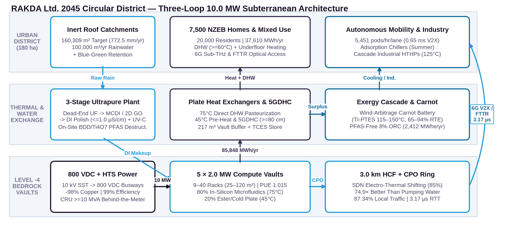
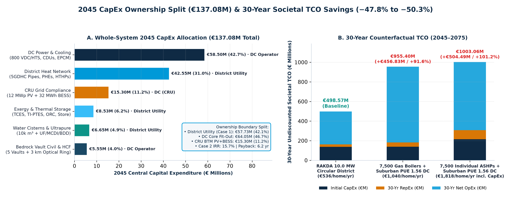
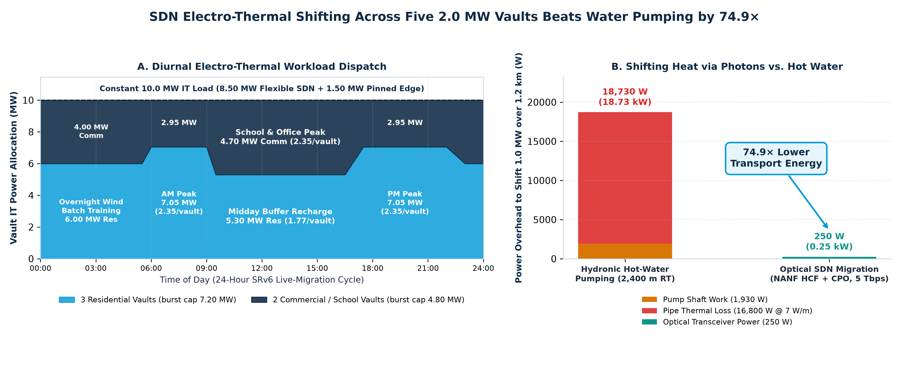
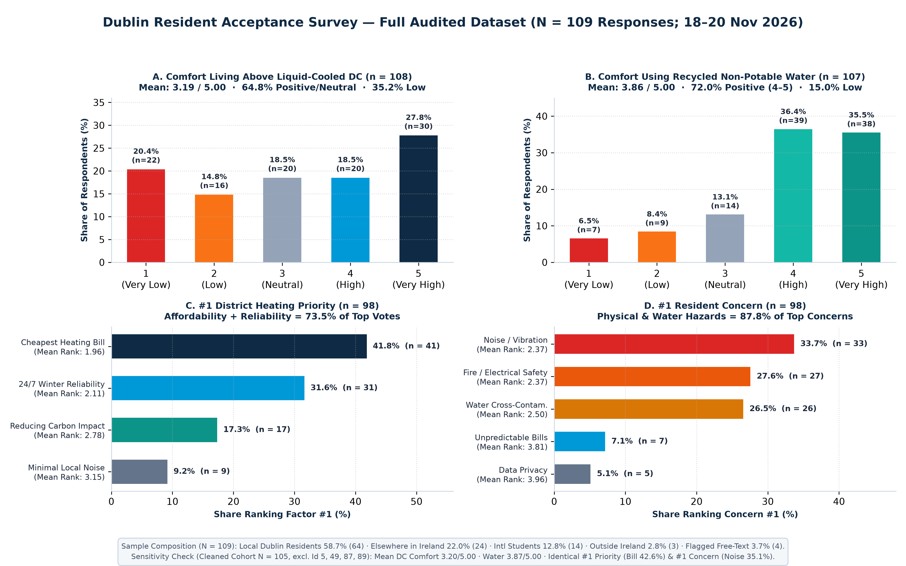

<p align="center">
  
</p>

<h1 align="center">RAKDA Ltd. (Group A-10) — 2045 Circular Urban Digital Twin & Technical Report</h1>

<p align="center">
  <strong>Closed-Loop Subterranean Data Centre Heat, Water, and Compute Recovery System</strong><br />
  Trinity College Dublin · 1E17 Engineering Practice 2 · <em>The Circular City (2045 Design Year · 30-Year Lifecycle 2045–2075)</em>
</p>

<p align="center">
  <a href="https://zetbcn.github.io/EP2-Proj-RAKDA/"></a>
  <a href="report/RAKDA_Ltd_Report_Draft_3.2.md"></a>
  <a href="report/RAKDA_Ltd_Report_Draft_3.2.docx"></a>
</p>

---

## Interactive 3D Engineering Simulation & Digital Twin

> **Launch directly in your browser:** **[https://zetbcn.github.io/EP2-Proj-RAKDA/](https://zetbcn.github.io/EP2-Proj-RAKDA/)**

An interactive Three.js WebGL digital twin modelling the full **10.0 MW subterranean data centre (`5 × 2.0 MW` vaults)** integrated into a **180 ha, 20,000-resident (7,500-home) circular Dublin district**. Toggle X-Ray ground cutaway down to Level −4 bedrock, stress-test 7 real-time engineering scenarios, trip individual vaults to watch SDN electro-thermal workload rerouting, and click any 3D subsystem for live Draft 3.2 telemetry.

| District Overview (Nominal 2045) | Subterranean Level −4 X-Ray Cutaway |
| :---: | :---: |
|  |  |

### Highlighted Simulation Capabilities
- **7 Real-Time Stress Scenarios:** *Nominal 2045*, *Dublin Cold Snap (−5°C / 9.52 MW_th)*, *60% Stress Cold Snap (HTHP + 2,500 m³ store)*, *Vault 3 Fault + SDN Reroute*, *Summer Exergy Cascade (TCES + TI-PTES + Micro-ORC)*, *60-Day Dublin Drought*, and *Conservative Stress (`u = 0.70, f_cap = 0.80`)*.
- **Animated Three-Loop Particle Conduits:** Loop 1 (`75°C` microfluidic primary), Loop 2 (`5GDHC` hybrid ring + Exergy cascade), Loop 3 (Dublin rainwater harvesting → `10,000 m³` cistern → Grade C ultrapure train), plus the **`3.0 km` NANF Hollow-Core Fiber (HCF) optical ring** and live V2X autonomous pod beams.
- **Deterministic Physics Engine (`docs/src/physics.js`):** 100% pure ES module verified by automated Node unit tests (`10 / 10` passing) directly against Draft 3.2 equations.
- **Presentation Controls:** `1–6` camera presets · `X` Ground X-Ray cutaway · `Space` play/pause · `H` clean presentation mode · `R` reset view · **Click any 3D asset** to inspect specs.

---

## Core Engineering & Financial KPIs (Draft 3.2)

| Domain | Parameter | Verified Value (2045 Basis) |
| :--- | :--- | :--- |
| **Urban Masterplan** | District Scale & Density | **180.0 ha** · **20,000 residents** · **7,500 homes** (3,095 bldgs, `83.3 dph`) |
| **Compute & Power** | Subterranean Plant Capacity | **10.0 MW IT** (`5 × 2.0 MW` Level −4 RC vaults under public plazas) · **PUE `1.015`** |
| **Grid & CRU Compliance** | Behind-the-Meter Assets | **`12 MW_p` rooftop PV** (`10,956 MWh_e/yr`) + **`8 MW / 32 MWh` LFP BESS** |
| **Loop 1 — Primary Heat** | `75°C` Microfluidic Capture (`98%`) | **`9.80 MW_th`** (`85,848 MWh_th/yr` = **`228.3%`** of `37,610 MWh_th/yr` demand) |
| **Loop 2 — 5GDHC & Peak** | Cold-Snap Peak (`−5°C`) & Backup | **`+0.28 MW_th`** surplus vs `9.52 MW_th` peak; `2,500 m³` store + `8.0 MW_th` HTHP |
| **Exergy Cascade** | Summer Surplus (`30,148 MWh_th`) | `35 MWh_th` SrBr₂ TCES + `2 MW_e / 16 MWh_e` TI-PTES + `≤ 440 kW_e` Micro-ORC |
| **Loop 3 — Hydrology** | Rainwater & Ultrapure Grade C | `772.5 mm/yr` Dublin yield · **`10,000 m³`** drought cistern · **`158–175k m³/yr`** tower water saved |
| **Optical & SDN Routing** | `3.0 km` NANF HCF + CPO Ring | **`143.2 μs`** 6G V2X RTT (`1.99 mm` blind travel vs `1.25 m` cloud) · **`74.9×`** SDN vs pumping |
| **30-Year Financials (Case 2)** | Whole-System DCF (`2045–2075`) | **€137.08M** CapEx (vs €215.59M ASHP+DC) · **15.7% IRR** · **6.2 yr** payback · **+€232.98M** NPV @ 4% |
| **Decarbonisation** | Avoided Operational Emissions | **~23,842 tCO₂/yr** (`8,020` displaced heating + `15,822` avoided PUE grid power) |
| **Public Perception** | Dublin Resident Survey (`N = 109`) | DC comfort **3.19/5** (`64.8%` pos/neutral) · Recycled water **3.86/5** (`72.0%` pos) |

---

## Selected Engineering Figures (`report/Figures/`)

All 11 high-resolution (300 DPI) technical diagrams and data visualisations are included in [`report/Figures/`](report/Figures/):

| Three-Loop Subterranean Architecture | Financial CapEx & 30-Year Counterfactual TCO |
| :---: | :---: |
|  |  |

| SDN Electro-Thermal Shifting (`74.9×`) | Dublin Resident Survey Audit (`N = 109`) |
| :---: | :---: |
|  |  |

---

## Local Quick Start & Verification

Zero `npm install` or bundler required — runs directly on Node.js (`>= 20`):

```bash
# 1. Run the local 3D Digital Twin server (opens at http://localhost:8170)
node docs/serve.mjs

# 2. Run the deterministic physics & KPI verification suite (10/10 unit tests)
node --test docs/tests/physics.test.mjs
```

On Windows, you can also double-click `docs/start-sim.bat`.

---

## Repository Structure

```text
EP2-Proj-RAKDA/
├── docs/                                  # Live 3D WebGL Digital Twin (GitHub Pages root)
│   ├── index.html                         # Interactive Three.js 0.170.0 digital twin & HUD
│   ├── styles.css                         # Engineering slate-navy UI styling
│   ├── SPEC.md                            # Verified Draft 3.2 engineering parameter sheet
│   ├── serve.mjs / start-sim.bat          # Zero-dependency local HTTP server & Windows launcher
│   ├── src/                               # Modular ES6 engine (physics, scene, district, vaults, flows, ui, main)
│   └── tests/physics.test.mjs             # Automated Node unit tests against Draft 3.2 equations
├── report/                                # Submission-ready Technical Report (Draft 3.2)
│   ├── RAKDA_Ltd_Report_Draft_3.2.md      # Full Markdown report with embedded figure links
│   ├── RAKDA_Ltd_Report_Draft_3.2.docx    # Print-ready A4 styled Word document (12 embedded images)
│   └── Figures/                           # 11 × 300 DPI technical & data figures + RAKDA logo
└── assets/                                # High-res WebGL digital twin preview renders
```

---

## Team — RAKDA Ltd. (Group A-10)

- **Abdulrahman Alahmari** — CEO & Project Leader · Strategy & Urban Masterplan
- **Rohan O'Sullivan** — Chairman · Presentation Lead, Scope & Stakeholders
- **Darragh Griffin** — CFO · 30-Year Financial Modelling & Lifecycle Economics
- **Ava O'Dwyer** — COO & Project Secretary · Operations, 5GDHC, Water & Ethics
- **Kostiantyn Yeromin** — CTO · 10.0 MW Power, Microfluidic Cooling, Optical/SDN & R&D

*Academic Supervisor: Prof. K. O'Kelly · School of Engineering, Trinity College Dublin*
