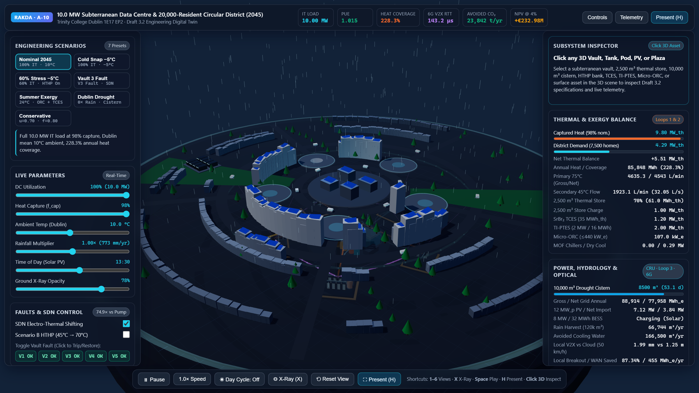
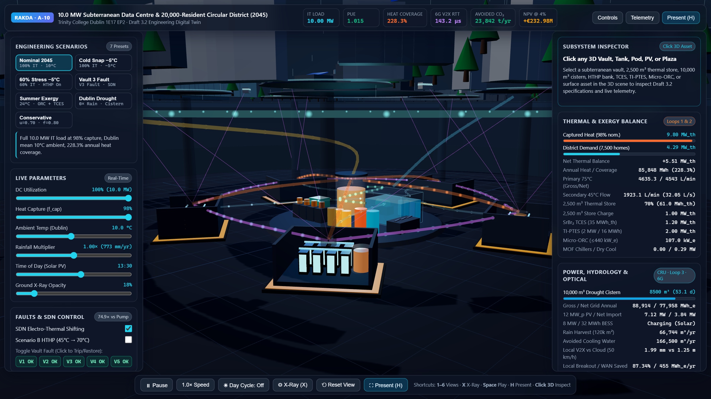
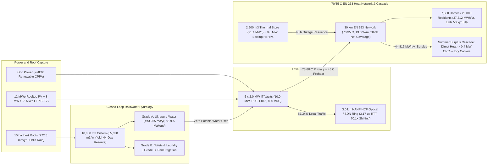
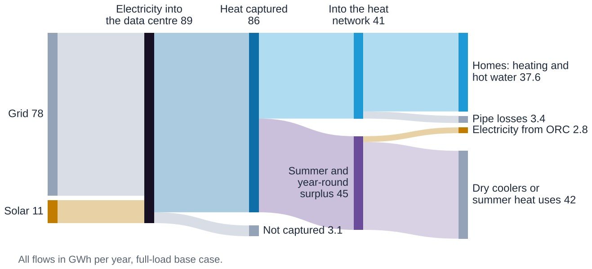
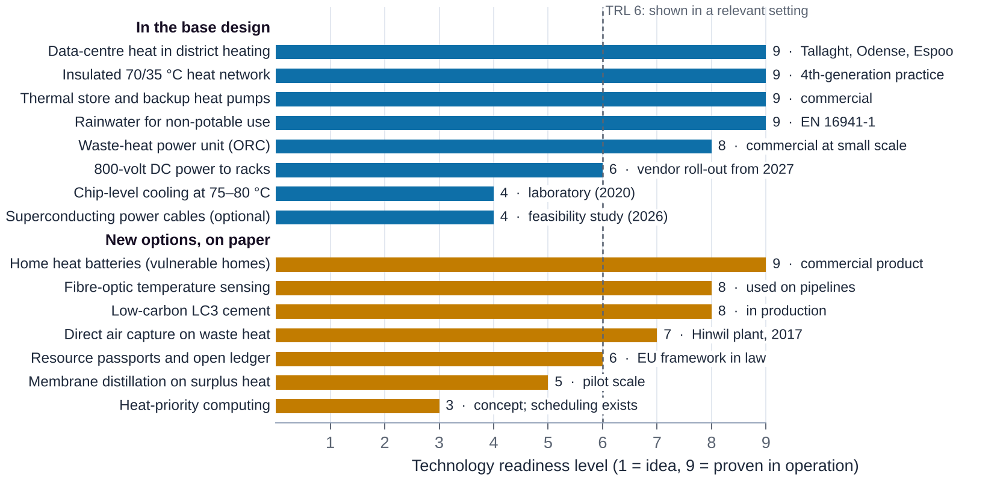

<p align="center">
  
</p>

<h1 align="center">RAKDA Ltd. (Group A-10) — USCI: 2045 Circular Urban Digital Twin &amp; Technical Report</h1>

<p align="center">
  <strong>Urban Subterranean Compute Infrastructure (USCI): Closed-Loop 10.0 MW Underground Data Centre for a 20,000-Resident Circular District</strong><br />
  Trinity College Dublin · 1E17 Engineering Practice 2 · <em>2045 Design Year · 30-Year Lifecycle (2045–2075)</em>
</p>

<p align="center">
  <a href="https://zetbcn.github.io/EP2-Proj-RAKDA/"></a>
  <a href="https://rakda.ltd/"></a>
  <a href="report/RAKDA-USCI.md"></a>
  <a href="report/RAKDA-USCI.docx"></a>
  <a href="report/Abd_Rep_Finn_2.pdf"></a>
  <a href="report/Rakda_Ltd_Report_v2_Summary.pdf"></a>
</p>

---

## Overview

USCI places **five 2.0 MW liquid-cooled data-centre vaults (10.0 MW IT total)** 8–12 m underground beneath public plazas in a 180 ha greenfield Dublin district of **20,000 residents (7,500 homes)**. Direct chip-level microfluidics capture **98% of IT heat** (`80%` at `75–80 °C` and `20%` at `45 °C`) to feed a `30 km` pre-insulated `70/35 °C` EN 253 district heat network without heat pumps in normal operation. Inert-roof rainwater feeds sealed cooling loops and civic non-potable uses so compute requires zero drinking water, while a `3.0 km` hollow-core optical ring connects all five vaults for ultra-low-latency edge compute and electro-thermal load shifting.

---

## 3D Digital Twin &amp; Native Windows App

- **WebGL Digital Twin (`docs/`):** **[https://zetbcn.github.io/EP2-Proj-RAKDA/](https://zetbcn.github.io/EP2-Proj-RAKDA/)**
- **Native Windows Desktop App (`sim/RAKDA_3D_Sim.exe`):** Standalone C# WinForms + OpenGL 3.3 simulator built from `sim/native/`. (`docs/RAKDA_3D_Sim.exe` and `docs/launcher/` were removed so GitHub Pages serves static web assets only.)

| District Overview (Nominal 2045) | Subterranean Level −4 X-Ray Cutaway |
| :---: | :---: |
|  |  |

### Simulation Capabilities &amp; Recent Updates
- **Synced WebGL Engine (`docs/src/` ↔ `sim/src/`):** Runs the upgraded Three.js renderer with PMREM `RoomEnvironment` lighting, `UnrealBloomPass` post-processing, static geometry batching, a 3D selection reticle, DOM-diffed HUD updates, tab-visibility pause, and WebGL context-loss recovery.
- **Dark / Light Theme Toggle:** Switch in the header between the default dark engineering slate HUD and a `rakda.ltd` light paper theme (`#FAF7F2` paper, `#1A0F3C` ink, `#FF5C9A` accent), persisted in `localStorage`.
- **Accessibility &amp; Mobile Layout:** Full `:focus-visible` outlines, `aria-expanded` / `aria-pressed` / `aria-live="polite"` state bindings across panels, faults, and scenarios, `prefers-reduced-motion` support, and auto-collapsed side drawers with a wrapping dock bar on viewports `<= 900px`.
- **Interactive Stress Testing &amp; Controls:** Toggle X-Ray bedrock cutaway (`X`), test real-time scenarios including `−3 °C` cold-snap peaks, Scenario B (`45 °C` HTHP fallback), vault faults with `70.1×` SDN optical workload rerouting, summer ORC cascade, and 44-day drought reserves. Shortcuts: `1–6` camera presets · `Space` play/pause · `H` clean presentation mode · `R` reset view · click any 3D asset to inspect live specs.

---

## System Architecture



---

## Core Engineering &amp; Financial KPIs (RAKDA USCI — Nov 2026)

All figures match the canonical report ([`report/RAKDA-USCI.docx`](report/RAKDA-USCI.docx) / [`report/RAKDA-USCI.md`](report/RAKDA-USCI.md)) and the verified simulation physics engine (`docs/src/physics.js` and `sim/native/Physics.cs`).

| Domain | Parameter | Canonical Value (2045 Basis) |
| :--- | :--- | :--- |
| **Urban Masterplan** | District Scale &amp; Heat Demand | **180.0 ha** · **20,000 residents** · **7,500 homes** (3,095 bldgs, `60%` apts) · **`37,612 MWh/yr`** (`26,362` DHW + `11,250` SH) |
| **Compute &amp; Power** | Subterranean Plant Capacity | **10.0 MW IT** (`5 × 2.0 MW` Level −4 RC vaults under plazas, `100-yr` EN 1990 life) · **PUE `1.015`** · **`800 VDC`** (HTS optional) |
| **Grid &amp; CRU Compliance** | Behind-the-Meter Assets | **`12 MWp` rooftop PV** (`10,956 MWh_e/yr`) + **`8 MW / 32 MWh` LFP BESS** + ≥ 80% renewable CPPAs (`CRU/2025/236`) |
| **Loop 1 — Heat Network** | `70/35 °C` Pre-Insulated EN 253 | `98%` chip capture (`75–80 °C` primary / `45 °C` preheat; `76.5 / 32.0 L/s`) · `13.0 W/m` (`3,421 MWh/yr` = `9.1%` loss) |
| **Heat Coverage** | Annual &amp; Break-Even Load | **`228%` gross / `209%` net** base (`85,848 MWh/yr`) · **`130%` gross / `120%` net** cautious (`49,056 MWh/yr`) · break-even **`u = 47.8%`** (`58.6%` @ 80%) |
| **Winter Peak &amp; Backup** | `−3 °C` Design Day &amp; Outage | `9.80 MW` vs `9.91 MW` (`9.52` + `0.39` loss = `−0.11 MW`; cautious gap `4.31 MW`) · **`2,500 m³` store (`91.4 MWh` usable)** + **`8.0 MW` HTHPs** (`48 h`) |
| **Scenario B Fallback** | `45 °C` Chip Ceiling Hedge | `40→75 °C` condensing (`5 K` pinch), **`COP 4.0–6.0`**, `~8.5 MW` HTHPs (`5.9–8.8 GWh_e/yr`), **`+€33/MWh`** (`LCOH → €126/MWh`) |
| **Summer Surplus Cascade** | `44,816 MWh/yr` (`35,852 MWh` @ `75 °C`) | Direct heat sales (`€95/MWh`) → **`0.4 MW` Micro-ORC** (`17.2%` Carnot @ `15 °C`, `7.2–8.3%` eff., **`2.60–2.97 GWh_e/yr`**, `€0.35M/yr`) → Dry coolers |
| **Rainwater Hydrology** | Closed-Loop &amp; Civic Grades | `772.5 mm/yr` Dublin rain → **`55,620 m³/yr`** · **`10,000 m³` cistern** (`6,700 m³` min, `44-day` reserve) · **`157,680–175,200 m³/yr`** saved |
| **Water Purity Tiers** | Segregated Three-Grade Supply | **Grade A = UPW** (`≤ 3,265 m³/yr`, `< 5.9%` yield, PFAS oxidation) · **Grade B = toilets &amp; laundry** · **Grade C = parks** |
| **Optical &amp; SDN Ring** | `3.0 km` NANF HCF + CPO Ring | **`3.17 μs`** local RTT / **`143.2 μs`** V2X / **`48.2 μs`** fixed fibre · **`87.34%`** local (`455 MWh/yr` WAN saved) · **`70.1×`** SDN vs pumping |
| **30-Yr Financials (Case 2)** | Whole-Project DCF (`2045–2075`) | **`€136.7M`** (`€136.66M`: `€57.31M` Utility + `€79.35M` DC) · **`€145/kW/mo`** rent · **`€19.6M/yr`** EBITDA · **`13.7%` IRR** · **`7.0 yr`** payback · **`+€189M`** NPV (4%) |
| **Utility &amp; Households** | Case 1 &amp; 30-Yr Societal TCO | Case 1: **`4.2%` IRR**, **`€93/MWh`** net LCOH (`€68/MWh` w/ 30% grant) · TCO: **`€520M`** vs Gas `€826M` / ASHP `€936M` · Bill: **`€536/yr`** vs `€1,001` gas / `€1,691` ASHP |
| **Carbon Accounting** | Embodied, Avoided &amp; Residual | `4,628 t CO₂e` CEM I (`4,178 t` GGBS / `3,908 t` LC3) · **`7,230–7,270 t/yr`** avoided vs gas · `7,780–14,700 t/yr` PUE saved · `12,707–24,011 t/yr` residual DC grid |
| **Resident Survey** | Cleaned Cohort (`N = 105`) | DC comfort **`3.20/5`** (`47.1%` pos / `17.3%` neut / `35.6%` low; Apts `3.92`) · Water **`3.87/5`** (`72.8%` pos) · Top priorities: Bill `42.6%`, Reliability `33.0%` |
| **Technology Readiness** | EU TRL 1–9 &amp; Options (`§3.13`) | Core `75–80 °C` chip cooling at **TRL 4** (hedged by Scenario B) + 7 quantified options (heat-priority AI `-36%` backup, MD, DTS, ERF ledger, DAC, LC3) |

---

## Selected 300 DPI Engineering Figures (`report/Figures/`)

All 14 regenerated 300 DPI figures from `RAKDA-USCI.docx` live in [`report/Figures/`](report/Figures/):

| System Architecture (`Fig_3.1`) | Annual Energy Flow Sankey (`Fig_3.2`) |
| :---: | :---: |
|  |  |

| CapEx Split &amp; 30-Year Societal TCO (`Fig_3.10`) | Audited Resident Survey `N = 105` (`Fig_3.12`) |
| :---: | :---: |
|  |  |

| EU TRL 1–9 Readiness &amp; Innovation Audit (`Fig_3.13`) |
| :---: |
|  |

---

## Local Quick Start &amp; Verification

Requires **Node.js `>= 20`** (`npm install` is not needed). On Windows, you can also run `docs/start-sim.bat` or launch [`sim/RAKDA_3D_Sim.exe`](sim/RAKDA_3D_Sim.exe) directly.

```powershell
# 1. Serve the local 3D WebGL Digital Twin (http://localhost:8170)
node docs/serve.mjs

# 2. Run the automated physics & KPI unit tests
node --test docs/tests/physics.test.mjs

# 3. Verify docs/ and sim/ web assets are byte-identical (and docs/ has no .exe or CNAME)
node sim/scripts/check-sync.mjs

# 4. Build & test the standalone Windows OpenGL 3.3 simulator (Windows .NET 4.x)
powershell -ExecutionPolicy Bypass -File sim\native\build.ps1
```

---

## Repository Structure

```text
EP2-Proj-RAKDA/
├── .github/workflows/ci.yml               # Automated JS syntax, physics tests, docs/sim sync & Windows C# tests
├── docs/                                  # Live 3D WebGL Digital Twin (clean static GitHub Pages root)
│   ├── .nojekyll                          # Bypass Jekyll processing on GitHub Pages
│   ├── index.html                         # Interactive Three.js digital twin, theme toggle & ARIA HUD
│   ├── styles.css                         # Dark slate & rakda.ltd light paper themes, a11y & mobile layout
│   ├── SPEC.md                            # Verified RAKDA USCI (Nov 2026) engineering specification
│   ├── README.md                          # Digital twin technical guide
│   ├── serve.mjs / start-sim.bat          # Zero-dependency local HTTP server & Windows launcher
│   ├── src/                               # Synced ES6 engine (physics, scene, district, vaults, flows, ui, main)
│   └── tests/physics.test.mjs             # Automated Node unit tests against RAKDA USCI equations
├── sim/                                   # Mirrored WebGL twin + standalone native Windows simulator
│   ├── RAKDA_3D_Sim.exe                   # Standalone Windows OpenGL 3.3 desktop application
│   ├── native/                            # C# WinForms + OpenGL 3.3 source, build.ps1 & PhysicsTests.cs
│   ├── scripts/check-sync.mjs             # Parity guard asserting docs/ == sim/ web assets
│   └── ...                                # Mirrored index.html, styles.css, SPEC.md, serve.mjs, src/, tests/
├── report/                                # Canonical Technical Reports (RAKDA USCI — Nov 2026)
│   ├── RAKDA-USCI.md                      # Clean GitHub-Flavored Markdown report with embedded figures
│   ├── RAKDA-USCI.docx                    # Canonical submission Word document
│   ├── Abd_Rep_Finn_2.pdf                 # Streamlined final PDF edition
│   ├── Rakda_Ltd_Report_v2_Summary.pdf    # 6-page plain-English executive summary
│   └── Figures/                           # 14 × 300 DPI regenerated figures (Fig_1.1, Fig_3.1–3.13) + rakda_logo.png
└── assets/                                # Digital twin preview screenshots for README
```

---

## Team &amp; Company

**RAKDA Ltd.** (Group A-10) — named from the initials of its five co-founders — operates both as our 1E17 engineering project team and as a student-founded consultancy at **[https://rakda.ltd/](https://rakda.ltd/)** ([Founders](https://rakda.ltd/founders)).

- **Kostiantyn Yeromin** — CTO &amp; 1E17 Project Leader · Schedule, agendas, cross-subsystem integration &amp; R&amp;D (`10.0 MW` power, microfluidic cooling, optical/SDN, ORC)
- **Abdulrahman Alahmari** — CEO · Company strategy, planning coordination &amp; 180 ha urban masterplan
- **Rohan O'Sullivan** — Chairman · Presentation lead, corporate image, scope resilience &amp; stakeholder engagement
- **Darragh Griffin** — CFO · 30-year DCF/TCO financial modelling, lifecycle economics &amp; deadlines
- **Ava O'Dwyer** — COO &amp; 1E17 Project Secretary · Decision log, signed attendance, operations, heat/water systems &amp; ethical compliance

*Rakda Ltd. is an independent student-run company in Dublin; it is not part of Trinity College Dublin.*  
*1E17 Academic Supervisor: Prof. K. O'Kelly · School of Engineering, Trinity College Dublin*
