

  

# USCI: Urban Subterranean Compute Infrastructure

**Integrating a closed-loop 10.0 MW underground liquid-cooled data centre to heat, water, and connect a 20,000-resident circular urban district (2045)**

| Field | Details |
|---|---|
| **PREPARED BY** | RAKDA Ltd. (Group A-10) |
| **TEAM MEMBERS** | Kostiantyn Yeromin, Abdulrahman Alahmari, Rohan O'Sullivan, Darragh Griffin, Ava O'Dwyer |
| **CLIENT (SUPERVISOR)** | Prof. K. O'Kelly (1E17 Module Coordinator) |
| **COURSE** | 1E17 Engineering Practice 2 · Trinity College Dublin |
| **PLANT & HORIZON** | 10.0 MW IT (5 × 2.0 MW Vaults) · 2045 Design Year (2045–2075 Lifecycle) |
| **SUBMISSION DATE** | 27 November 2026 |
| **DIGITAL COMPANION** | https://zetbcn.github.io/EP2-Proj-RAKDA/ · rakda.ltd |

*1E17 Project 2026 · The Circular City*

## Contents

| Section | Title |
|---|---|
| 1 | [Team Information](#1-team-information) |
| 1.1 | [Team Biographies](#11-team-biographies) |
| 1.2 | [Company, Structure, and Role Allocation](#12-company-structure-and-role-allocation) |
| 1.3 | [How the Project Was Conducted](#13-how-the-project-was-conducted) |
| 2 | [Project Summary and Objectives](#2-project-summary-and-objectives) |
| 2.1 | [Executive Summary](#21-executive-summary) |
| 2.2 | [Feasibility Summary](#22-feasibility-summary) |
| 2.3 | [Objectives and Scope](#23-objectives-and-scope) |
| 2.4 | [Stakeholders and Capture Methods](#24-stakeholders-and-capture-methods) |
| 3 | [Technical Content](#3-technical-content) |
| 3.1 | [Context, Precedents, and Design Basis](#31-context-precedents-and-design-basis) |
| 3.2 | [USCI System Architecture at a Glance](#32-usci-system-architecture-at-a-glance) |
| 3.3 | [District Masterplan and Hot-Water Output](#33-district-masterplan-and-hot-water-output) |
| 3.4 | [Heat Balance, Network Security, and Summer Surplus Cascade](#34-heat-balance-network-security-and-summer-surplus-cascade) |
| 3.5 | [Compute Plant, Silicon Microfluidics, and Power Architecture](#35-compute-plant-silicon-microfluidics-and-power-architecture) |
| 3.6 | [Water Loop and Ultrapure Water (UPW) Inputs](#36-water-loop-and-ultrapure-water-upw-inputs) |
| 3.7 | [Vault Safety and Physical Isolation](#37-vault-safety-and-physical-isolation) |
| 3.8 | [Auxiliary Subterranean Networking Benefits](#38-auxiliary-subterranean-networking-benefits) |
| 3.9 | [Life-Cycle Carbon and Maintenance](#39-life-cycle-carbon-and-maintenance) |
| 3.10 | [Economics and Societal Cost](#310-economics-and-societal-cost) |
| 3.11 | [Resident Survey Validation](#311-resident-survey-validation) |
| 3.12 | [Ethics, Circularity, Carbon Honesty, and Climate Resilience](#312-ethics-circularity-carbon-honesty-and-climate-resilience) |
| 3.13 | [Innovation and Technology Readiness](#313-innovation-and-technology-readiness) |
| 3.14 | [Feasibility Verdict, Risks, and Limitations](#314-feasibility-verdict-risks-and-limitations) |
| 4 | [Conclusions and References](#4-conclusions-and-references) |
| 4.1 | [Conclusions and Recommendations](#41-conclusions-and-recommendations) |
| 4.2 | [References](#42-references) |
| App. A | [Master Assumptions Register [A1–A41]](#appendix-a-master-assumptions-register) |
| App. B | [Calculation Register [C1–C30]](#appendix-b-calculation-register) |
| App. C | [Survey Cleaning Audit [S1–S6] and Interview Protocol](#appendix-c-survey-cleaning-audit-and-industry-interview-protocol) |
| App. D | [Project Task Log and Attendance Record](#appendix-d-project-task-log-and-attendance-record) |
| App. E | [Civic Land Screening and Technical Glossary](#appendix-e-civic-land-screening-and-technical-glossary) |
| App. F | [Detailed Monthly Balance and Financial Breakdown](#appendix-f-detailed-monthly-balance-and-financial-breakdown) |

---

## 1. Team Information

### 1.1 Team Biographies

**Kostiantyn Yeromin — Chief Technology Officer (CTO) and Project Leader.** Born in Kyiv, Kostiantyn is a first-year engineering student at Trinity College Dublin drawn to physics, defence engineering, and high-technology systems architecture. Twelve years of competitive robotics shaped how quickly he analyses multi-domain problems and coordinates technical work. Under 1E17 rules he serves as Project Leader, managing meeting schedules, agendas, and cross-subsystem integration, while leading research and development as CTO.

**Abdulrahman Alahmari — Chief Executive Officer (CEO).** Originally from Saudi Arabia, Abdulrahman is a first-year engineering student at Trinity College Dublin motivated by mechanical engineering for its fusion of physics, mathematics, and materials science. A strategic planner who breaks large goals into structured tasks and adapts quickly when direction shifts, he sets company strategy and keeps work moving smoothly.

**Rohan O'Sullivan — Chairman.** Raised in Dublin city, Rohan combines interests in Irish civic culture, guitar, football, and basketball with a strong grounding in mathematics, particularly functional analysis. Known for calm public speaking and sustained analytical focus, he leads external presentation delivery, corporate image, and long-term scope resilience.

**Darragh Griffin — Chief Financial Officer (CFO).** Born and raised in Dublin as the eldest of four brothers, Darragh balances engineering studies with hurling, strength training, and distance running. Drawn to quantitative problem solving across mathematics, chemistry, and physics, he stewards financial analysis, lifecycle cost benchmarking, and project deadlines.

**Ava O'Dwyer — Chief Operating Officer (COO) and Project Secretary.** From Kilkenny and a 2026 graduate of Loreto Kilkenny, Ava pairs reading and fitness with a lifelong curiosity for how physical systems operate. Organised and punctual, she serves as 1E17 Project Secretary—maintaining the decision log and signed attendance records—while overseeing operational workflows and ethical compliance.

### 1.2 Company, Structure, and Role Allocation

**Company Identity.** RAKDA Ltd. (Group A-10) is a student-led engineering consultancy formed in Trinity College Dublin, named from the initials of its five co-founders (Rohan, Abdulrahman, Kostiantyn, Darragh, Ava). Its operating motto is **"Where computing warms the city — heat with purpose, infrastructure with a conscience."** The district concept developed for the 1E17 Circular City brief (Trinity College Dublin, 2026a) is designated **USCI (Urban Subterranean Compute Infrastructure)**.

**Governance Structure.** In accordance with 1E17 guidelines (Trinity College Dublin, 2026b), Kostiantyn Yeromin serves as Project Leader and Ava O'Dwyer serves as Project Secretary. Executive company titles define governance duties rather than locking individual report sections: Table 1.1 records the team's standing company and 1E17 roles while Table 1.1 records shared authorship across all chapters (populated from `Abd_Rep_Finn_2.pdf`).

**Table 1.1: Company titles, 1E17 statutory roles, and shared authorship matrix**

| Task / Domain | Kostiantyn Yeromin | Abdulrahman Alahmari | Rohan O'Sullivan | Darragh Griffin | Ava O'Dwyer |
|---|---|---|---|---|---|
| **Company & 1E17 role** | **CTO & Project Leader** | **CEO** | **Chairman** | **CFO** | **COO & Project Secretary** |
| Schedule, agendas, technical integration | **Lead** | ● | ● | ● | ● |
| Planning and task breakdown | ● | **Lead** | ● | ● | ● |
| Scope, future-proofing, presentation | ● | ● | **Lead** | ● | ● |
| Financial case & lifecycle costing | ● | ● | ● | **Lead** | ● |
| Decision log, attendance, ethics review | ● | ● | ● | ● | **Lead** |
| Research, model, survey & writing of every chapter | ● | ● | ● | ● | ● |

*Source: Team profiles (19–20 November 2026), shared authorship matrix from `Abd_Rep_Finn_2.pdf` Table 1.1, and record of tasks (Appendix D). Lead = owned the task; ● = took part.*

> **Editorial Note:** The verbatim Word submission (`RAKDA-USCI.docx`) retains the §1.2 work-package pick-list and Appendix D.2 attendance blanks pending final team sign-off. In this Markdown edition, Table 1.1 is populated from the shared authorship record in `Abd_Rep_Finn_2.pdf`, and the temporary pick-list block has been removed.

### 1.3 How the Project Was Conducted

Work ran across eight stages over six weeks, from team formation on 21 October to final submission on 27 November 2026 (Figure 1.1). After agreeing roles and submitting the project proposal on 1 November, the team allocated initial research topics on 4–5 November and selected the subterranean data-centre district on 6 November after benchmarking it against inductive-charging roads, inter-building heat sharing, and modular apartments. Five specialist briefs were compiled into one linked Python thermal, hydrological, and financial model (RAKDA Ltd., 2026b). An anonymous Dublin resident survey ran on 18–20 November (N = 109), followed by four iterative report drafts and an independent audit against the 1E17 marking rubric on 24 November.

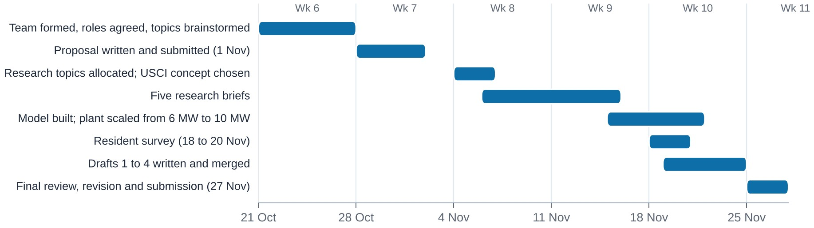

**Figure 1.1. Project execution timeline across Weeks 6 to 11 of the 1E17 semester.**

*Source: RAKDA Ltd. task log and weekly meeting minutes (Appendix D).*

**Management Practice and Key Design Pivot.** The team met across all four scheduled weekly 1E17 sessions alongside self-scheduled design reviews, tracking decisions and attendance in Appendix D. The decisive engineering pivot raised plant capacity from an initial 6.0 MW concept to 10.0 MW after daily Heating Degree Day modelling showed 6.0 MW left a 3.64 MW winter cold-snap deficit and covered only 72% of demand in the cautious case ([C5]).

**Table 1.2: Project execution and verification milestones (2026)**

| Date / Window | Milestone & Output | Status |
| --- | --- | --- |
| 21–27 Oct | Team formed, company name (RAKDA Ltd.) & executive roles agreed, brainstorming | Completed |
| 28 Oct – 1 Nov | Project Proposal written (problem, scope, O1–O12, stakeholders) and submitted | Completed |
| 4–6 Nov | Initial research allocated; USCI concept chosen over 3 competing options | Completed |
| 6–15 Nov | Five specialist technical and economic briefs completed; initial 6.0 MW sizing | Completed |
| 15–21 Nov | Scaled to 10.0 MW (5 × 2.0 MW); coupled Python thermal/water/DCF model built | Completed |
| 18–20 Nov | Dublin resident acceptance survey executed (N = 109 raw / N = 105 cleaned) | Completed |
| 21–24 Nov | Drafts 1–4 merged; rubric audit flagged clarity, ethics, and network fixes | Completed |
| 25–27 Nov | Assimilated clean report finalised; Python scripts published on GitHub | Completed |

*Source: RAKDA Ltd. project records (Appendix D).*

**Tools and Academic Integrity.** Grammarly was declared at proposal stage for editing. Generative AI tools assisted research structuring, calculation cross-checks, and document formatting. Every empirical figure (rainfall, tariffs, census data, electricity prices) was verified against primary published sources in §4.2 and the open simulation repository at https://zetbcn.github.io/EP2-Proj-RAKDA/. RAKDA Ltd. takes full responsibility for all engineering claims.

## 2. Project Summary and Objectives

### 2.1 Executive Summary

Almost 100% of electrical power entering data-centre servers degrades into low-grade heat. Conventional suburban facilities reject this energy to ambient air while evaporative cooling towers consume municipal drinking water, even as neighbouring homes burn fossil gas or draw grid power for space heating and hot water. USCI (Urban Subterranean Compute Infrastructure) closes that urban loop for a greenfield 2045 circular district of 20,000 residents across 180 ha in a Dublin climate. Five modular 2.0 MW data-centre vaults (10.0 MW IT total) sit 8–12 m underground strictly beneath public plazas and parking decks. Chip-level liquid cooling captures 98% of IT heat—80% at 75–80 °C and 20% at 45 °C—feeding a 30 km pre-insulated district network (70 °C supply / 35 °C return) without heat pumps in normal operation. Roof rainwater fills sealed cooling loops and supplies non-potable civic uses, so computing consumes zero drinking water.

| **2.3×** | **€536** | **7,200 t** | **160,000 m³** |
| --- | --- | --- | --- |
| heat recovered vs. district needs at full load (1.2× net in cautious case) [C3][C5] | annual household heating bill, vs. €1,001 for gas boilers & €1,691 for ASHPs [C23] | net CO₂ avoided per year compared with domestic gas boilers [C17] | drinking water saved yearly by avoiding cooling-tower evaporation [C12] |

**Three features distinguish USCI from existing data-centre heat-recovery schemes:**

- **Direct-use 75–80 °C heat:** Existing networks in Tallaght, Odense, and Espoo harvest 25–35 °C server air/water and rely on large heat pumps to reach usable temperatures. USCI's chip-level microchannels deliver 75–80 °C water straight to homes, reserving heat pumps strictly for backup and a 45 °C fallback case (Scenario B).
- **Built into the district from Day 1:** Vaults sit under public plazas rather than residential blocks, and a ring-fenced public utility owns the pipes, 2,500 m³ thermal store, and 8.0 MW backup heat pumps so domestic heating never depends on a single commercial tenant.
- **Subterranean latency compression & traffic redirection:** Linking all five vaults via a 3.0 km hollow-core optical fibre ring slashes pure transport latency by 99.9% (3,135 μs → 3.17 μs), keeps 87.3% of district network traffic local, and routes flexible compute optically across vaults at 70.1× higher energy efficiency than pumping hot water (§3.8).
- **Grounded answers to model weaknesses:** Seven quantified options in §3.13 target bottlenecks exposed by our own model—for example, shifting flexible AI training onto Dublin's 27 coldest days (<3 °C) cuts winter backup demand by 36%.

### 2.2 Feasibility Summary

On paper, USCI is thermodynamically, hydrologically, ethically, and financially feasible across both baseline and cautious operating envelopes. At full load, recovered chip heat supplies 209% of district demand net of EN 253 pipe losses (120% net in the cautious 70% utilisation / 80% capture case), closed-loop rainwater eliminates 158,000–175,000 m³/yr of evaporative cooling-tower demand, and 48-hour outage backup secures winter supply. Financially, the combined €136.7M co-investment returns 13.7% IRR over 30 years while cutting societal Total Cost of Ownership by 44% against home heat pumps and reducing household bills to €536/yr (vs. €1,001 for gas boilers). The standalone public heat utility breaks even at Ireland's 4% public discount rate (4.2% IRR, €93/MWh net LCOH).

Four practical conditions govern progression beyond conceptual feasibility: (1) 75 °C chip-level cooling (currently TRL 4) must be pilot-tested before committing to direct heating vs. the Scenario B 45 °C heat-pump fallback (+€33/MWh); (2) data-centre utilisation must remain above the 47.8% annual heat-coverage threshold; (3) the district network must sit inside a ring-fenced public utility with a heat-first service agreement; and (4) residual grid electricity still emits 12,700–24,000 t CO₂/yr, making USCI a heat- and water-recovery system rather than a carbon-negative one (detailed subsystem audit in §3.14).

### 2.3 Objectives and Scope

Table 2.1 defines twelve measurable engineering objectives (O1–O12) established at proposal stage and audited honestly in §4.1 as Met, Met on paper, Partly met, or Not met.

**Table 2.1: Measurable engineering objectives (O1–O12) and verification criteria**

| ID | Objective | Measure of Success | Section |
| --- | --- | --- | --- |
| O1 | Size compute plant and vaults | IT load, rack count, vault footprint, and coolant temperatures fixed | §3.5 |
| O2 | Match annual heat to demand | Recovered heat ≥ 100% of demand + network losses in cautious case | §3.4 |
| O3 | Guarantee winter reliability | Peak load met; 2,500 m³ store + backup carry a full vault outage | §3.4 |
| O4 | Deliver Legionella-safe DHW | Instant hot water ≥ 55 °C (≥ 60 °C basis) with zero stored hot water | §3.4 |
| O5 | Close the cooling water loop | Dublin rain yield, cistern volume, UPW train; zero potable cooling | §3.6 |
| O6 | Prioritise summer surplus heat | Surplus uses ranked thermodynamically & economically; cascade chosen | §3.4 |
| O7 | Ensure safe vault co-location | Engineered control mapped to every acoustic, fire, flood, and EMI hazard | §3.7 |
| O8 | Account for carbon honestly | Embodied (A1–A4), avoided, and residual grid CO₂ all quantified | §3.9, §3.12 |
| O9 | Model 30-yr finance & TCO | Utility LCOH, NPV/IRR, household bill, counterfactual TCO, sensitivity | §3.10 |
| O10 | Engage residents & audit ethics | 100+ survey responses; 6 ethical domains + 4 lecture frameworks applied | §3.11, §3.12 |
| O11 | Validate with industry expert | Conduct ≥ 1 structured interview with an Irish heat-network utility | §2.4, App. C |
| O12 | Quantify next-gen options | Innovation options quantified in model, tied to weaknesses, TRL-rated | §3.13 |

*Source: RAKDA Ltd. Project Proposal (1 November 2026), harmonised against the 1E17 Brief.*

**Scope Boundaries.** In scope: the 180 ha district energy and water balance (2045–2075), 10.0 MW vault power and cooling, 30 km pre-insulated heat network, rainwater harvesting and UPW polishing train, summer exergy cascade, subterranean optical networking, 30-year life-cycle carbon and DCF economics, resident survey, ethics, and innovation options. Out of scope: detailed architectural building plans, municipal foul sewage, residential greywater recycling, external transmission grid upgrades beyond CRU rules, and commercial tenant software workloads.

### 2.4 Stakeholders and Capture Methods

Nine stakeholder groups shape USCI's physical layout, tariff design, and governance safeguards (Table 2.2). Requirements were captured through an anonymous Dublin resident survey (109 raw / 105 valid, exceeding our 30–50 target), statutory Irish and EU policy benchmarks, and course lecture frameworks.

**Table 2.2: Stakeholder register, capture methods, and engineering design responses**

| Stakeholder Group | Primary Interests | Capture Method | Design Response |
| --- | --- | --- | --- |
| Future Residents (~20,000) | Low bills, 24/7 heat, zero noise, fire & water safety | Dublin survey (105 valid) [S1] | €536/yr bill; plaza-only vaults; floating slabs; air-gaps |
| Vulnerable Households | Heat security during outages; zero upfront cost | Survey by housing [S3]; ethics audit | 8 MW backup + 2,500 m³ store; home heat-battery option |
| Public Heat Utility | Cost recovery, open network post-2075 | Tallaght benchmark; interview guide | Ring-fenced utility owns pipes, store & backup |
| DC Operator & Tenants | 99.999%+ uptime, competitive rent, fast refresh | CBRE (2026); Uptime Inst. (2024) | 5-vault staggered refresh; N+1 dry coolers; 800 V DC |
| Grid & CRU (EirGrid) | Grid adequacy; CRU ≥ 10 MVA compliance | CRU/2025/236 policy review | 12 MWp PV + 8 MW/32 MWh BESS + ≥ 80% CPPAs |
| Planners & Council | Compact density, EED compliance, flood control | Compact Settlements (DHLGH, 2024) | 180 ha compact zoning; underground vaults; green roofs |
| Water & Safety (EPA/HSE) | Legionella prevention, zero PFAS, no backflow | HPSC (2009); EN 1717; Ali (2026a) | Instant ≥ 55 °C DHW; sealed water cooling; air-gaps |
| Technology Developers | 2045 microfluidics & 800 V DC readiness | Van Erp et al. (2020); Blake (2025) | Scenario B (45 °C) fallback + ±30% CapEx sensitivity |
| Client (Prof. K. O'Kelly) | Quantitative rigour, honesty, 1E17 compliance | Brief & supervisor reviews | Brief numbering, 6-domain ethics, open GitHub model, website |

*Source: RAKDA Ltd. stakeholder audit and Appendix C.*

**Industry Interview Status (Objective O11).** A structured 20-minute interview protocol targeting Heat Works (South Dublin County Council's not-for-profit utility running the Tallaght scheme) and Codema (Dublin's energy agency) was prepared and is documented in Appendix C. Because the interview had not taken place by the report deadline, no unverified interview claims appear in this study and Objective O11 is recorded honestly as Not met in Table 4.1.

## 3. Technical Content

### 3.1 Context, Precedents, and Design Basis

Data centres consumed 6,969 GWh in Ireland in 2024—22% of all metered national electricity (CSO, 2025)—and global data-centre demand is projected to more than double by 2030 (IEA, 2025). Conventional facilities reject this energy at 25–35 °C while cooling towers evaporate large volumes of treated drinking water (Ebrahimi, Jones and Fleischer, 2014; Siddik, Shehabi and Marston, 2021). European and Irish rules now mandate circular integration. The recast EU Energy Efficiency Directive requires waste-heat reuse for data centres above 1 MW unless infeasible (Directive (EU) 2023/1791, Art. 26(6)), while EU Delegated Regulation 2024/1364 enforces public reporting of energy and water metrics from 500 kW upward. Germany's Energy Efficiency Act goes further, requiring 10% energy reuse from July 2026 and 20% from July 2028 (EnEfG, 2023). Nationally, CRU Decision CRU/2025/236 obliges new ≥ 10 MVA connections to provide matching dispatchable generation or storage and ≥ 80% new Irish renewable electricity (CRU, 2025; Arthur Cox, 2025).

Table 3.1 compares four operational or planned European schemes with USCI. Existing projects retrofit onto legacy air/water-cooled halls at 25–35 °C, forcing multi-megawatt heat pumps to lift every unit of heat. USCI designs computing, heating, and rainwater recovery into a new district simultaneously at 75–80 °C.

**Table 3.1: European data-centre heat-recovery precedents compared with USCI**

| Scheme | Scale & Impact | Heat Delivery Method | Lesson Applied to USCI |
| --- | --- | --- | --- |
| Tallaght, Dublin (Heat Works, 2023) | Heats council buildings & TU Dublin campus; 3,770 MWh & 1,100 t CO₂ saved in Year 1 (Codema, 2026) | Low-grade AWS heat upgraded by central heat pumps | Proves an Irish not-for-profit public heat utility works |
| Odense, Denmark (Meta, 2019) | Supplies heat to >12,000 homes (Ramboll, n.d.) | ~45 MW of heat pumps upgrade low-grade server heat | Low coolant temperatures require heavy heat-pump CapEx |
| Espoo, Finland (Fortum & Microsoft) | Planned to supply ~40% of heat for 250,000 users (Fortum, 2022) | Large-scale heat pumps feeding city grid | Waste heat can anchor a major urban heat network |
| Stockholm, Sweden (Open District Heating) | 30,000 apartments served by 20+ heat suppliers (Covenant of Mayors, 2023) | Heat pumps; open-market heat purchase tariffs | Open pipes & transparent tariffs attract third-party heat |
| USCI (This Design) 2045 Greenfield | 7,500 homes + civic buildings in a planned 180 ha district | 75–80 °C chip-level heat used directly; HTHPs only as backup | Co-designing vaults, pipes, and roofs eliminates baseline HTHPs |

*Source: Published scheme documentation as cited in each row.*

Because 2045 hardware relies on technologies currently at laboratory or early commercial stage, Table 3.2 assigns explicit evidence tiers to every core input. Complete parameter justifications and sensitivity ranges are tabulated in Appendix A ([A1]–[A41]).

**Table 3.2: USCI 10.0 MW design basis and evidence classification**

| Design Input | Adopted Value | Evidence Tier | Tag |
| --- | --- | --- | --- |
| Residents & dwellings | 20,000 residents; 7,500 homes (8,000-home upper check) | Given; Assumed | [A1] [A2] |
| District site & density | 180 ha greenfield (~1.5 × 1.2 km); 60% apartments | Assumed | [A3] |
| Space heating & floor area | 15 kWh/m²·yr (Passive House); 100 m² nominal home | Standard; Assumed | [A4] [A5] |
| Domestic hot water (DHW) | 166 L/home/day at 60 °C (62 L/person/day; 9.63 kWh/day) | Assumed | [A6] |
| Climate & rainfall | Dublin Airport 1991–2020; 772.5 mm/yr rain; 1,213 HDD₁₂ | Measured | [A7] [A8] |
| Compute plant | 10.0 MW IT in five 2.0 MW vaults (40 × 250 kW racks) | Assumed | [A9] |
| Heat capture & grade | 98% captured: 80% at 75–80 °C, 20% at 45 °C; PUE 1.015 | Projected | [A10] [A12] |
| Utilisation scenarios | 100% base (98% cap.); 70% cautious (80% cap.) | Assumed | [A11] |
| Heat network | 30 km EN 253 pre-insulated pair (70/35 °C; 13.0 W/m) | Standard; Calc. | [A15] [C4] |
| Heat security | 2,500 m³ thermal store (91 MWh); 8.0 MW backup HTHPs | Calculated | [C7] |
| Water storage | 10,000 m³ subterranean cisterns (10 ha inert roofs) | Calculated | [C11] [C13] |
| Tariffs & discount rates | Power €125/MWh; Heat €95/MWh + €60/yr; 4% / 8% real | Assumed; Standard | [A27]–[A29] |

*Source: RAKDA model (RAKDA Ltd., 2026b); full register in Appendices A and B.*

### 3.2 USCI System Architecture at a Glance

USCI converts one electricity stream into three urban outputs: commercial computing, zero-boiler district heat, and seasonal electricity generation (Figure 3.1). Grid power (matched ≥ 80% by Irish renewable contracts) and 12 MWp of district rooftop solar with an 8 MW / 32 MWh battery supply five underground 2.0 MW vaults. Sealed aqueous loops cool the processors at 75–80 °C and ancillary electronics at 45 °C. Central heat exchangers transfer heat into a 30 km insulated 70/35 °C pipe network, backed by a 2,500 m³ thermal store and 8.0 MW of air-source heat pumps. When summer district demand drops, surplus heat follows a strict economic cascade—direct heat buyers first, a 0.4 MW Organic Rankine Cycle (ORC) generator second, and dry coolers last—while 10 ha of inert roofs feed three treated grades of rainwater.

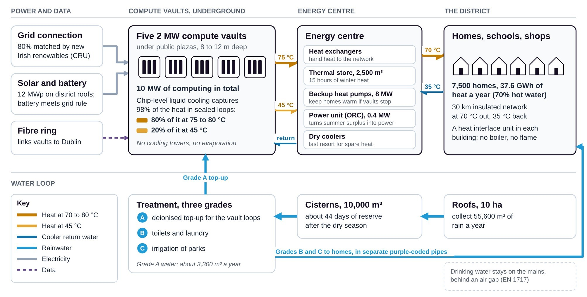

**Figure 3.1. USCI integrated architecture connecting power, subterranean compute, district heat, and rainwater loops.**

*Source: RAKDA Ltd. system design; flow quantities verified in Appendix B.*

In a full-load year, 88.9 GWh of total electrical input yields 85.8 GWh of captured thermal energy (Figure 3.2). Of that, 37.6 GWh reaches homes, 3.4 GWh is lost through buried pipes, and 44.8 GWh becomes surplus heat ([C3], [C4], [C6]). Addressing that seasonal surplus is the focus of §3.7 and §3.13.

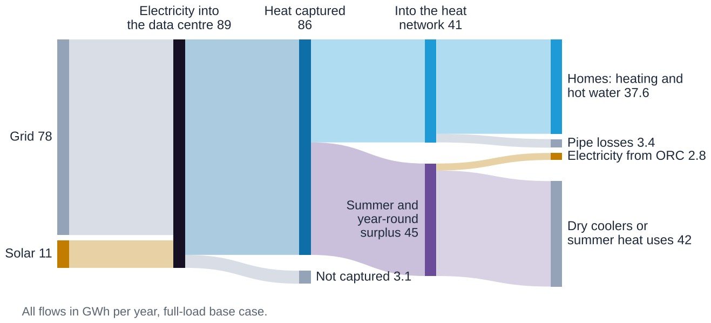

**Figure 3.2. Annual energy flow Sankey diagram for the 10.0 MW full-load base case (GWh/yr).**

*Source: RAKDA Ltd. Python model [C3], [C4], [C6], [C15].*

**Table 3.3: Structured options appraisal across core architectural decisions**

| Design Choice | Options Evaluated | Selected | Engineering Rationale |
| --- | --- | --- | --- |
| Plant IT scale | 5.0 MW, 6.0 MW, or 10.0 MW | 10.0 MW (5 × 2 MW) | Only 10 MW covers cautious demand (120% net) and meets the 9.9 MW winter peak at full load [C5] |
| Cooling regime | Air (~30 °C), immersion (45–60 °C), or chip-level (75–80 °C) | Chip-level 75–80 °C + 45 °C secondary | Eliminates PFAS fluids & baseline heat pumps; validated in lab (Van Erp et al., 2020); hedged by Scenario B |
| Heat network | Uninsulated ambient loop + 3,095 home HPs vs. 70/35 °C EN 253 | Pre-insulated 70/35 °C EN 253 | 3.4 GWh/yr (9.1%) pipe loss is far cheaper & simpler than installing 3,095 building heat pumps [C4] |
| Surplus priority | Electricity-first (ORC) vs. heat-first cascade | Heat → 0.4 MW ORC → Dry coolers | Surplus heat sells for €95/MWh vs. ~€10/MWh as ORC electricity (9.8× value ratio) [C16] |
| Vault siting | Surface data hall vs. underground plaza vaults | Level −4 plaza vaults | Preserves surface civic land, isolates noise on rubber bearings, and lowers network latency (§3.7–3.8) |

*Source: RAKDA design analysis and cited literature.*

### 3.3 District Masterplan and Hot-Water Output

USCI's primary civic output is steady 70 °C hot water serving a 20,000-resident greenfield district. Calibrated against Ireland's 2022 Census average of 2.74 persons per household (CSO, 2023)—spanning 2.48 in Dublin City to 3.02 in Fingal—20,000 residents represent 7,299 occupied dwellings. The masterplan adopts 7,500 dwellings across 3,095 buildings on 180 ha (1.80 km², embedding a 2.7% vacancy margin, with 8,000 homes tested in sensitivity). Apartments represent 60% of units (4,500 homes in 95 blocks), aligning with Ireland's Compact Settlements Guidelines (DHLGH, 2024) and higher apartment acceptance in our resident survey (§3.11).

**Table 3.4: Reconciled 180 ha urban masterplan programme (20,000 residents, 7,500 dwellings)**

| Land / Housing Category | Units / Area | Buildings / Share | Occupancy, Density & Planning Notes |
| --- | --- | --- | --- |
| Detached houses (2–3 floors) | 900 units | 900 bldgs (22.5 ha) | 3,200 res. (3.56/unit; 40 dph) — Assumed mix |
| Townhouses / semi-detached (2–3 fl.) | 2,100 units | 2,100 bldgs (30.0 ha) | 6,800 res. (3.24/unit; 70 dph) — Assumed mix |
| Low-rise apartments (3–4 floors) | 1,200 units | 40 blocks (12.0 ha) | 3,000 res. (2.50/unit; 100 dph) — Assumed mix |
| Mid-rise apartments (5–7 floors) | 3,300 units | 55 blocks (22.0 ha) | 7,000 res. (2.12/unit; 150 dph) — Assumed mix |
| Total Residential Programme | 7,500 units (90.0 ha) | 3,095 bldgs (50.0%) | 20,000 res. (2.67/unit); 83.3 dph (within 50–250 dph guidance) |
| Transit & pedestrian corridors | 36.0 ha | 20.0% of district | Greenways, cycle lanes, and bus/transit corridors |
| District parks & green space | 25.0 ha | 13.9% gross | 12.5 m²/res. (meets 10–15% net open-space rule) |
| Schools & community facilities | 15.0 ha | 8.3% of district | 4 primary + 2 secondary need ~15.54 ha (0.54 ha shortfall noted below) |
| Retail, offices & civic energy centre | 14.0 ha | 7.8% of district | 9.0 ha commercial + 5.0 ha civic/energy centre |
| Total District Area | 180.0 ha | 100.0% | Gross district density: 111 residents/ha |

*Source: RAKDA district programme calibrated to CSO (2023) and DHLGH (2024). Note: Department of Education ratios (12% primary, 8.5% post-primary) indicate 15.54 ha for schools, resolved via multi-storey urban school plots or trimming 0.54 ha from road widths.*

By 2045, Passive House building envelopes (Passive House Institute, 2016) limit annual space heating to 15 kWh/m²·yr across a nominal 100 m² dwelling ([A4], [A5]). Hot water depends on occupancy rather than insulation, requiring 166 L/day at 60 °C (9.63 kWh/home/day, [A6]). Total annual heat demand is governed by Equations (1) and (2):

> **Equation (1):** `Q_SH = 7,500 × 100 m² × 15 kWh/(m²·yr) = 11,250 MWh/yr`

> **Equation (2):** `Q_DHW = 7,500 × 9.63 kWh/day × 365 days = 26,362 MWh/yr → D_total = 37,612 MWh/yr`

Because hot water forms 70.1% of annual heat demand, load stays flat across the year: domestic hot water provides a steady 3.01 MW baseload, winter average demand is 5.61 MW, and the −3 °C design-day peak is 9.52 MW—or 9.91 MW including 0.39 MW of pipe heat losses ([C1], [C2]). Increasing the district to 8,000 homes raises annual demand to 40,120 MWh/yr, which is tested in §3.10. Inside every building, a heat interface unit receives 70 °C network water and generates tap hot water instantaneously at ≥ 55 °C (60 °C sizing basis) with zero stored domestic hot water, eliminating Legionella risk (HPSC, 2009; HSE, 2024).

### 3.4 Heat Balance, Network Security, and Summer Surplus Cascade

Annual recoverable heat Q_rec depends on IT power (P_IT = 10.0 MW), utilisation (u), capture fraction (f_cap), and annual hours (8,760 h/yr). At full load (u = 1.00, f_cap = 0.98), the vaults export 85,848 MWh/yr (228% of district demand, or 209% after network losses). Under the cautious case (u = 0.70, f_cap = 0.80), output is 49,056 MWh/yr—still 130% of demand and 120% after losses (Equation 3; [C3], [C5]).

> **Equation (3):** `Q_rec = P_IT · u · f_cap · 8,760 h → Break-even u = (D + Q_loss) / (P_IT · f_cap · 8,760) = 47.8% (58.6% at f_cap = 0.80)`

Distribution heat losses are calculated conservatively for 30 km of buried pre-insulated EN 253:2019 steel pipe pairs (70 °C supply, 35 °C return, 10 °C ground, thermal resistance R = 6.53 m·K/W from insulation plus soil; Çengel and Ghajar, 2015). Using Equation (4), linear heat loss is 13.0 W/m (9.19 W/m supply + 3.83 W/m return), totalling 3,421 MWh/yr—9.1% of delivered demand ([C4]). Pumping across primary vault loops and the 30 km network consumes 259 MWh/yr of electricity, under 1% of delivered heat ([C8]). Returning 35 °C network water is preheated toward 42 °C by the 45 °C secondary compute loop before entering the 75–80 °C primary exchangers.

> **Equation (4):** `q_loss = (T_pipe − T_ground) / R → (70 − 10)/6.53 + (35 − 10)/6.53 = 13.0 W/m (3,421 MWh/yr)`

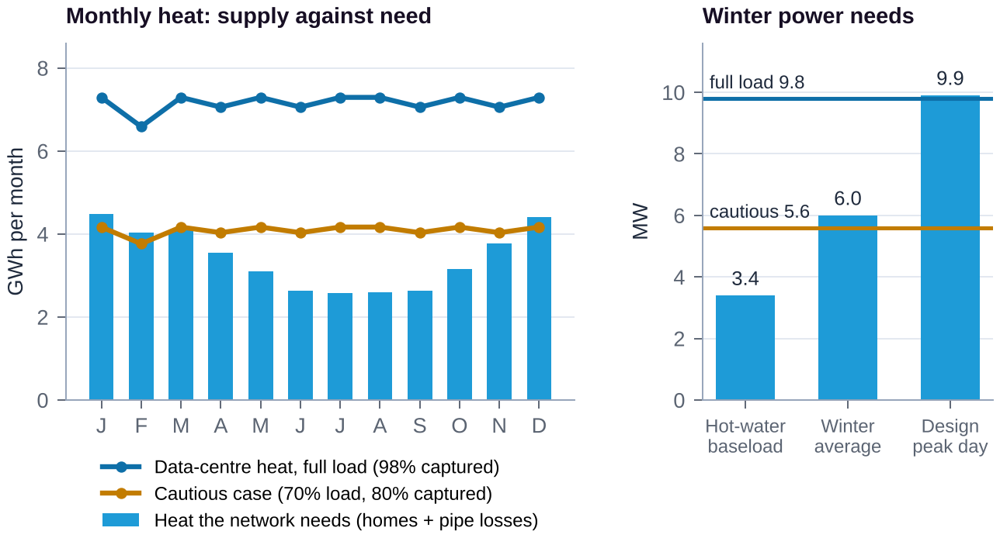

**Figure 3.3. Monthly hot-water heat supply versus network demand (left) and winter power comparison (right).**

*Source: RAKDA daily Heating Degree Day model [C2], [C3], [C6].*

Thermal Store, Outage Security, and Scenario B Fallback. At full load the vaults supply 9.80 MW against the 9.91 MW design peak (0.11 MW gap covered easily by storage); in the cautious case the cold-snap gap is 4.31 MW (Figure 3.3). A central 2,500 m³ pressurised water tank holds 101.6 MWh (91.4 MWh usable across ΔT = 35 K), sustaining average winter demand for 15 hours with zero data-centre heat, while 8.0 MW of air-source backup heat pumps extend full peak-day resilience past 48 hours ([C7]). Over a cautious year, backup supplies just 5.3% of heat (2,176 MWh, concentrated in December–February). If commercial 2045 silicon remains capped at 45 °C (Scenario B), central high-temperature heat pumps upgrade 40 °C loop water (allowing a 5 K exchanger pinch) to 75 °C condensing temperature. Using Equation (5) at 40–60% of Carnot (Arpagaus et al., 2018), practical COP is 4.0–6.0, requiring ~8.5 MW of added heat pumps (€5.1M) and 5.9–8.8 GWh/yr of electricity—adding ~€33/MWh while maintaining full 70 °C network service ([C9]).

> **Equation (5):** `COP_Carnot = T_cond / (T_cond − T_evap) = 348.15 K / (348.15 − 313.15) K = 9.95 ⇒ COP_practical = 4.0–6.0`

Summer Surplus Cascade. Because compute heat arrives year-round while winter space heating drops off in spring, 44,816 MWh/yr becomes surplus (35,852 MWh at 75 °C; Figure 3.4; [C6]). Converting 75 °C (348.15 K) heat against a 15 °C (288.15 K) cooling sink faces a strict Carnot ceiling (Equation 6; Çengel, Boles and Kanoğlu, 2019):

> **Equation (6):** `η_Carnot = 1 − (288.15 K / 348.15 K) = 17.2% ⇒ η_ORC (42–48% of Carnot) = 7.2–8.3%`

A PFAS-free Organic Rankine Cycle (ORC) unit (Quoilin et al., 2013) converts 7.2–8.3% of 75 °C surplus, generating 2.60–2.97 GWh/yr (~0.4 MW capacity, [C15]) worth ~€10/MWh of input heat versus €95/MWh sold directly as thermal energy ([C16]). Solid-state thermoelectric generators remain limited by contact resistance to 2.9–4.2% efficiency (Snyder and Toberer, 2008), reserving them for self-powered vault sensors. USCI enforces a three-tier surplus cascade: (1) direct 70–75 °C heat sales to local commercial buyers (pools, laundries, greenhouses, or thermally driven adsorption chillers delivering 1.8×–12.5× ORC value); (2) the 0.4 MW ORC (+€3.5M utility NPV); and (3) N+1 dry coolers at the energy centre so server uptime never depends on summer heat demand. Two additional surplus options—membrane distillation and direct air capture—are quantified in §3.13.

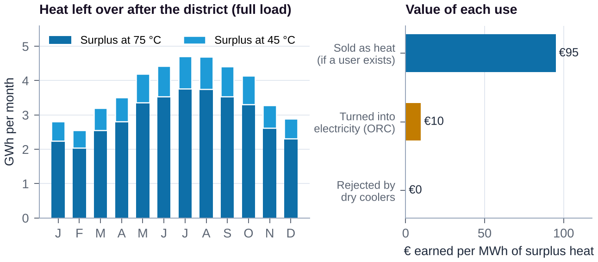

**Figure 3.4. Monthly surplus heat by temperature grade (left) and economic value per MWh by end use (right).**

*Source: RAKDA model [C6], [C15], [C16].*

### 3.5 Compute Plant, Silicon Microfluidics, and Power Architecture

Delivering 70 °C district hot water directly without heat pumps requires shifting heat capture from server rooms down to the silicon die. Conventional enterprise racks averaged ~11 kW near air's ~50 W/cm² heat-flux ceiling, whereas 2025–2045 AI hardware escalates from 40–132 kW per rack toward 250–1,200 kW cabinets (Figure 3.5). Two-phase fluorocarbon immersion is disqualified by PFAS persistence and basement asphyxiation risk (Cousins et al., 2022), while single-phase immersion caps coolant around 45–60 °C.

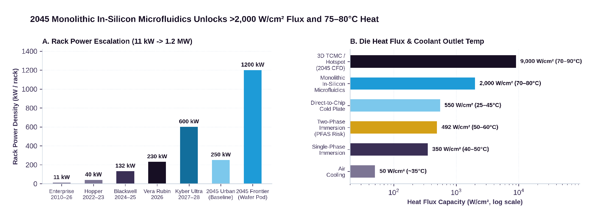

**Figure 3.5. Rack power escalation (11 kW to 1,200 kW) and cooling heat-flux regimes (log scale).**

*Source: RAKDA engineering synthesis from Van Erp et al. (2020) and hardware roadmaps.*

In-Silicon Microfluidic Die Stack. USCI adopts monolithic chip-level microfluidic cooling (Figure 3.6): ultrapure water enters manifold microchannels etched directly into the silicon/substrate package at ~50 °C, removing >1.7 kW/cm² at laboratory scale (Van Erp et al., 2020) and exiting at 75–80 °C. By 2045 we project 80% of IT heat is captured on this 75–80 °C primary loop, while the remaining 20% (co-packaged optics, voltage regulators, and 3D logic/memory tiers) is collected at 45 °C on a secondary loop ([A10]) that preheats returning district water. Running silicon warm at 85 °C imposes negligible physical penalty under Landauer's bit-erasure limit (Equation 7): raising junction temperature from 300 K (27 °C) to 358.15 K (85 °C) increases minimum erasure energy by 19.4% (2.871 zJ to 3.427 zJ)—five orders of magnitude below real transistor switching energy—whereas 4.2 K cryogenic logic incurs kilowatts of cryocooler penalty and yields unusable low-grade heat.

> **Equation (7):** `E_Landauer = k_B · T · ln(2) (300 K: 2.871 zJ vs. 358.15 K: 3.427 zJ)`

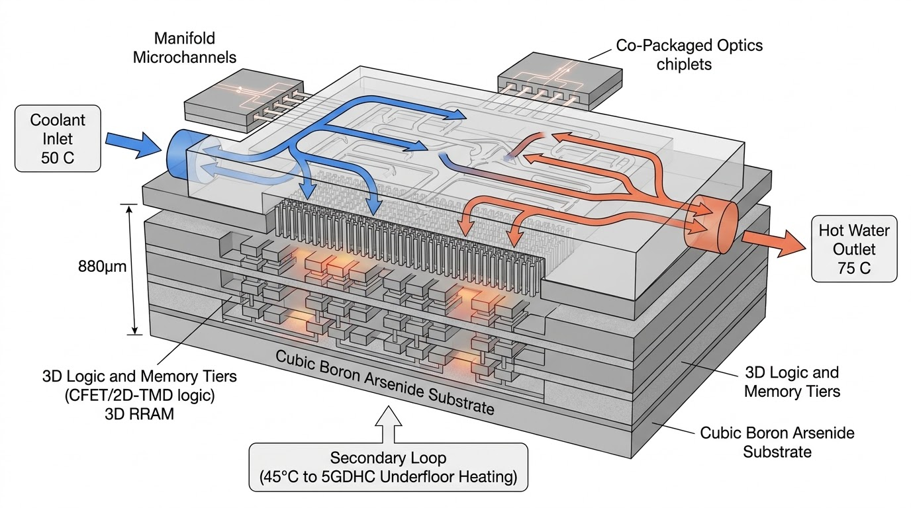

**Figure 3.6. Projected 2045 3D silicon die stack with etched manifold microchannels (75 °C primary output) and 45 °C secondary cold-plate path.**

*Source: RAKDA 2045 hardware synthesis after Van Erp et al. (2020). Note: In USCI's coupled baseline, the 45 °C secondary loop preheats returning 35 °C EN 253 district water toward 42 °C rather than feeding a separate 5GDHC network.*

Vault Sizing, Power Delivery, and 10.0 MW Scaling. Total IT capacity of 10.0 MW is distributed across five 2.0 MW subterranean vaults (Figure 3.7, Table 3.5), each measuring 25 × 16 m internally at 8–12 m depth beneath a public plaza ([A13], subject to borehole investigation). At 250 kW/rack, 40 racks occupy just 100–120 m² across the district, leaving room inside each vault for heat exchangers, 43 m³ cooling buffers (215 m³ total), electrical switchgear, and water polishing. Eliminating chillers and cooling towers yields a projected PUE of 1.015 versus the 1.56 global average (Uptime Institute, 2024; [A12]). Power reaches racks at 800 V DC, cutting conversion losses by up to 5% over 54 V racks and saving copper mass (Blake et al., 2025); superconducting busways (Tokamak Energy, 2026) remain optional until their cryogenic cooling draw is verified. While servers refresh every ~5 years under certified WEEE metal recovery (Bashroush, 2018; Directive 2012/19/EU), concrete vaults carry a 100-year structural life (EN 1990:2002). Replicated across 50 districts of a 1,000,000-person city, USCI provides 500 MW of urban compute while heating 375,000 homes.

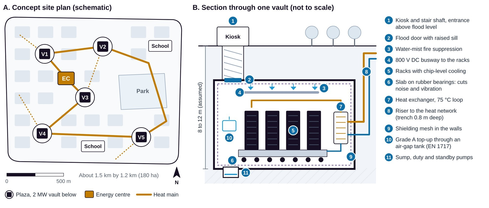

**Figure 3.7. District vault layout (A) and cross-section through one Level −4 vault showing 11 safety barriers (B).**

*Source: RAKDA schematic design [A13]; physical safety controls detailed in §3.7.*

**Table 3.5: Subterranean plant sizing comparison (5.0 MW, initial 6.0 MW, and selected 10.0 MW)**

| Sizing Metric | 5.0 MW Plant | 6.0 MW (Initial) | 10.0 MW Selected (5 × 2.0 MW) |
| --- | --- | --- | --- |
| Captured heat (98% cap., full load) | 42,924 MWh/yr (4.90 MW) | 51,509 MWh/yr (5.88 MW) | 85,848 MWh/yr (9.80 MW) |
| Annual coverage incl. 9.1% pipe loss | 105% (7,500 homes) | 126% (7,500 homes) | 209% (196% at 8,000 homes) |
| Cautious coverage (u = 0.70, f = 0.80) | 60% (net of losses) | 72% (net of losses) | 120% (49,056 MWh/yr gross; +20% net) |
| Winter design peak vs. 9.91 MW need | −5.01 MW deficit | −4.03 MW deficit | −0.11 MW (met by thermal store) |
| Primary 75 °C / Secondary 45 °C flow | 38.3 / 16.0 L/s | 45.9 / 19.2 L/s | 76.5 / 32.0 L/s |
| 15-min vault buffers (ΔT = 10 K) | 108 m³ | 130 m³ | 215 m³ total (43 m³ per vault) |
| Racks (at 250 kW) & IT floor area | 20 racks (~50 m²) | 24 racks (~60 m²) | 40 racks (~100–120 m²) |

*Source: RAKDA Python model [C3]–[C5], [C8], [C10]. Only 10.0 MW covers cautious-case annual demand including pipe losses.*

### 3.6 Water Loop and Ultrapure Water (UPW) Inputs

Turning from thermal and compute outputs to system inputs, conventional 10 MW evaporative cooling towers consume 157,680–175,200 m³/yr of drinking water (1.8–2.0 L/kWh; Siddik, Shehabi and Marston, 2021)—equivalent to the household demand of 3,250–3,610 residents ([C12]). At Uisce Éireann's non-domestic Band 3 tariff (€1.66/m³ supply, plus €2.38/m³ wastewater blowdown avoided; CRU, 2026), eliminating evaporative cooling saves €261,700–€290,800/yr in municipal water supply fees alone, plus ~€83,000/yr across civic non-potable uses (reported strictly as societal savings rather than operator EBITDA). USCI's hermetically sealed cooling loops evaporate zero water, directly applying the water–energy nexus from course lectures (Ali, 2026a).

Roof Harvesting, Cistern Sizing, and Three-Stream Runoff Segregation. Across Dublin's 772.5 mm/yr mean rainfall (Met Éireann, 2023), 10 ha of inert roofs (metal, slate, and PV arrays at 0.80 runoff and 0.90 filter efficiency to EN 16941-1) yield 55,620 m³/yr, or 152 m³/day ([C11]). Monthly mass-balance modelling reveals a 3,318 m³ seasonal drawdown across spring and summer; 10,000 m³ of cool subterranean reinforced-concrete cisterns keep minimum storage near 6,700 m³ and hold ~44 days of drought reserve (Figure 3.8; [C13]). Surface runoff is separated into three dedicated streams to protect water quality: (1) inert elevated roofs (slate, metal, PV) feed the cooling-water purification train directly; (2) multilayer blue-green roofs (54 L/m² storm retention mitigating +24% projected winter storm surges; Met Éireann, 2025) supply irrigation and toilet flushing because vegetation raises organic carbon; and (3) roadways and pavements drain through vegetated bioretention swales achieving 90–95% hydrocarbon attenuation rather than entering cisterns.

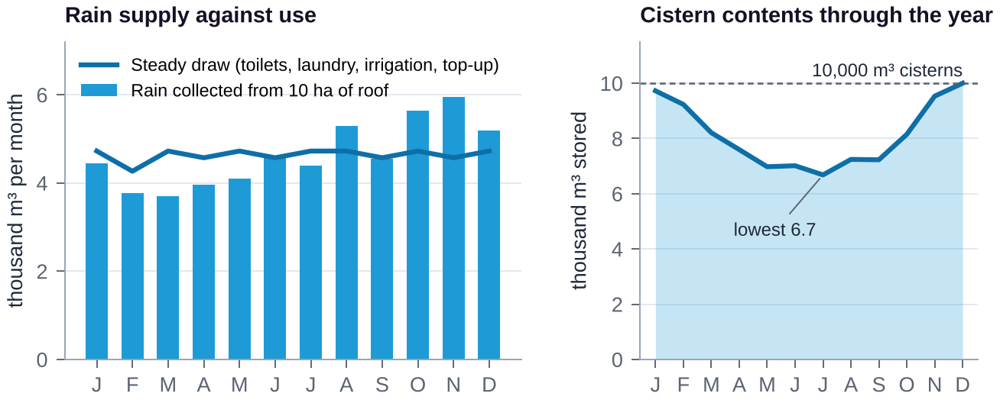

**Figure 3.8. Monthly rainwater yield against steady district demand (left) and cistern storage level (right).**

*Source: RAKDA hydrological model [C11], [C13]; rainfall normals from Met Éireann (2023).*

**Ultrapure Water (UPW) Filtration Train vs. Standard Deionised Water.** Because closed-loop cooling makeup requires at most 3,265 m³/yr (<6% of harvested inert-roof yield; [C14]), water purity—not volume—governs hydraulic design. Standard deionised boiler water (such as VDI 2035 at ≤ 100 μS/cm) still permits silica scaling, bacterial micro-fouling, and corrosion inside 50–100 μm silicon chip microchannels, while Dublin urban rainfall carries trace atmospheric PFAS (Cousins et al., 2022). USCI therefore separates non-potable civic water from semiconductor-grade Ultrapure Water (UPW): Grade C covers park irrigation via coarse filtration; Grade B supplies toilets and laundry (covering 22% of district toilet demand) via ultrafiltration and UV-C LED disinfection; and Grade A produces semiconductor-grade UPW makeup meeting ≤ 1.0 μS/cm conductivity (1–18.2 MΩ·cm electrical resistivity), ≤ 0.2–1.0 μm particle exclusion, ≤ 1.0 ppm silica (SiO₂), and ≤ 0.10 ppm dissolved metals.

Grade A UPW polishing operates continuously in three low-chemical stages, backed by physical air-gaps (EN 1717:2000) and purple-coded non-potable piping:

- **1. Dead-end ultrafiltration (<0.1 kWh/m³):** Removes suspended particulates, bacteria, and colloidal silica upstream of ionic polishing.
- **2. Membrane capacitive deionisation (0.234 kWh/m³):** Electrostatically strips dissolved salts and minerals while cutting acid/caustic chemical regenerants by ~85% relative to conventional ion-exchange columns (or uses 2045 selective ion-barrier membranes).
- **3. Mixed-bed UPW polishing, UV-C LEDs, and electrochemical PFAS oxidation:** Final resin polishing lifts resistivity into the 1–18.2 MΩ·cm semiconductor band under continuous Total Organic Carbon (TOC) monitoring, while boron-doped diamond / titanium oxide electrochemical cells mineralise captured atmospheric PFAS directly on site rather than generating concentrated toxic brine for landfill (supplemented optionally by waste-heat membrane distillation in §3.13). Compact ~40 °C-regenerated atmospheric moisture harvesters linked to the secondary loop provide auxiliary drought makeup.

### 3.7 Vault Safety and Physical Isolation

Placing data-centre vaults beneath a residential district requires an engineered barrier for every credible physical, acoustic, electrical, and hydraulic hazard (Table 3.6). Controls involving structural ground conditions and fire compartmentation require statutory specialist sign-off at detailed design, as recorded in §4.1.

**Table 3.6: Principal vault hazards and engineered safety controls**

| Hazard | Engineered Control in USCI | Basis / Verification |
| --- | --- | --- |
| Noise & vibration (top survey concern) | Vaults under plazas only on floating concrete slabs with elastomeric bearings + 1.0 m vibration trenches; dry coolers remote at energy centre | Survey [S6]; structural isolation design |
| Fire & asphyxiation | Fire-rated compartments; water-based coolants only; low-pressure water mist (<110 dB); escape via surface kiosk shaft | Team design; chartered fire engineer sign-off |
| Flooding & groundwater | Entrance sill above flood level; watertight flood doors; duty + standby sump pumps; continuous leak telemetry | Team design; site flood & borehole study needed |
| 800 V DC electrical fault | Solid-state arc-fault protection, continuous insulation monitoring, trained technician access only | Blake et al. (2025) |
| Water cross-contamination | Separate purple-coded non-potable pipes; Type AA/AB physical air-gaps to drinking mains; Grade A UPW only in cooling loops | EN 1717:2000; EN 16941-1:2018 |
| Legionella proliferation | Instant ≥ 55 °C hot water at building heat interface units; zero stored hot water; cool cisterns with UV-C | HPSC (2009); HSE (2024) |
| PFAS & chemical leaks | Zero fluorocarbon coolants; low-GWP natural refrigerants in backup heat pumps; electrochemical PFAS destruction | Reg. (EU) 2024/573; Cousins et al. (2022) |
| Structure & ground risk | 100-year structural design life; depth (8–12 m) pending intrusive borehole investigation | EN 1990:2002 |
| Electromagnetic fields | Grounded shielding mesh integrated into vault walls and switchgear rooms | Precautionary team design |

*Source: RAKDA engineering safety design and cited standards.*

### 3.8 Auxiliary Subterranean Networking Benefits

#### 3.8.1 Optical Latency Compression and Local Traffic Redirection

Housing compute capacity directly beneath the district creates a distinct telecommunications benefit alongside heat recovery. Distributing five 2.0 MW vaults across 180 ha gives each vault a local catchment of roughly 36 ha (~339 m radius), connected by a 3.0 km hollow-core optical fibre ring (refractive index near 1.00, 3.33 μs/km light propagation) terminating on fast cut-through optical switches, with short (<50 m) indoor glass-fibre drops directly into apartments, schools, and clinics.

Bypassing five to six metropolitan routing hops cuts pure transport round-trip time (RTT) by 99.9%—from 3,135 μs for a regional core cloud (75 km, ±1,850 μs jitter) and 1,095 μs for a suburban hyperscale campus (25 km, ±420 μs jitter) down to 3.17 μs locally (±2.5 μs jitter) and 8.16 μs between neighbouring vaults across 1.0 km (Table 3.7). Including radio and indoor access hops, end-to-end user round-trip latency drops from 6.34–7.64 ms down to 48.2 μs over fixed building fibre and 143.2 μs over local wireless links.

**Table 3.7: Modelled 2045 network latency — regional cloud vs. USCI subterranean vaults**

| Deployment Tier (Modelled 2045) | One-Way Route | Fibre Medium | Pure Net RTT | Wireless E2E RTT | Fixed Fibre E2E | Tail Jitter |
| --- | --- | --- | --- | --- | --- | --- |
| Regional core cloud (6 hops) | 75.0 km | Standard silica (1.47) | 3,135.0 μs | 7.64 ms | 6.34 ms | ±1,850 μs |
| Suburban hyperscale (4 hops) | 25.0 km | Standard silica (1.47) | 1,095.0 μs | 2.70 ms | 2.20 ms | ±420 μs |
| USCI vault (standard riser) | 0.25 km | Bend-insens. silica | 6.95 μs | 167.0 μs | 72.0 μs | ±8.0 μs |
| USCI vault (hollow-core ring) | 0.25 km | Hollow-core (~1.00) | 3.17 μs | 143.2 μs | 48.2 μs | ±2.5 μs |
| Inter-vault ring hop (A → B) | 1.00 km | Hollow-core (~1.00) | 8.16 μs | — (vault sync) | — | ±1.2 μs |

*Source: RAKDA optical path-length and switching latency model (RAKDA Ltd., 2026b).*

Local Traffic Redirection and Metro Backhaul Savings. Co-locating local edge caches and content routing inside the five vaults keeps 87.34% of the district's 20.0 Tbps total data traffic (17.47 Tbps) inside the subterranean ring rather than backhauling requests across Dublin's metropolitan fibre core. This supports responsive civic applications—such as low-latency telehealth, interactive education, smart-grid fault protection, and real-time building telemetry—while internal ring switching consumes just 0.87 kW (7.7 MWh/yr), avoiding 183.6–726.8 MWh/yr (midpoint 455 MWh/yr) of metropolitan core routing electricity. Optical links are protected with post-quantum encryption and continuous millimetre-scale fibre fault monitoring.

#### 3.8.2 Electro-Thermal Network Traffic Shifting and Digital Governance

Subterranean optical networking also improves district thermal balancing. Of USCI's 10.0 MW IT capacity, 15% (1.50 MW) serves location-pinned real-time district traffic while 85% (8.50 MW) is flexible batch and cloud compute that can be redirected dynamically between vaults via software-defined network (SDN) routing. Migrating 1.0 MW of compute traffic (5.0 Tbps) optically over 1.2 km consumes only 250 W at the transceivers, whereas pumping 1.0 MW of hot water across a 1.2 km EN 253 pipe pair incurs 1,930 W of pump shaft work plus 15,600 W of pipe thermal loss (17,530 W total)—making optical traffic shifting 70.1× more energy-efficient than hydronic heat transport (Figure 3.9).

Across a 24-hour cycle, traffic routing shifts flexible loads toward the three residential vaults (7.05 MW) during morning and evening domestic hot-water peaks and toward the two commercial/school vaults (4.70 MW) midday, while overnight AI training absorbs curtailed wind power. For resident privacy and governance, the utility control room receives only aggregated building heat-meter readings and vault safety telemetry (leak, temperature, pressure, vibration); no household usage or telecom payload data passes to commercial tenants, and all automated scheduling affecting district services must comply with the EU Artificial Intelligence Act (Regulation (EU) 2024/1689).

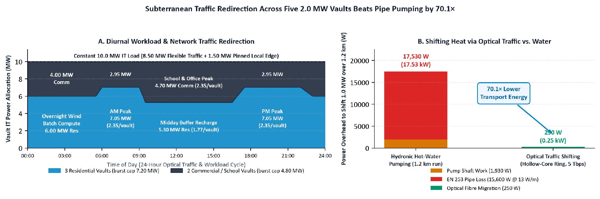

**Figure 3.9. Diurnal optical traffic shifting across five vaults (A) and energy overhead of photon routing vs. pipe pumping (B).**

*Source: RAKDA network-thermal routing model; EN 253 pipe loss basis from §3.4 (13.0 W/m).*

### 3.9 Life-Cycle Carbon and Maintenance

Embodied Carbon (Stages A1–A4). Compressing 10.0 MW of IT racks into five compact underground vaults eliminates surface data halls and cooling-tower yards. Table 3.8 details cradle-to-gate material emissions (A1–A3) and HGV transport (A4) for civil structures and the 30 km network using published UK/Irish conversion factors (MPA, 2025; steelconstruction.info, n.d.; DESNZ, 2024). Total embodied carbon is 4,628 t CO₂e with ordinary Portland cement (CEM I), falling by 9.7% to 4,178 t CO₂e with 50% slag cement (GGBS)—and further to 3,908 t CO₂e under the LC3 cement option in §3.13. Reusing ~65,600 t of excavated vault soil on site for landscaping avoids ~180 t CO₂e of haulage ([C19]). Against net avoided domestic gas-boiler emissions of 7,230–7,270 t CO₂/yr ([C17]), structural embodied carbon pays back in 6.8–7.5 months.

**Table 3.8: Embodied carbon of primary civil structures and heat network (Stages A1–A4)**

| Asset / Material Stream | Quantity | Emission Factor | CEM I (t CO₂e) | 50% GGBS (t CO₂e) |
| --- | --- | --- | --- | --- |
| RC vaults: 5 × (25 × 16 × 6 m int.) | 3,470 m³ | 0.48 t/m³ (0.41 GGBS) | 1,666 | 1,416 |
| RC rainwater cisterns (10,000 m³) | 2,547 m³ | 0.48 t/m³ (0.41 GGBS) | 1,223 | 1,039 |
| RC thermal-store foundation | 231 m³ | 0.48 t/m³ (0.41 GGBS) | 111 | 94 |
| Steel thermal store (2,500 m³) | 80 t | 1.74 t/t | 139 | 139 |
| EN 253 network steel pipework (2 × 30 km) | 360 t | 2.49 t/t | 896 | 896 |
| PUR insulation & PE pipe casing (proxy) | 72 t / 86 t | 4.3 / 2.0 t/t | 484 | 484 |
| HGV transport (~781 concrete & pipe trips) | 40 km avg | 0.906 kg/km | 110 | 110 |
| Total Embodied Carbon (A1–A4) | — | — | 4,628 t CO₂e | 4,178 t CO₂e (−9.7%) |

*Source: RAKDA model [C19], [A25]; PUR/PE factors use parametric proxies pending supplier EPDs.*

**30-Year Maintenance, Refreshes, and Circularity.** Tables 3.9 and 3.10 map replacement intervals and end-of-life circular pathways across 2045–2075 (Byrne, 2026). Staggering 5-year server refreshes across the five vaults keeps 80% of capacity live continuously, while retired hardware enters WEEE metal and semiconductor recovery (Bashroush, 2018; Directive 2012/19/EU). Crucially, we never claim USCI is carbon negative: net grid electricity drawn by the vaults (77,958 MWh after solar) still emits 12,707–24,011 t CO₂/yr depending on grid mix ([C18]), though CRU's 80% renewable rule drives that figure downward.

**Table 3.9: Component service lives and 30-year replacement schedule (2045–2075)**

| Asset Group | Service Life | Replacements in 30 Years | End-of-Life Circular Strategy |
| --- | --- | --- | --- |
| IT servers & chips (tenant-owned) | ~5 years | 6 staggered cycles (80% live) | Refurbish/resell; certified WEEE metal & chip recovery |
| Battery storage (8 MW / 32 MWh LFP) | ~12 years | 2 swaps (Years 12 & 24) | Certified hydrometallurgical cell recycling |
| Backup HTHPs, ORC, CDUs & pumps | 15–20 years | 1 major overhaul (Year 15) | Refrigerant recovery (F-Gas); motor/copper rebuild |
| Water filtration membranes & UV-C | 5–10 years | Scheduled swaps (Yrs 10, 15, 20) | Media regeneration; spent resin safe disposal |
| Building heat interface units (HIUs) | ~20 years | 1 swap (Year 20) | Modular brass/steel heat-exchanger recycling |
| EN 253 pre-insulated pipes (30 km) | 30+ years | Condition-monitored (none) | Remain in ground post-2075 for any future heat source |
| Concrete vaults, cisterns & store | 100 years | None (EN 1990:2002) | Reusable post-2075 for storage, water, or transit |

*Source: RAKDA design [C20], [C22]; Jakubowicz et al. (2022); Byrne (2026).*

**Table 3.10: Continuous circularity flows across water, heat, and earthworks**

| Resource Stream | Circular Mechanism |
| --- | --- |
| Excavated earth (65,600 t) | 100% reused on site for parks & acoustic berms, avoiding ~180 t CO₂e of haulage [C19] |
| Rainwater (55,620 m³/yr) | Cascaded across three purity grades (cooling top-up, toilets/laundry, park irrigation); zero potable cooling |
| Recovered heat (85,848 MWh/yr) | Three-step cascade: 7,500 homes first, then commercial heat buyers, then 0.4 MW ORC, then dry coolers |

*Source: Adapted from built-environment circularity framework (Byrne, 2026).*

### 3.10 Economics and Societal Cost

USCI splits €136.7M of total capital expenditure between two ring-fenced owners (Table 3.11, Appendix F). Case 1, the publicly owned Heat Utility (€57.3M), owns the 30 km heat network, 3,095 building substations, 2,500 m³ store, 8.0 MW backup heat pumps, rainwater cisterns/treatment, and 0.4 MW ORC. Case 2, the Whole Project (€136.7M), combines the utility with the commercial Data-Centre Operator's €79.3M for vault fit-out, 800 V DC power, cooling, and CRU-mandated 12 MWp solar plus battery ([A32]).

Levelised Cost of Heat (LCOH) discounts lifetime CapEx (C₀), O&M and electricity (O_t), mid-life replacements (R_t), and non-heat credits from standing charges and ORC electricity (S_t) across delivered annual heat (H_t = 37,612 MWh/yr; Equation 8, [C20]):

> **Equation (8):** `LCOH_net = [ C₀ + Σ (O_t + R_t − S_t) / (1 + r)^t ] / [ Σ H_t / (1 + r)^t ] (t = 1..30 yr)`

Selling heat at €95/MWh plus a €60/yr standing charge, the Heat Utility achieves a net LCOH of €93/MWh at Ireland's 4% public test discount rate (DPENDR, n.d.), delivering +€1.1M NPV, 4.2% IRR, and a 15.8-year payback ([C20], [C21]). At a commercial 8% rate NPV is −€18.7M, confirming public financing or support is needed—just as Tallaght received Climate Action Fund grants. A 30% capital grant lowers LCOH to €68/MWh (7.5% IRR), while a €1M/yr cooling fee from the operator lifts utility IRR to 6.6%. Across the whole project (Case 2), colocation rent anchored at €145/kW/month (CBRE, 2026; [A33]) yields €19.6M/yr EBITDA, a 13.7% IRR, and a 7.0-year payback ([C22]). Avoided municipal water and telecom savings (~€0.33M/yr) are reported strictly as societal benefits rather than inflating operator EBITDA.

**Table 3.11: 30-year financial summary for Heat Utility (Case 1) and Whole Project (Case 2)**

| Financial Metric (Constant 2026 €, 30 Years) | Case 1: Public Heat Utility | Case 2: Whole Project |
| --- | --- | --- |
| Initial capital expenditure (CapEx) | €57.3M | €136.7M |
| Annual operating cash flow (EBITDA) | €3.6M/yr | €19.6M/yr |
| Net LCOH at 4% (Gross LCOH before credits) | €93/MWh (€114/MWh gross) | — |
| Net present value at 4% / 8% discount rate | +€1.1M / −€18.7M | +€189M / +€77M |
| Internal rate of return (IRR) & simple payback | 4.2% (15.8 years) | 13.7% (7.0 years) |
| With 30% public capital grant | 7.5% IRR; €68/MWh net LCOH | 15.8% IRR |
| Combined stress (+30% CapEx, 60% utilisation) | €129/MWh net LCOH | 4.3% IRR |

*Source: RAKDA DCF model [C20]–[C22]; detailed CapEx and annual operating lines in Appendix F.*

> **Annual Household Heating Bill Comparison (5.01 MWh/yr, VAT included, SEAI 2026 basis)**
> - USCI District Heat: €536/yr (€95/MWh × 5.01 MWh + €60 standing charge; zero boiler/HP CapEx)
> - Domestic Gas Boiler: €1,001/yr (€659 fuel @ €118.3/MWh ÷ 90% eff. + €342 annualised €3,800 boiler, 15 yr @ 4%)
> - Individual Air-Source Heat Pump: €1,691/yr (€567 electricity @ €339.2/MWh ÷ COP 3.0 + €1,124 annualised €12,500 unit)

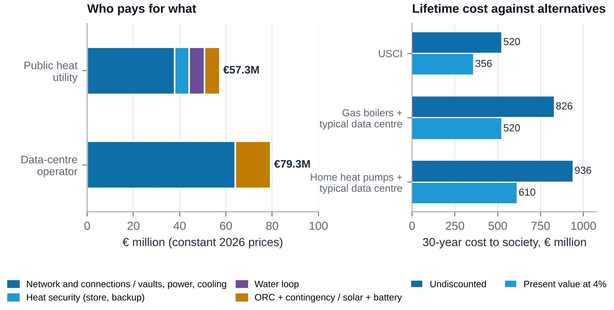

**Figure 3.10. Capital expenditure split by owner (left) and 30-year societal cost against alternatives (right).**

*Source: RAKDA model [C20], [C22], [C23]; household comparators based on SEAI (2026).*

Over 30 years, USCI costs Irish society €520M undiscounted (€356M PV at 4%), compared with €826M (€520M PV) for gas boilers and €936M (€610M PV) for individual heat pumps paired with a conventional PUE 1.56 data centre ([C23]). Sensitivity testing (Figure 3.11) shows capital cost overrun is the dominant risk: a +30% CapEx overrun lifts utility LCOH to €126/MWh and trims combined IRR to 9.6%, while 45 °C chip limits (Scenario B) also push heat cost to €126/MWh. Even under simultaneous +30% CapEx and 60% utilisation, Case 2 stays positive at 4.3% IRR.

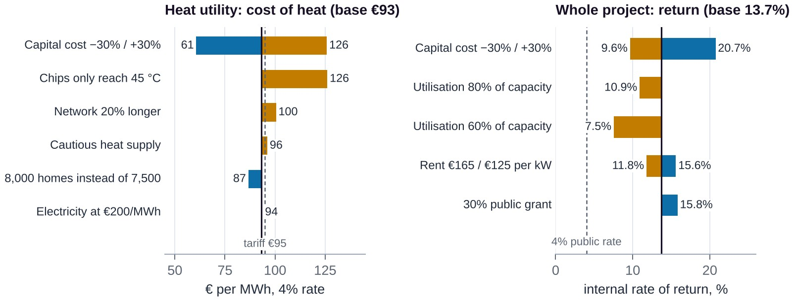

**Figure 3.11. Parametric sensitivity of utility cost of heat (left) and whole-project IRR (right).**

*Source: RAKDA sensitivity model [C21], [C22].*

### 3.11 Resident Survey Validation

An anonymous online survey ran on 18–20 November 2026, gathering 109 responses (64 Dublin residents, 24 elsewhere in Ireland, 14 international students, 3 abroad). Removing four clearly non-serious demographic entries (Appendix C) left 105 valid responses ([S1]; RAKDA Ltd., 2026a). Because this is a convenience sample, percentages indicate directional sentiment rather than a statistically representative census.

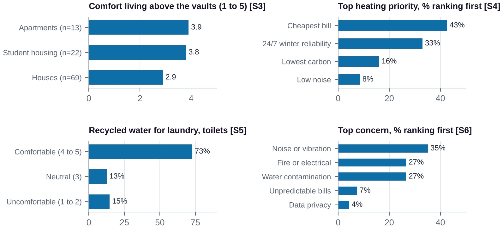

**Figure 3.12. Audited resident survey results (N = 105 valid responses; exact percentages in Appendix C).**

*Source: RAKDA Microsoft Forms survey, 18–20 November 2026 (Appendix C).*

Cleaned results show comfort living above a liquid-cooled data centre averaged 3.20 out of 5 (47.1% comfortable, 17.3% neutral, 35.6% uncomfortable; n = 104, [S2]), with higher acceptance among apartment dwellers (3.92) and students (3.8) than house residents (2.87; [S3]). Note that the question mentioned cheaper electricity, which may nudge comfort slightly upward. Cost and reliability dominated heating priorities: cheapest bill ranked first for 42.6% and 24/7 winter reliability for 33.0% ([S4]). Comfort with recycled water—phrased in the form as 'dishwashers, laundry, garden irrigation, etc.'—averaged 3.87/5 with 72.8% comfortable ([S5]); USCI conservatively restricts domestic reuse to toilets and laundry plus park irrigation, excluding dishwashers entirely. Noise/vibration (35.1%), fire/electrical safety (26.6%), and water contamination (26.6%) accounted for 88.3% of primary concerns ([S6]). Every finding drove physical design choices: plaza-only siting on rubber isolation slabs, €536/yr tariffs, 48-hour outage backup, physical EN 1717 air-gaps, and phasing initial construction near apartment blocks.

### 3.12 Ethics, Circularity, Carbon Honesty, and Climate Resilience

The core ethical risk in urban waste-heat recovery is making essential household heating hostage to commercial compute economics. Applying the Engineers Ireland Code of Ethics (Engineers Ireland, 2023) public-welfare override alongside all six 1E17 ethical domains (Trinity College Dublin, 2026b) and four course lecture frameworks—resource nexus (Ali, 2026a), carbon accounting (Ali, 2026b), built-environment circularity (Byrne, 2026), and AI ethics (Ahmad, 2026; O'Dwyer, 2026)—yields the governance matrix in Table 3.12.

**Table 3.12: Six-domain 1E17 ethical assessment and engineered governance safeguards**

| 1E17 Ethical Domain | Key Ethical Risks Identified | Engineered & Governance Safeguards |
| --- | --- | --- |
| 1. Public Health & Safety | Legionella; scalding; vault fire, inert-gas noise shock, low-frequency vibration, EMF | Instant ≥ 55 °C DHW (no stored hot water); EN 1717 air-gaps; plaza-only Level −4 siting; <110 dB water mist; rubber bearings + 1.0 m trenches + wall shielding |
| 2. Environmental Quality | PFAS coolants & atmospheric rain PFAS; refrigerant leaks; Ireland's 22% DC electricity load | Zero fluorocarbons; on-site electrochemical PFAS oxidation; natural refrigerants; 12 MWp solar + ≥ 80% renewable CPPAs under CRU/2025/236 |
| 3. Social Equity | Localised vault nuisance concentrated on nearby plazas vs. district-wide heating benefits | Zero vaults under housing cores; uniform tariff & water grades across all 7,500 homes; empirical resident survey (N = 109) integrated into design |
| 4. Affordability | Commercial tenant exit or CapEx overrun pushing costs onto resident heat bills | Ring-fenced non-profit public utility; €536/yr bill (~46% below gas); binding heat-supply contract + 30% grant / €1M fee options |
| 5. Accessibility & Inclusion | Medically vulnerable households losing heat in outages or facing upfront heat-pump costs | 2,500 m³ store + 8.0 MW backup (48 h peak resilience); zero upfront home HP CapEx; targeted home heat-battery option ([C26]) |
| 6. Future Generations | 30-year lock-in to one operator; 6–10 server e-waste cycles; structural embodied carbon | Open 70/35 °C pipes accept post-2075 heat sources; 100-year reusable EN 1990 vaults (50% GGBS/LC3); WEEE recovery & open AI transparency |

*Source: Evaluated against Trinity College Dublin (2026b), Engineers Ireland (2023), and course lectures.*

**Quantitative Carbon Honesty Check (Ali, 2026b).** Table 3.13 audits annual operational CO₂ using Ali's (2026b) unit factors (0.175 t CO₂/MWh gas at 90% boiler efficiency; 0.163 t/MWh all-island grid mix; 0.308 t/MWh gas-heavy supplier mix). Replacing gas boilers avoids 7,230–7,270 t CO₂/yr net of pumping (~0.99 kg CO₂/person/day against Ali's 14.9 kg/day baseline). However, Scenario B heat pumps cut net savings to ~5,790–6,310 t/yr, and USCI's own residual data-centre electricity draw emits 12,707–24,011 t CO₂/yr. USCI therefore recovers waste heat and water effectively, but can only claim net system decarbonisation when displacing less efficient suburban compute (saving 7,780–14,700 t/yr from PUE 1.015 vs. 1.56) and contracting new indigenous renewables.

**Table 3.13: Quantitative carbon accounting check (10.0 MW USCI, 7,500 homes)**

| Carbon Stream | Calculation Basis | Annual CO₂ (t CO₂/yr) |
| --- | --- | --- |
| Gas-boiler counterfactual | 37,612 MWh ÷ 0.90 × 0.175 t/MWh | ~7,313 |
| Scenario A pumping electricity | 259 MWh × 0.163–0.308 t/MWh | ~42–80 |
| Net avoided heating CO₂ (Scenario A vs. Gas) | 7,313 − (42 to 80) | ~7,230–7,270 avoided |
| Scenario B HTHP electricity (COP 4.0–6.0) | 5,893–8,839 MWh × 0.163–0.308 t/MWh | ~960–2,720 |
| Avoided PUE grid penalty (1.015 vs. 1.56) | 47,742 MWh × 0.163–0.308 t/MWh | ~7,780–14,700 avoided |
| USCI residual DC grid electricity | 77,958 MWh (net of solar) × 0.163–0.308 | ~12,707–24,011 emitted |

*Source: RAKDA model [C17], [C18] using Ali (2026b) emission factors.*

**AI Ethics & Integrity.** Following Ahmad (2026) and O'Dwyer (2026), tenant leases require compliance with the EU AI Act (Regulation (EU) 2024/1689), meter telemetry is isolated from commercial tenants, and all AI-assisted report drafting was cross-verified against primary sources.

**Climate Resilience (Grey, Green, and Soft Tiers).** Extreme heat caused 86–91% of European weather-related fatalities between 1980 and 2020 while floods affected 5.5 million Europeans (Byrne, 2026), and Ireland faces drier summers alongside +24% heavier winter storms (Ali, 2026b; Met Éireann, 2025). USCI pairs grey barriers (flood-sealed Level −4 thresholds and duty/standby sump pumps), green drainage (54 L/m² blue-green roofs, bioretention swales, and 10,000 m³ drought cisterns), and soft measures (heatwave-rated dry coolers and utility–resident emergency heat protocols).

### 3.13 Innovation and Technology Readiness

Most of USCI uses proven commercial hardware (EU Technology Readiness Levels 8–9; European Commission, 2014). The sole low-TRL core element is 75–80 °C chip-level cooling at TRL 4 (laboratory stage; Figure 3.13), hedged by Scenario B. To close five specific vulnerabilities exposed by our model—cautious-case winter shortfalls, low-value summer surplus, unseen pipe losses, public trust in claims, and concrete carbon—seven further options were quantified in the same Python model (Table 3.14; [C24]–[C30]). Each remains optional pending pilot validation.

**Table 3.14: Seven quantified innovation options tied to specific model weaknesses**

| Option | Model Weakness Targeted | Quantified Result on Paper | TRL | Next Step |
| --- | --- | --- | --- | --- |
| 1. Heat-priority computing (shift flexible AI jobs to cold days) | Winter backup shortfall in cautious case | Running at 90% on the 27 days <3 °C & 68.4% otherwise cuts backup 36% & peak gap 4.3 → 2.7 MW; store lasts 34 h on the cautious design day instead of 21 h [C24] (Google precedent: Radovanovic et al., 2021) | 3 | Write into supply contract; pilot scheduler |
| 2. Membrane distillation on surplus | Low-value surplus; Grade A energy | 2–5% of surplus distils all 3,265 m³/yr loop makeup, leaving 363 m³ concentrate [C25]; 85% PFAS rejection in bench tests (Tow et al., 2021), so pairs with polishing | 5 | Pilot unit at one vault |
| 3. Home heat batteries (vulnerable homes) | Outage risk for medically vulnerable | 3.5 kWh unit gives 8.7 h hot water or 4.7 h full heat; 750 homes cost €1.5M (~53× central store cost/MWh) [C26]; commercial product (Sunamp, n.d.) | 9 | Target medically vulnerable households |
| 4. Fibre-optic pipe temperature sensing | Unseen heat loss & leaks along 30 km | Each extra 1 W/m wastes 263 MWh (€25k)/yr; a 10% loss rise wastes 342 MWh/yr [C27]; proven on pipelines (Ukil et al., 2012) | 8 | Lay sensing fibre with EN 253 pipes |
| 5. Resource passports & open ledger | Performance claims taken on trust | Monthly Energy Reuse Factor = 0.46 (base) / 0.62 (cautious), >2× Germany's 0.20 mandate [C28] (EN 50600-4-6); EU Ecodesign Reg. 2024/1781 | 6 | Publish open ledger from Day 1 |
| 6. Direct air capture (DAC) on surplus | Summer surplus & residual emissions | Boosting half of 75 °C surplus to 100 °C captures 8,544–14,241 t CO₂/yr (net 6,400–12,874 t after power) only if permanent storage exists [C29] (Fasihi et al., 2019; Climeworks, 2017) | 7 | Reserve site space; build once CO₂ storage opens |
| 7. Limestone calcined clay (LC3) cement | Structural embodied carbon | Saves ~720 t CO₂e (16% of embodied total) vs. 450 t with 50% GGBS [C30] (Scrivener et al., 2018) | 8 | Specify in concrete tender where available |

*Source: RAKDA model [C24]–[C30] and cited literature; TRL scale per European Commission (2014).*

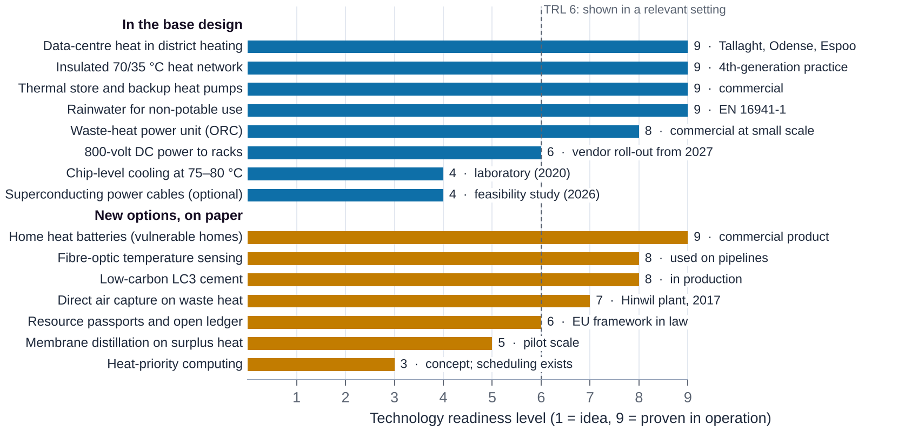

**Figure 3.13. Technology readiness levels (EU TRL 1–9) of base-design subsystems and the seven innovation options.**

*Source: European Commission (2014) scale applied to sources cited in §3.5 and Table 3.14.*

### 3.14 Feasibility Verdict, Risks, and Limitations

Table 3.15 consolidates subsystem feasibility across the 10.0 MW baseline alongside conservative stress bounds, while Table 3.16 summarises principal project risks and mitigations.

**Table 3.15: Consolidated subsystem feasibility audit and evidence tier**

| Subsystem | Base Case (Full Load) | Cautious / Stress Case | Verdict & Guardrail |
| --- | --- | --- | --- |
| Annual heat balance | 85,848 MWh (209% net of losses) | 49,056 MWh (120% net @ u=0.7, f=0.8) | Pass — Break-even utilisation u = 47.8% |
| Winter peak & outage | 9.80 MW vs. 9.91 MW peak | 4.31 MW cautious peak deficit | Pass w/ Guardrail — 2,500 m³ store + 8 MW HTHPs |
| DHW & Scenario B | Direct 70 °C HIUs (≥ 55 °C tap) | 45 °C chips → HTHPs COP 4.0–6.0 (+€33/MWh) | Pass w/ Guardrail — Pilot 75 °C; keep Scenario B ready |
| Network & pumping | 13.0 W/m (3,421 MWh = 9.1%); 259 MWh pump | 30 km +20% length → +€7/MWh LCOH | Pass — Standard EN 253 practice; optional fibre DTS |
| Water loop & purity | 55,620 m³ rain; 160k m³ tower water saved | 3,318 m³ swing; 44-day drought buffer | Pass — 10,000 m³ cistern + 3-stage Grade A + air-gaps |
| Grid & CRU ≥ 10 MVA | 88.9 GWh/yr (PUE 1.015; saves 47.7 GWh) | 78.0 GWh net import after 12 MWp PV | Pass w/ Guardrail — PV + 8 MW/32 MWh BESS + ≥80% CPPA |
| 30-yr economics | Case 2: 13.7% IRR; Case 1: €93/MWh (4.2%) | +30% CapEx & 60% use: 4.3% Case 2 IRR | Pass w/ Guardrail — Public 4% finance / grant for Case 1 |

*Source: RAKDA engineering audit across §§3.1–3.13.*

**Table 3.16: Principal USCI risk register and engineering responses**

| Risk | Likelihood / Impact | Mitigation & Governance Response |
| --- | --- | --- |
| 75 °C chip cooling delayed past 2045 | Medium / High | Vendor test-vault pilot (2027–2030); Scenario B HTHP design (+€33/MWh) ready |
| Low data-centre utilisation (<48%) | Medium / High | Multi-tenant colocation; heat-first SLA; heat-priority scheduling onto cold days |
| Capital cost overrun (+30%) | Medium / Medium | 10% contingency included; phased vault build; 30% utility capital grant option |
| Flooding or difficult bedrock at 8–12 m | Low / High | Borehole ground investigation & flood study; raised sills, flood doors, dual sumps |
| Resident opposition (noise / safety fear) | Medium / Medium | Plaza-only siting, floating rubber slabs, water mist, open performance ledger |
| Grid connection or renewable rules tighten | Medium / Medium | 12 MWp on-site PV, 32 MWh LFP BESS, and long-term Irish renewable CPPAs |

*Source: RAKDA risk register.*

**Study Limitations and Threshold Boundaries.** Five boundaries limit this conceptual design: (1) thermal and water balances run month-by-month with synthetic daily temperature spread rather than an 8,760-hour coupled pipe-network CFD model; (2) 2045 equipment costs rely on team unit rates and public benchmarks rather than vendor quotes; (3) the survey (N = 105) is a non-representative convenience sample; (4) polyurethane and polyethylene pipe embodied carbon use proxy factors pending supplier EPDs; and (5) the Heat Works/Codema utility interview was not completed before submission. Economically and thermodynamically, feasibility hinges on keeping annual utilisation above 47.8% (58.6% at 80% capture), validating 75 °C cooling vs. the +€33/MWh Scenario B fallback, holding combined CapEx/utilisation stress above the 4.3% IRR floor (+30% CapEx / 60% utilisation), and confirming dry 8–12 m excavation by borehole survey.

## 4. Conclusions and References

### 4.1 Conclusions and Recommendations

Integrating a 10.0 MW subterranean liquid-cooled data centre into a 20,000-resident, 180 ha greenfield district provides reliable heat, eliminates potable cooling water, and improves urban economics when designed as one coupled system. Five underground vaults with 75–80 °C chip-level cooling recover more than double the district's annual heat requirement at full load and 120% net of pipe losses in a cautious case. Closed-loop rainwater harvesting saves 158,000–175,000 m³/yr of drinking water. Household heating bills drop to €536/yr—about half the cost of domestic gas—while the combined project achieves a 13.7% IRR and the ring-fenced public utility breaks even at 4.2%.

These gains hold under clear engineering conditions: 75 °C chip cooling must mature from laboratory prototype to commercial hardware (hedged by Scenario B), utilisation must remain above 48%, and resident heat supply must sit inside a ring-fenced public utility. Table 4.1 reports every project objective honestly.

**Table 4.1: Honest verification scorecard across measurable objectives (O1–O12)**

| ID | Key 10.0 MW USCI Outcome | Status |
| --- | --- | --- |
| O1 | 10.0 MW in five 2.0 MW vaults (25 × 16 m); 40 racks; 75–80 °C and 45 °C loops fixed | Met on paper |
| O2 | 209% net of losses at full load; 120% net in cautious case; break-even 47.8% | Met on paper |
| O3 | 9.80 MW meets 9.91 MW peak via store; 2,500 m³ store + 8 MW HTHPs cover full outage | Met on paper |
| O4 | Instant HIU hot water ≥ 55 °C (zero stored DHW); Scenario B HTHP fallback quantified | Met on paper |
| O5 | 55,620 m³/yr rain; 10,000 m³ cisterns; 3 grades + PFAS polishing; zero potable cooling | Met on paper |
| O6 | Three-tier surplus cascade chosen: heat buyers (€95/MWh) → 0.4 MW ORC (€10) → dry coolers | Met |
| O7 | Controls mapped to every hazard; fire engineering & borehole study still required | Partly met |
| O8 | 4,628 t embodied (4,178 t GGBS); 7,230–7,270 t/yr avoided; 12.7–24.0k t/yr residual stated | Met |
| O9 | Utility €93/MWh (4.2% IRR); project 13.7% IRR; household €536 vs. €1,001 gas; sensitivity done | Met |
| O10 | 105 valid survey answers shaped 5 design choices; 6 ethical domains & 4 lectures applied | Met |
| O11 | Heat Works / Codema interview protocol prepared (App. C), but interview not held before deadline | Not met |
| O12 | Seven innovation options quantified in model, linked to weaknesses, and rated on EU TRL scale | Met on paper |

*Note: 'Met on paper' denotes verified analytical modelling where hardware or site construction has not yet been tested.*

**Six concrete actions govern progression from feasibility to delivery:**

- **1. Pilot 75 °C cooling first:** Test chip-level liquid cooling in one 2.0 MW demonstration vault during 2027–2030 before committing to baseline vs. Scenario B hardware.
- **2. Replace monthly models with site data:** Run an 8,760-hour coupled thermal-hydraulic simulation over multi-year Dublin weather data alongside borehole and flood surveys at each plaza.
- **3. Ring-fence the heat utility:** Establish a publicly owned not-for-profit utility (modelled on Heat Works in Tallaght) backed by a heat-first SLA requiring minimum thermal output or backup reimbursement.
- **4. Phase construction near apartment blocks:** Build vaults sequentially alongside apartment occupancy (highest survey acceptance) so heat supply and revenue scale together.
- **5. Publish live operational metrics & complete interviews:** Launch the open Energy Reuse Factor ledger from Day 1, and execute the Heat Works interview and a representative census-weighted survey prior to planning.
- **6. Preserve open network compatibility:** Keep the 70/35 °C EN 253 network open-access so buried pipes continue serving the district with alternative heat sources long after 2075.

### 4.2 References

Ahmad, K. (2026) Introduction to generative artificial intelligence: basic definitions and systems. 1E17 lecture slides, School of Computer Science and Statistics, Trinity College Dublin. Unpublished.

Ali, M. (2026a) Sustainability lecture 1: the water–energy nexus and urban water engineering. 1E17 Engineering Practice 2 lecture slides, Trinity College Dublin. Unpublished.

Ali, M. (2026b) Lecture 2: energy and carbon footprint. 1E17 Engineering Practice 2 lecture slides, Trinity College Dublin. Unpublished.

Arpagaus, C., Bless, F., Uhlmann, M., Schiffmann, J. and Bertsch, S.S. (2018) 'High temperature heat pumps: market overview, state of the art, research status, refrigerants, and application potentials', Energy, 152, pp. 985–1010. doi:10.1016/j.energy.2018.03.166.

Arthur Cox (2025) New connection policy for data centres in Ireland, 16 December. Dublin: Arthur Cox LLP. Available at: https://www.arthurcox.com/knowledge/new-connection-policy-for-data-centres-in-ireland/ (Accessed: 24 November 2026).

Bashroush, R. (2018) 'A comprehensive reasoning framework for hardware refresh in data centers', IEEE Transactions on Sustainable Computing, 3(4), pp. 209–220. doi:10.1109/TSUSC.2018.2795465.

Blake, M., Hsu, M., Goldwasser, I., Petty, H. and Huntington, J. (2025) 'NVIDIA 800 V HVDC architecture will power the next generation of AI factories', NVIDIA Technical Blog, 20 May. Available at: https://developer.nvidia.com/blog/nvidia-800-v-hvdc-architecture-will-power-the-next-generation-of-ai-factories/ (Accessed: 24 November 2026).

Buffa, S., Cozzini, M., D'Antoni, M., Baratieri, M. and Fedrizzi, R. (2019) '5th generation district heating and cooling systems: a review of existing cases in Europe', Renewable and Sustainable Energy Reviews, 104, pp. 504–522. doi:10.1016/j.rser.2018.12.059.

Byrne, A. (2026) Circularity in the built environment: core principles of a circular, sustainable and resilient built environment. 1E17 lecture slides, Trinity College Dublin, 29 September. Unpublished.

CBRE (2026) 'Data centre capacity pricing in Europe set for double-digit growth amid supply constraints', press release, 14 May. Available at: https://www.cbre.com/press-releases/data-centre-capacity-pricing-in-europe-set-for-double-digit-growth-amid-supply-constraints (Accessed: 24 November 2026).

Çengel, Y.A. and Ghajar, A.J. (2015) Heat and mass transfer: fundamentals and applications. 5th edn. New York: McGraw-Hill Education.

Çengel, Y.A., Boles, M.A. and Kanoğlu, M. (2019) Thermodynamics: an engineering approach. 9th edn. New York: McGraw-Hill Education.

Central Statistics Office (CSO) (2023) Census of Population 2022, summary results: household size and marital status. Cork: CSO. Available at: https://www.cso.ie/en/releasesandpublications/ep/p-cpsr/censusofpopulation2022-summaryresults/householdsizeandmaritalstatus/ (Accessed: 16 November 2026).

Central Statistics Office (CSO) (2025) Data Centres Metered Electricity Consumption 2024. Cork: CSO. Available at: https://www.cso.ie/en/releasesandpublications/ep/p-dcmec/datacentresmeteredelectricityconsumption2024/keyfindings/ (Accessed: 14 November 2026).

Climeworks (2017) 'Today Climeworks is unveiling its proudest achievement' (Hinwil direct air capture plant). Zurich: Climeworks. Available at: https://climeworks.com/news/today-climeworks-is-unveiling-its-proudest-achievement (Accessed: 24 November 2026).

Codema (2026) Tallaght District Heating Scheme. Dublin: Codema. Available at: https://www.codema.ie/our-work/tallaght-district-heating-scheme/ (Accessed: 24 November 2026).

Commission Delegated Regulation (EU) 2024/1364 of 14 March 2024 on the first phase of the establishment of a common Union rating scheme for data centres. Official Journal of the European Union, L, 17 May 2024.

Commission for Regulation of Utilities (CRU) (2025) Large Energy Users Connection Policy: decision paper (CRU2025236). Dublin: CRU. Available at: https://www.cru.ie/publications/28906/ (Accessed: 24 November 2026).

Commission for Regulation of Utilities (CRU) (2026) Uisce Éireann non-domestic water and wastewater tariff framework 2026/27. Dublin: CRU.

Cousins, I.T., Johansson, J.H., Salter, M.E., Sha, B. and Scheringer, M. (2022) 'Outside the safe operating space of a new planetary boundary for per- and polyfluoroalkyl substances (PFAS)', Environmental Science & Technology, 56(16), pp. 11172–11179. doi:10.1021/acs.est.2c02765.

Covenant of Mayors (2023) 'Stockholm, Sweden: heat recovery from data centres', 10 October. Brussels: European Commission. Available at: https://eu-mayors.ec.europa.eu/en/news/stockholm-sweden-heat-recovery-data-centres (Accessed: 24 November 2026).

Department for Energy Security and Net Zero (DESNZ) (2024) Greenhouse gas reporting: conversion factors 2024. London: DESNZ.

Department of Housing, Local Government and Heritage (DHLGH) (2024) Sustainable residential development and compact settlements: guidelines for planning authorities. Dublin: Government of Ireland.

Department of Public Expenditure, NDP Delivery and Reform (DPENDR) (n.d.) Public Spending Code: project discount and inflation rates. Dublin: Government of Ireland.

Deshmukh, A., Boo, C., Karanikola, V., Lin, S., Straub, A.P., Tong, T., Warsinger, D.M. and Elimelech, M. (2018) 'Membrane distillation at the water–energy nexus: limits, opportunities, and challenges', Energy & Environmental Science, 11(5), pp. 1177–1196.

Directive 2012/19/EU of the European Parliament and of the Council of 4 July 2012 on waste electrical and electronic equipment (WEEE) (recast). Official Journal of the European Union, L 197, 24 July 2012.

Directive (EU) 2023/1791 of the European Parliament and of the Council of 13 September 2023 on energy efficiency (recast). Official Journal of the European Union, L 231, 20 September 2023.

Ebrahimi, K., Jones, G.F. and Fleischer, A.S. (2014) 'A review of data center cooling technology, operating conditions and the corresponding low-grade waste heat recovery opportunities', Renewable and Sustainable Energy Reviews, 31, pp. 622–638.

EN 253:2019 (2019) District heating pipes. Bonded single pipe systems for directly buried hot water networks. Brussels: CEN.

EN 1717:2000 (2000) Protection against pollution of potable water in water installations. Brussels: CEN.

EN 1990:2002 (2002) Eurocode: basis of structural design. Brussels: CEN.

EN 16941-1:2018 (2018) On-site non-potable water systems. Part 1: systems for the use of rainwater. Brussels: CEN.

EN 50600-4-6:2020 (2020) Information technology. Data centre facilities and infrastructures. Part 4-6: Energy Reuse Factor. Brussels: CEN.

EnEfG (2023) Energieeffizienzgesetz (EnEfG), §11: Energieeffizienz in Rechenzentren. Berlin: Bundesministerium der Justiz.

Engineers Ireland (2023) Code of Ethics. Dublin: Engineers Ireland.

European Commission (2014) Horizon 2020 Work Programme 2014–2015, General Annexes, G: Technology readiness levels. Brussels: European Commission.

Fasihi, M., Efimova, O. and Breyer, C. (2019) 'Techno-economic assessment of CO2 direct air capture plants', Journal of Cleaner Production, 224, pp. 957–980.

Fortum (2022) 'Fortum and Microsoft announce world's largest collaboration to heat homes, services and businesses with sustainable waste heat from new data centre region', press release, 17 March.

Health and Safety Executive (HSE) (2024) Legionnaires' disease: hot and cold water systems. Available at: https://www.hse.gov.uk/legionnaires/hot-and-cold.htm.

Health Protection Surveillance Centre (HPSC) (2009) National guidelines for the control of legionellosis in Ireland, 2009. Dublin: HPSC.

International Energy Agency (IEA) (2025) Energy and AI. Paris: IEA. Available at: https://www.iea.org/reports/energy-and-ai.

Jakubowicz, I., Sällström, J.H., Vega, A. and Yarahmadi, N. (2022) Lifetime predictions and status assessments of district heating pipelines. Report 2022:872. Stockholm: Energiforsk.

Lund, H., Werner, S., Wiltshire, R., Svendsen, S., Thorsen, J.E., Hvelplund, F. and Mathiesen, B.V. (2014) '4th Generation District Heating (4GDH): integrating smart thermal grids into future sustainable energy systems', Energy, 68, pp. 1–11.

Met Éireann (2023) Dublin Airport 1991–2020 averages. Dublin: Met Éireann.

Met Éireann (2025) TRANSLATE climate projections for Ireland (extreme rainfall and storm intensity). Dublin: Met Éireann.

Mineral Products Association (MPA) (2025) Fact sheet 18: embodied CO2e of UK cements. Revision 4, 10 April. London: MPA.

O'Dwyer, H. (2026) A.I. history and use in creative media. 1E17 guest lecture slides, Trinity College Dublin, 13 October. Unpublished.

Passive House Institute (2016) Criteria for the Passive House, EnerPHit and PHI Low Energy Building Standard. Version 9f. Darmstadt: PHI.

Quoilin, S., Van Den Broek, M., Declaye, S., Dewallef, P. and Lemort, V. (2013) 'Techno-economic survey of Organic Rankine Cycle (ORC) systems', Renewable and Sustainable Energy Reviews, 22, pp. 168–186.

Radovanovic, A. et al. (2021) 'Carbon-aware computing for datacenters', arXiv:2106.11750.

RAKDA Ltd. (2026a) Liquid-cooled data centre survey (Microsoft Forms export, 109 responses, 18–20 November 2026). Unpublished dataset, Group A-10, Trinity College Dublin.

RAKDA Ltd. (2026b) USCI calculation model (Python scripts, datasets, and outputs). Companion archive: https://zetbcn.github.io/EP2-Proj-RAKDA/.

Ramboll (n.d.) Meta surplus heat to district heating (Odense project page). Copenhagen: Ramboll.

Regulation (EU) 2024/573 of 7 February 2024 on fluorinated greenhouse gases. Official Journal of the European Union, L.

Regulation (EU) 2024/1689 of 13 June 2024 laying down harmonised rules on artificial intelligence (Artificial Intelligence Act). Official Journal of the European Union, L.

Regulation (EU) 2024/1781 of 13 June 2024 establishing a framework for ecodesign requirements for sustainable products. Official Journal of the European Union, L.

Scrivener, K., Martirena, F., Bishnoi, S. and Maity, S. (2018) 'Calcined clay limestone cements (LC3)', Cement and Concrete Research, 114, pp. 49–56.

Siddik, M.A.B., Shehabi, A. and Marston, L. (2021) 'The environmental footprint of data centers in the United States', Environmental Research Letters, 16(6), 064017.

Snyder, G.J. and Toberer, E.S. (2008) 'Complex thermoelectric materials', Nature Materials, 7(2), pp. 105–114.

steelconstruction.info (n.d.) End of life LCA and embodied carbon data for common framing materials.

Sunamp (n.d.) UniQ HW and HW +i heat batteries: technical datasheet. Macmerry: Sunamp.

Sustainable Energy Authority of Ireland (SEAI) (2022) National Heat Study, Report 4: low carbon heating and cooling technologies. Dublin: SEAI.

Sustainable Energy Authority of Ireland (SEAI) (2026) Domestic fuel cost comparison (S1 2026). Dublin: SEAI.

Tokamak Energy (2026) 'New study shows high temperature superconductors could transform data centre power distribution', 29 April. Abingdon: Tokamak Energy.

Tow, E.W. et al. (2021) 'Managing and treating per- and polyfluoroalkyl substances (PFAS) in membrane concentrates', AWWA Water Science, 3(5), e1233.

Trinity College Dublin (2026a) 1E17 Engineering Practice 2: Project Description 2026–27. School of Engineering. Unpublished.

Trinity College Dublin (2026b) 1E17 Project setup slides. School of Engineering. Unpublished.

Ukil, A., Braendle, H. and Krippner, P. (2012) 'Distributed temperature sensing: review of technology and applications', IEEE Sensors Journal, 12(5), pp. 885–892.

Uptime Institute (2024) Global data center survey 2024. New York: Uptime Institute.

Van Erp, R., Soleimanzadeh, R., Nela, L., Kampitsis, G. and Matioli, E. (2020) 'Co-designing electronics with microfluidics for more sustainable cooling', Nature, 585(7824), pp. 211–216.

## Appendices

### Appendix A: Master Assumptions Register

Every model input not derived by calculation is listed below with its evidence classification and tested sensitivity range (RAKDA Ltd., 2026b).

**Table A.1: Master assumptions register [A1–A41]**

| ID | Input | Value | Evidence | Source / Tested Range |
| --- | --- | --- | --- | --- |
| A1 | Residents | 20,000 | Given | 1E17 Brief (Trinity College Dublin, 2026a) |
| A2 | Dwellings | 7,500 (8,000 tested) | Assumed | CSO (2023) 2.74/hh → ~7,300; rounded up for 2045 |
| A3 | Site area | 180 ha (~1.5 × 1.2 km) | Assumed | 60% apartments; DHLGH (2024) density |
| A4 | Home floor area | 100 m² nominal | Assumed | Uniform design basis across typologies |
| A5 | Space heating | 15 kWh/m²·yr | Standard | Passive House Institute (2016) |
| A6 | Hot water | 9.63 kWh/home/day (166 L @ 60 °C) | Assumed | 62 L/person/day |
| A7 | Climate & rain | 772.5 mm/yr; monthly means | Measured | Dublin Airport 1991–2020 (Met Éireann, 2023) |
| A8 | Heating balance | 12 °C base; σ = 3 K; −3 °C design day | Assumed | 1,213 HDD₁₂ for 2045 NZEB stock |
| A9 | IT plant | 10.0 MW (5 × 2.0 MW; 40 × 250 kW) | Assumed | Table 3.5 options comparison |
| A10 | Heat capture | 98% (80% @ 75–80 °C, 20% @ 45 °C) | Projected | Van Erp et al. (2020) microfluidics |
| A11 | Utilisation | 100% base; 70% cautious (80% cap.) | Assumed | Tested across 60–100% |
| A12 | Facility PUE | 1.015 (industry avg 1.56) | Projected | Uptime Institute (2024) |
| A13 | Vault geometry | 25 × 16 m int.; 8–12 m depth | Assumed | Plaza-only siting; ground survey needed |
| A14 | Power delivery | 800 V DC racks (HTS optional) | Projected | Blake et al. (2025); Tokamak Energy (2026) |
| A15 | Heat network | 30 km, 70/35 °C (42 °C preheat) | Assumed | Lund et al. (2014); +20% length tested |
| A16 | Pipe properties | DN50 S3; k = 0.025; soil 1.5 W/m·K | Standard | EN 253:2019; Çengel & Ghajar (2015) |
| A17 | Pumping | 200 kPa primary, 600 kPa net; η = 70% | Assumed | Team hydraulic estimate |
| A18 | Store & backup | Store ΔT 35 K; backup COP 2.5; 15m buf. | Assumed | Team sizing basis |
| A19 | HTHP efficiency | 40–60% of Carnot limit | Measured | Arpagaus et al. (2018) |
| A20 | Rainwater coeff. | 10 ha inert roofs; Cr = 0.8; ηf = 0.9 | Standard | EN 16941-1:2018 |
| A21 | Tower water | 1.8–2.0 L/kWh avoided | Measured | Siddik et al. (2021) |
| A22 | District water | 133 L/person/day; toilets 26% | Assumed | Irish domestic benchmark |
| A23 | ORC efficiency | 42–48% of Carnot (75 °C / 15 °C) | Measured | Quoilin et al. (2013) |
| A24 | Carbon factors | Gas 0.175 (90% eff); grid 0.163–0.308 | Given | Ali (2026b) |
| A25 | Embodied factors | CEM I 0.20, GGBS 0.17; steel 1.74–2.49 | Measured | MPA (2025); DESNZ (2024); steelconstruction |
| A26 | Price horizon | Constant 2026 €; 30 yr (2045–2075) | Assumed | Real-terms DCF |
| A27 | Discount rates | 4% public test rate; 8% commercial | Standard | DPENDR (n.d.) |
| A28 | Electricity CPPA | €125/MWh renewable contract | Assumed | Tested up to €200/MWh |
| A29 | Heat tariff | €95/MWh + €60/home/yr | Assumed | Priced below gas [C23] |
| A30 | Utility unit costs | Net €600/m; HIUs €19.75M; 10% cont. | Assumed | SEAI (2022); tested ±30% |
| A31 | ORC cost | €4,000/kW; O&M 3.3%/yr | Assumed | Team estimate |
| A32 | Operator costs | Fit-out €6.4M/MW; PV/BESS €1.53M/MW | Assumed | 12 MWp PV = 10,956 MWh/yr |
| A33 | Colocation rent | €145/kW/month NNN | Measured | CBRE (2026); tested €125–165/kW/mo |
| A34 | Cooling fee opt. | €100/kW/yr (€1.0M/yr) | Assumed | Optional operator transfer |
| A35 | Home comparators | Gas €118.3; Elec €339.2/MWh; 15y @ 4% | Measured | SEAI (2026) fuel w/ VAT; boiler €3.8k / HP €12.5k |
| A36 | Water tariff | €1.66/m³ non-domestic Band 3 | Measured | CRU (2026) |
| A37 | Heat-priority AI | 90% on days <3 °C; 70% annual mean | Assumed | Radovanovic et al. (2021) concept |
| A38 | Membrane distil. | GOR 1–3; 90% rec.; h_fg = 2,358 kJ/kg | Assumed | Deshmukh et al. (2018); Çengel et al. (2019) |
| A39 | Heat batteries | 3.5 kWh; 10% homes; €2,000 installed | Measured | Sunamp (n.d.) |
| A40 | Direct air capture | Booster 50% Carnot to 100 °C | Assumed | 1.5–2.5 MWh_th + 0.25 MWh_e/t (Fasihi 2019) |
| A41 | LC3 cement | 30% lower CO₂ than Portland cement | Measured | Scrivener et al. (2018) |

### Appendix B: Calculation Register

Summary of governing equations and model outputs executed in the open Python scripts (RAKDA Ltd., 2026b).

**Table B.1: Calculation register [C1–C30]**

| ID | Method / Equation | Verified Result | Sec. |
| --- | --- | --- | --- |
| C1 | D = homes × (DHW_day × 365 + 100 m² × 15) | DHW 26,362 + SH 11,250 = 37,612 MWh/yr (8k: 40,120) | §3.3 |
| C2 | DHW/8,760 + k·(12 − T_mean); 1,213 HDD₁₂; −3 °C peak | 3.01 MW base; 5.61 MW winter; 9.52 MW peak (9.91 w/ loss) | §3.3 |
| C3 | Q = 10 MW × u × f_cap × 8,760 h | Base 85,848 MWh (228%); cautious 49,056 MWh (130%) | §3.4 |
| C4 | q = (T − 10)/R; R = 6.53 m·K/W | 13.0 W/m (0.39 MW); 3,421 MWh/yr (9.1%) | §3.4 |
| C5 | Coverage = Q/(D+loss); break-even u | Base 209%; cautious 120%; break-even 47.8% (58.6% @ 80%) | §3.4 |
| C6 | Daily T ~ N(T_month, 3 K); excess/shortfall | Base surplus 44,816 MWh; cautious backup 2,176 MWh (5.3%) | §3.4 |
| C7 | Store V = gap·24h / (ρ c_p ΔT); ΔT = 35 K | 2,500 m³ (91.4 MWh usable; 15 h carry) + 8 MW backup (48 h) | §3.4 |
| C8 | P = ṁ Δp / (ρ η) | Primary 21.9 kW (191 MWh) + Net 68 MWh = 259 MWh/yr (<1%) | §3.4 |
| C9 | COP = (0.4–0.6) × 348.15/(348.15−313.15) | Carnot 9.95; COP 4.0–6.0; 5.9–8.8 GWh/yr; +€33/MWh | §3.4 |
| C10 | Vault buffers: 2 MW × 15 min / (ρ c_p · 10 K) | 43 m³ per vault (215 m³ total; €0.38M) | §3.5 |
| C11 | Y = 100,000 m² × 0.7725 m × 0.8 × 0.9 | 55,620 m³/yr (152 m³/day; 3,701–5,954 m³/mo) | §3.6 |
| C12 | 87,600 MWh × 1.8–2.0 L/kWh; ÷ 133 L/day | 157,680–175,200 m³/yr avoided (3,248–3,609 residents) | §3.6 |
| C13 | Monthly cistern balance S_m = min(10k, S_{m-1}+Y-D) | Seasonal swing 3,318 m³; min 6,700 m³ (44-day reserve) | §3.6 |
| C14 | Pipe + buffer + PHE loop volume (1 refill/yr cap) | ≤ 3,265 m³/yr makeup (<5.9% of rain yield) | §3.6 |
| C15 | η_Carnot = 1 − 288/348; ORC = 42–48% of Carnot | Carnot 17.2%; ORC 7.2–8.3%; 2,595–2,966 MWh/yr (0.4 MW) | §3.4 |
| C16 | Heat €95/MWh vs. ORC 7.8% × €125/MWh | €95 vs. ~€10 vs. €0/MWh (9.8× value ratio) | §3.4 |
| C17 | Avoided = D/0.90 × 0.175 − pump × grid | Gas 7,313 t − (42–80 t) = 7,230–7,270 t CO₂/yr net | §3.12 |
| C18 | (88,914 − 10,956 MWh) × 0.163–0.308 t/MWh | 12,707–24,011 t CO₂/yr residual DC grid emissions | §3.9 |
| C19 | Quantities × factors + 781 HGV trips | 4,628 t (CEM I); 4,178 t (GGBS); 6.8–7.5 mo payback | §3.9 |
| C20 | LCOH discounted over 30 yr @ 4% / 8% | Utility CapEx €57.31M; €93.2/MWh net (€114.5 gross) @ 4% | §3.10 |
| C21 | Utility NPV & IRR (30 yr) | NPV +€1.14M (4%), −€18.69M (8%); IRR 4.2%; grant 7.5% | §3.10 |
| C22 | Whole project CapEx & DCF | €136.7M CapEx; €19.6M EBITDA; IRR 13.7%; 7.0-yr payback | §3.10 |
| C23 | 5.01 MWh home bill & 30-yr societal TCO | €536 vs €1,001 gas vs €1,691 HP; TCO €520M / €826M / €936M | §3.10 |
| C24 | 90% load on 27 cold days (<3 °C), 68.4% else | Backup −36% (2,176 → 1,397 MWh); store 34 h vs 21 h | §3.13 |
| C25 | MD heat = 3,265 m³ × 2,358 kJ/kg ÷ GOR(1–3) | 713–2,139 MWh/yr (1.6–4.8% surplus); 363 m³ brine | §3.13 |
| C26 | 3.5 kWh / home load; €2,000 / 3.5 kWh | 8.7 h DHW / 4.7 h full; 750 homes €1.5M (53× store cost) | §3.13 |
| C27 | 1 W/m × 30 km × 8,760 h × €95/MWh | 263 MWh (€25,000)/yr per W/m; 10% rise = 342 MWh/yr | §3.13 |
| C28 | ERF = district heat used / total DC energy | 0.46 base; 0.62 cautious (>2× EnEfG 0.20 limit) | §3.13 |
| C29 | Booster COP = 0.5 × 373/30; 1.5–2.5 MWh/t | 8,544–14,241 t/yr gross; 6,400–12,874 t/yr net CO₂ | §3.13 |
| C30 | 30% × 80% × concrete CO₂ (2,999 t) | 720 t saved (3,908 t embodied total vs 4,628 t CEM I) | §3.13 |

### Appendix C: Survey Cleaning Audit and Industry Interview Protocol

The Microsoft Forms survey ran 18–20 November 2026 (RAKDA Ltd., 2026a), collecting 109 responses. Removing four humorous demographic entries (IDs 5, 49, 87, 89) yields N = 105 cleaned responses without shifting any #1 ranking.

**Table C.1: Exact audited survey results (Full N = 109 vs. Cleaned N = 105)**

| Tag | Survey Question | Full (N = 109) | Cleaned (N = 105) |
| --- | --- | --- | --- |
| S1 | Sample breakdown | 109 raw (64 Dublin, 24 Ireland, 14 int. students, 3 abroad, 4 humorous) | 105 valid (70 houses, 22 student, 13 apartments) |
| S2 | Comfort above liquid-cooled DC (given cheaper electricity, 1–5) | n=108: mean 3.19; 46.3% pos, 18.5% neut, 35.2% low | n=104: mean 3.20; 47.1% pos, 17.3% neut, 35.6% low |
| S3 | Comfort by housing type | Apartments 3.92 (n=13); Houses 2.87 (n=70) | Apartments 3.92 (n=13); Students 3.8; Houses 2.87 (n=69) |
| S4 | Top district heating priority (#1 rank) | n=98: Bill 41.8%, Reliab. 31.6%, Carbon 17.3%, Noise 9.2% | n=94: Bill 42.6%, Reliab. 33.0%, Carbon 16.0%, Noise 8.5% |
| S5 | Comfort using recycled water (dishwashers, laundry, irrigation, etc., 1–5) | n=107: mean 3.86; 72.0% pos, 13.1% neut, 15.0% low | n=103: mean 3.87; 72.8% pos, 12.6% neut, 14.6% low |
| S6 | Main concern living in district (#1 rank) | n=98: Noise 33.7%, Fire 27.6%, Water 26.5%, Bills 7.1%, Privacy 5.1% | n=94: Noise 35.1%, Fire 26.6%, Water 26.6%, Bills 7.4%, Privacy 4.3% |

*Source: Direct audit of Liquid-cooled data centre survey.xlsx (RAKDA Ltd., 2026a). Note: USCI excludes dishwashers and limits domestic reuse to toilets and laundry.*

**Interview Protocol (Heat Works / Codema — Prepared, Not Held Before Submission):**

1. What supply/return temperatures does the Tallaght network run at, and how would 75 °C input heat change plant operation?

2. How were Tallaght's heat pumps, thermal storage, and backup capacity sized, and how often does backup run?

3. What contractual SLAs protect residents if a data-centre operator reduces output or exits?

4. How are regulated tariffs and standing charges structured relative to residential natural gas?

5. Which planning, permitting, or public-grant hurdles proved most critical in practice?

6. Would a public utility accept subterranean heat sources inside a new residential masterplan?

7. What do residential customers raise most often: bills, reliability, or noise?

8. Does 13.0 W/m heat loss align with measured EN 253 network losses in Ireland?

### Appendix D: Project Task Log and Attendance Record

**Table D.1: Chronological project task log (October–November 2026)**

| Date (2026) | Activity | Status |
| --- | --- | --- |
| 21–27 Oct | Team formation, company structure & roles agreed, initial topic brainstorm | Completed |
| 28 Oct – 1 Nov | Project Proposal drafted and submitted (1 November) | Completed |
| 4–5 Nov | Initial exploratory research streams distributed across all 5 members | Completed |
| 6 Nov | Concept selection: USCI chosen over charging roads, building heat sharing & modular housing | Completed |
| 6–15 Nov | Five specialist technical & economic research briefs drafted | Completed |
| 15–21 Nov | Unified Python model built; plant scaled from 6.0 MW to 10.0 MW | Completed |
| 18–20 Nov | Resident acceptance survey executed (109 responses) | Completed |
| 19–27 Nov | Drafts 1–4 merged, rubric-audited, cleaned, and finalised for submission | Completed |

**Table D.2: Scheduled 1E17 session attendance record (Project Secretary to complete from signed sheets)**

| Team Member | 1E17 Role | Scheduled Sessions Attended | Verified By |
| --- | --- | --- | --- |
| Kostiantyn Yeromin | Project Leader (CTO) | [ __ / __ sessions ] | Ava O'Dwyer (Secretary) |
| Abdulrahman Alahmari | Member (CEO) | [ __ / __ sessions ] | Ava O'Dwyer (Secretary) |
| Rohan O'Sullivan | Member (Chairman) | [ __ / __ sessions ] | Ava O'Dwyer (Secretary) |
| Darragh Griffin | Member (CFO) | [ __ / __ sessions ] | Ava O'Dwyer (Secretary) |
| Ava O'Dwyer | Project Secretary (COO) | [ __ / __ sessions ] | Signed session log |

*Note: Enter exact attendance counts from the Project Secretary's signed weekly 1E17 sheets before submission.*

### Appendix E: Civic Land Screening and Technical Glossary

**Table E.1: Civic and school-land screening (180 ha masterplan check)**

| Land-Use Check | Statutory Basis & Calculation | Screening Finding & Masterplan Resolution |
| --- | --- | --- |
| Primary & post-primary schools | Dept. of Education urban ratios (~12% primary, ~8.5% post-primary); 4 primary + 2 secondary = 15.54 ha | 0.54 ha shortfall vs. 15.0 ha civic budget; resolved via multi-storey urban school plots or trimming 0.54 ha from road widths |
| Public parks & civic open space | DHLGH (2024) 10–15% net open-space guideline | 25.0 ha allocated (13.9% gross; 12.5 m²/resident) — meets statutory range |

*Source: RAKDA district screening check against DHLGH (2024).*

**Table E.2: Concise glossary of core technical terms**

| Term | Plain-Language Definition |
| --- | --- |
| Air gap | Physical vertical separation preventing non-potable water from siphoning back into drinking mains (EN 1717). |
| Break-even utilisation | Minimum share of annual IT capacity required for recovered heat to cover 100% of district demand + losses. |
| Chip-level cooling | Liquid coolant flowing through microchannels etched in or on the silicon package, exiting at 75–80 °C. |
| CO₂e | Carbon dioxide equivalent: greenhouse gases expressed on a unified global-warming basis. |
| COP | Coefficient of Performance: thermal heat output divided by electrical power input for a heat pump. |
| Design day | Coldest reference outdoor condition used for peak plant sizing (−3 °C daily mean). |
| District heating | Insulated underground pipe network distributing hot water from central plant to buildings. |
| EBITDA | Earnings before interest, tax, depreciation, and amortisation (annual operating cash margin). |
| Energy Reuse Factor | Share of total data-centre electricity usefully reused outside the facility (EN 50600-4-6). |
| GGBS / LC3 | Ground Granulated Blast-furnace Slag and Limestone Calcined Clay Cements: lower-carbon cement blends. |
| Heat interface unit | Compact apartment/house heat exchanger generating instant hot water without local tanks. |
| IRR / NPV | Internal Rate of Return and Net Present Value across the 30-year discounted cash-flow horizon. |
| LCOH | Levelised Cost of Heat (€/MWh): discounted lifetime costs divided by discounted heat delivered. |
| Legionella | Waterborne bacteria controlled by keeping domestic hot water ≥ 55 °C with zero stagnant storage. |
| ORC | Organic Rankine Cycle: closed-loop turbine converting ~75 °C heat into electricity at 7–8% efficiency. |
| PFAS | Per- and polyfluoroalkyl substances: persistent synthetic chemicals excluded from USCI coolants. |
| PUE | Power Usage Effectiveness: total facility electricity divided by IT equipment electricity (1.00 is ideal). |
| Scenario B | Design fallback using central heat pumps if 2045 chip cooling remains capped at 45 °C. |
| TRL | Technology Readiness Level on the EU 1–9 scale (1 = basic principle; 9 = proven commercial operation). |
| Optical traffic shifting | Routing flexible compute workloads across vaults via fibre rather than pumping hot water (~70× lower transport loss). |
| Ultrapure water (UPW) | Semiconductor-grade coolant (≤ 1.0 μS/cm, 1–18.2 MΩ·cm, ≤ 1.0 ppm SiO₂) preventing silicon microchannel scaling. |
| WEEE | Waste Electrical and Electronic Equipment regulated for reuse and metal recovery (Directive 2012/19/EU). |

### Appendix F: Detailed Monthly Balance and Financial Breakdown

**Table F.1: Monthly heat and rainwater balance (MWh unless stated)**

| Month | Homes Demand | Need w/ Loss | Full Supply | Full Surplus | Surplus @75 °C | Cautious Backup | Rain (m³) |
| --- | --- | --- | --- | --- | --- | --- | --- |
| Jan | 4,198 | 4,488 | 7,291 | 2,803 | 2,243 | 526 | 4,450 |
| Feb | 3,766 | 4,028 | 6,586 | 2,558 | 2,046 | 459 | 3,773 |
| Mar | 3,804 | 4,094 | 7,291 | 3,197 | 2,557 | 304 | 3,701 |
| Apr | 3,265 | 3,546 | 7,056 | 3,510 | 2,808 | 134 | 3,960 |
| May | 2,802 | 3,092 | 7,291 | 4,199 | 3,359 | 27 | 4,104 |
| Jun | 2,350 | 2,631 | 7,056 | 4,425 | 3,540 | 3 | 4,608 |
| Jul | 2,294 | 2,585 | 7,291 | 4,706 | 3,765 | 0 | 4,392 |
| Aug | 2,306 | 2,597 | 7,291 | 4,694 | 3,755 | 0 | 5,285 |
| Sep | 2,359 | 2,640 | 7,056 | 4,416 | 3,533 | 3 | 4,558 |
| Oct | 2,861 | 3,151 | 7,291 | 4,140 | 3,312 | 34 | 5,645 |
| Nov | 3,495 | 3,777 | 7,056 | 3,279 | 2,624 | 213 | 5,954 |
| Dec | 4,112 | 4,403 | 7,291 | 2,888 | 2,311 | 472 | 5,191 |
| Total | 37,612 | 41,033 | 85,848 | 44,816 | 35,852 | 2,176 | 55,620 |

*Source: RAKDA model [C6], [C11].*

**Table F.2: Public Heat Utility (Case 1) capital expenditure breakdown**

| Heat Utility Capital Item | Cost (€M) |
| --- | --- |
| Pre-insulated EN 253 heat network (30 km pipe pair) | 18.00 |
| Building substations and heat interface units (3,095 buildings) | 19.75 |
| Backup air-source heat pumps (8.0 MW) | 4.80 |
| Central thermal store (2,500 m³) | 1.10 |
| Vault cooling buffers (215 m³ across 5 vaults) | 0.38 |
| Subterranean rainwater cisterns (10,000 m³) | 4.50 |
| Roof segregation and 3-grade water treatment train | 2.15 |
| Utility contingency (10%) | 5.07 |
| 0.4 MW ORC power unit | 1.57 |
| Total Public Heat Utility CapEx | 57.31 |

*Source: RAKDA model [C20], [A30], [A31]. Operator CapEx (€79.35M) brings Case 2 total to €136.66M (~€136.7M).*

**Table F.3: Annual steady-state operating cash flows (Base Case, €M/yr)**

| Annual Cash Flow Line (€M/yr) | Heat Utility (Case 1) | DC Operator |
| --- | --- | --- |
| District heat sales (37,612 MWh @ €95/MWh) | +3.57 | — |
| Standing charges (7,500 homes @ €60/yr) | +0.45 | — |
| ORC electricity sales | +0.35 | — |
| Colocation NNN rent (10 MW @ €145/kW/mo) | — | +17.40 |
| Routine O&M (1.1% Utility / 1.8% Operator) | −0.66 | −1.43 |
| Network & primary pumping electricity (259 MWh) | −0.03 | — |
| Water treatment consumables | −0.04 | — |
| Net DC grid power (77,958 MWh; 100% tenant pass-through) | — | (−9.74) |
| Societal water & telecom savings (excluded from EBITDA) | — | (0.33) |
| Net Operating Cash Flow (EBITDA) | +3.64 | +15.97 |

*Source: RAKDA model [C21], [C22]. Combined Case 2 EBITDA = €19.6M/yr.*
