# Closed-Loop Subterranean Data Centre Heat, Water, and Compute Recovery System

**Trinity College Dublin · 1E17 Engineering Practice 2 · The Circular City (2045)**

**Final Project Report:** Integrating a $10.0\text{ MW}$ Underground Liquid-Cooled Data Centre into a 20,000-Resident Circular Urban District

| Document Control | Specification |
| :--- | :--- |
| **Prepared By** | RAKDA Ltd. (Group A-10) |
| **Team Members** | Abdulrahman Alahmari (CEO & Project Leader), Rohan O'Sullivan (Chairman), Darragh Griffin (CFO), Ava O'Dwyer (COO & Project Secretary), Kostiantyn Yeromin (CTO) |
| **Client / Academic Supervisor** | Prof. K. O'Kelly (1E17 Module Coordinator) |
| **Plant Capacity Basis** | $10.0\text{ MW}$ IT Load ($5 \times 2.0\text{ MW}$ Subterranean Vaults) |
| **Course & Evaluation Horizon** | 1E17 Project 2026: The Circular City (2045 Design Year; 30-Year Lifecycle 2045–2075) |
| **Document Status** | **Draft 3.2** — Submission-Ready Technical, Financial, Lifecycle, Ethical, and Stakeholder Report (Full $N = 109$ Audit & Embedded Figures) |
| **Date** | 21 November 2026 |

> **Methodological and Audit Note**
>
> This report synthesises RAKDA Ltd.'s project proposal, urban housing masterplan, five technical research streams (compute density, power and cooling; optical latency and routing; district thermal balance; waste-heat recovery; and rainwater purification), 30-year financial feasibility model, lifecycle and ethical assessments, executive governance structure, and Dublin resident acceptance survey ($N = 109$ anonymous responses logged from 18 November 2026) around a unified $10.0\text{ MW}$ subterranean facility. Preliminary design assumptions were systematically audited against primary evidence: annual Dublin rainfall was revised from $1,000\text{ mm/yr}$ to the Met Éireann Dublin Airport 1991–2020 normal of $772.5\text{ mm/yr}$; $75^\circ\text{C}$ Organic Rankine Cycle (ORC) electrical efficiency was reduced from $10\text{--}18\%$ to realistic Second Law bounds ($\approx 8\%$); coolant conductivity was tightened from $100\text{ }\mu\text{S/cm}$ (VDI 2035) to $\le 1.0\text{ }\mu\text{S/cm}$ for etched silicon microchannels; and fluorocarbon immersion fluids containing per- and polyfluoroalkyl substances (PFAS) were replaced with water-based monolithic in-silicon microfluidics. Primary thermal balances are grounded in the Census-audited 7,500-home district ($37,610\text{ MWh}_\text{th}/\text{yr}$; exact sum $37,612\text{ MWh}_\text{th}/\text{yr}$ rounded to nearest $10\text{ MWh}$), with an earlier 8,000-home demand estimate ($40,100\text{ MWh}_\text{th}/\text{yr}$; exact $40,120\text{ MWh}_\text{th}/\text{yr}$) retained as an upper-bound sensitivity check. All empirical survey statistics reflect the complete audited $N = 109$ dataset (with a cleaned $N = 105$ sensitivity check excluding four humorous free-text entries).

---

## 1. Team Information

### 1.1 Company Identity and Team Biographies

**RAKDA Ltd. (Group A-10)** is a five-member first-year engineering consultancy formed within Trinity College Dublin's 1E17 Engineering Practice 2 module. Guided by the principle that urban infrastructure should serve residents seamlessly without intruding on the civic realm above, RAKDA Ltd. designs closed-loop thermal, hydrological, and digital infrastructure under the motto *"Where computing warms the city — heat with purpose, infrastructure with a conscience."* The company name **RAKDA** is derived from the first initials of its five co-founders: **R**ohan, **A**bdulrahman, **K**ostiantyn, **D**arragh, and **A**va.

All five co-founders hold defined executive portfolios aligned directly with their technical and administrative deliverables:

* **Abdulrahman Alahmari — Chief Executive Officer (CEO) & Project Leader | Strategy and Urban Masterplanning**
  * *Biography:* Abdulrahman is a first-year engineering student at Trinity College Dublin, originally from Saudi Arabia. He was drawn to mechanical engineering by its integration of physics, mathematics, and materials science to address practical challenges involving energy, motion, and structural systems. This project has enabled him to apply systems-level thinking to interconnected urban infrastructure within an interdisciplinary engineering team.
  * *Core Strengths:* Strategic planning, breaking complex objectives into structured milestones, rapid technical learning, early risk identification, and collaborative leadership.
  * *Primary Ownership:* Designated 1E17 Project Leader (schedule governance, strategic alignment, and decision resolution), executive synthesis, urban district masterplanning, CSO Census 2022 demographic audit, housing typology mix, and the $180\text{ ha}$ spatial land budget (§1.1–§1.2, §2.1–§2.2, §3.1, §4.1, Appendix E).

* **Rohan O'Sullivan — Chairman | Presentation Leadership, Scope, Future-Proofing, and Stakeholder Relations**
  * *Biography:* Rohan is a native Dubliner pursuing first-year engineering at Trinity College Dublin. Growing up in Dublin cultivated his strong interest in Irish civic culture, live music, and team sports including football and basketball. He entered engineering through a deep interest in mathematics—particularly functional analysis—and a commitment to developing rigorous quantitative problem-solving skills for large-scale infrastructure challenges.
  * *Core Strengths:* Public speaking, calm leadership under pressure, sustained analytical focus on complex problems, and reliable execution across stakeholder-facing deliverables.
  * *Primary Ownership:* Presentation leadership, corporate communications, project scope and operating boundaries, future-proofing and climate-resilience strategy, subterranean vault siting and public-safety isolation, and primary stakeholder engagement including the Dublin resident acceptance survey (§2.4–§2.5, §3.3.1, §3.10.10, §3.11, Appendix C).

* **Darragh Griffin — Chief Financial Officer (CFO) | Financial Modelling and Commercial Economics**
  * *Biography:* Darragh was born and raised in Dublin and is the eldest of four brothers. Alongside his studies at Trinity College Dublin, he is actively involved in hurling, strength training, and distance running. A longstanding aptitude for analytical problem solving across mathematics, applied mathematics, chemistry, and physics motivated his decision to pursue engineering.
  * *Core Strengths:* Quantitative rigour, disciplined execution under tight deadlines, critical commercial evaluation, and structured financial analysis.
  * *Primary Ownership:* 30-year financial feasibility model (2045–2075), bottom-up CapEx, OpEx, and RepEx architecture across the utility and commercial operator boundary, discounted cash-flow (DCF) and levelised cost of heat (LCOH) modelling, counterfactual total cost of ownership (TCO) comparisons, parametric sensitivity analysis, and Irish utility tariff benchmarking (§3.7 cost audit, §3.9, Appendix A financial baselines).

* **Ava O'Dwyer — Chief Operating Officer (COO) & Project Secretary | District Operations, Water/Heat Networks, LCA, and Ethics**
  * *Biography:* Ava is a first-year engineering student at Trinity College Dublin from Kilkenny, having graduated from Loreto Kilkenny in 2026. An active and engaged student who enjoys reading and fitness, she developed a strong commitment to mathematics and physics in secondary school and was motivated from an early age to pursue a STEM career focused on understanding and improving complex real-world systems.
  * *Core Strengths:* Exceptional organisation, punctuality, thorough research discipline, and strong team accountability across scheduled project deliverables.
  * *Primary Ownership:* Designated 1E17 Project Secretary (maintaining decision records, attendance logs, and deliverable tracking), district thermal network operations (hybrid 5GDHC piping and building heat-exchanger substations), Dublin rainwater harvesting and ultrapure water-plant operations, 30-year lifecycle maintenance and end-of-life circularity, and six-domain ethical and statutory compliance oversight (§1.2–§1.3, §3.4 network operations, §3.5, §3.8, §3.10, Appendix D).

* **Kostiantyn Yeromin — Chief Technology Officer (CTO) | Power and Cooling Systems, Compute Architecture, and R&D**
  * *Biography:* Born in Kyiv, Kostiantyn is a first-year engineering student at Trinity College Dublin with strong interests in physics, high-technology systems, defence engineering, and strategic systems design. He was drawn to engineering by the analytical satisfaction of dissecting complex multi-domain problems and translating theoretical principles into robust, cohesive technical architectures.
  * *Core Strengths:* Rapid analytical synthesis, deep technical literacy across electrical and thermal domains, 12 years of competitive robotics experience, adaptability, and rigorous execution standards.
  * *Primary Ownership:* End-to-end **Power and Cooling Systems** architecture—including $10.0\text{ MW}$ electrical distribution ($800\text{ VDC}$ Solid-State Transformers, High-Temperature Superconducting busways, behind-the-meter PV/BESS, and Carnot battery integration) and Dual-Regime Hybrid Cooling ($75\text{--}80^\circ\text{C}$ monolithic in-silicon microfluidics, $45^\circ\text{C}$ cold-plate recovery, high-temperature heat pump thermodynamics, and N+1 dry coolers)—alongside 2045 compute and optical/SDN R&D, waste-heat-to-power exergy cascades, and technical feasibility and risk engineering (§2.3, §3.2, §3.3.2–§3.3.3, §3.4 power/cooling, §3.6, §3.7, §3.12, Appendix B).

### 1.2 Team Structure, Role-Aligned Responsibilities, and Collaborative Approach

* **Organisational Structure:** RAKDA Ltd. operates with a clear, role-aligned executive structure tailored to 1E17 course requirements (Trinity College Dublin, 2026b). **Abdulrahman Alahmari (CEO)** serves as the designated **1E17 Project Leader**, responsible for schedule discipline, balanced participation, and strategic alignment. **Ava O'Dwyer (COO)** serves as the designated **1E17 Project Secretary**, responsible for logging decisions, action owners, attendance, and deliverable deadlines. Each technical and commercial work package is owned by one named executive whose office corresponds directly to that domain, eliminating overlapping or ambiguous accountability.
* **Collaborative Working Approach:** The team convened across the four scheduled weekly 1E17 design sessions supplemented by self-scheduled working meetings, using shared cloud repositories for version-controlled research briefs, calculation sheets, and report drafts. Technical trade-offs—such as replacing fluorocarbon immersion baths with in-silicon microfluidics, or scaling plant capacity from an initial $6.0\text{ MW}$ concept to $10.0\text{ MW}$—were resolved through quantitative cross-checks against primary Irish datasets and Second Law thermodynamic limits.

**Table 1.1: Executive titles, 1E17 administrative roles, work-package ownership, and primary report sections**

| Team Member | Executive Title & 1E17 Role | Role-Aligned Work Packages & Ownership | Primary Report Sections |
| :--- | :--- | :--- | :--- |
| **Abdulrahman Alahmari** | CEO & Project Leader · Strategy & Urban Masterplan | Schedule leadership, executive synthesis, district population model, CSO Census 2022 audit, housing typology mix, $180\text{ ha}$ land budget | §1.1–§1.2, §2.1–§2.2, §3.1, §4.1, Appendix E |
| **Rohan O'Sullivan** | Chairman · Presentation Lead & Stakeholders | Presentation leadership, corporate image, project scope and boundaries, future-proofing and climate resilience, vault siting/isolation, resident survey ($N = 109$) | §2.4–§2.5, §3.3.1, §3.10.10, §3.11, Appendix C |
| **Darragh Griffin** | CFO · Financial Modelling & Economics | 30-year DCF financial model (2045–2075), CapEx/OpEx/RepEx ownership split, LCOH and counterfactual TCO, 18-case sensitivity matrix, Irish tariff audit | §3.7 (cost audit), §3.9, Appendix A (financials) |
| **Ava O'Dwyer** | COO & Project Secretary · Operations, Water & Ethics | Decision/attendance logs, hybrid 5GDHC heat network & PHE operations, rainwater harvesting & ultrapure water plant, 30-year LCA & O&M, six-domain ethics | §1.2–§1.3, §3.4 (network), §3.5, §3.8, §3.10, Appendix D |
| **Kostiantyn Yeromin** | CTO · Power, Cooling & R&D | $10.0\text{ MW}$ electrical power ($800\text{ VDC}$/HTS, CRU PV/BESS), dual-regime cooling (in-silicon microfluidics, HTHPs, dry coolers), compute/optical SDN R&D, ORC/TEG exergy cascades, feasibility & risk engineering | §2.3, §3.2, §3.3.2–§3.3.3, §3.4 (cooling/HTHP), §3.6, §3.7, §3.12, Appendix B |

### 1.3 Project Execution Methodology and Timeline

The project followed the staged design methodology prescribed by the 1E17 brief (Trinity College Dublin, 2026a; 2026b):

1. **Desk Research and Regulatory Benchmarking:** Review of peer-reviewed literature, European directives, Irish statutory standards, and public energy, climate, and construction datasets covering liquid cooling, district heating, high-temperature heat pumps, rainwater hydrology, grid connection policy, and capital cost indices.
2. **Concept Selection:** Structured brainstorming across circular-city pillars, converging on a single integrated three-loop subterranean data-centre architecture (heat-to-homes, heat-to-exergy cascade, and rainwater top-up) rather than disconnected urban measures (RAKDA Ltd., 2026a).
3. **Iterative Engineering Analysis:** Demographic and spatial masterplanning for 20,000 residents, followed by plant sizing (scaling from an initial $6.0\text{ MW}$ concept to $10.0\text{ MW}$ to cover peak winter demand without fossil boilers), closed-loop thermal balances, rainwater yield and ultrapure treatment, optical latency and electro-thermal routing, and Second Law power-recovery bounds.
4. **Empirical Engagement and Multi-Domain Assessment:** Deployment of an anonymous Dublin resident acceptance survey ($N = 109$ responses collected from 18 November 2026), paired with evidence-classified technical feasibility auditing, 30-year lifecycle assessment (2045–2075), bottom-up financial modelling, and six-domain ethical review (§3.7–§3.12).
5. **Deliverables and Quality Audit:** Supervisor-approved proposal, consolidated technical report, and synchronised group oral presentation.

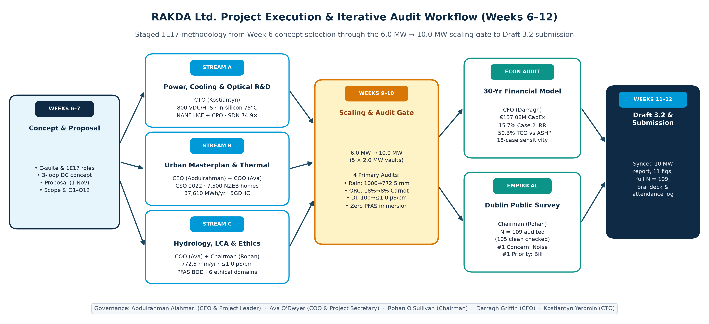

> **Figure 1.1 — Project Execution and Iterative Audit Workflow (Weeks 6–12)**
> *Branching schematic illustrating progression from Week 6 concept selection and Proposal (1 Nov) across three parallel research streams (Power/Cooling & Optical R&D; District Masterplan & Thermal Audit; Hydrology & Ethics), converging at the $6.0\text{ MW} \rightarrow 10.0\text{ MW}$ scaling gate before branching into the 30-year DCF financial model (€137.08M, $15.7\%$ IRR) and full audited Dublin resident survey ($N = 109$), and reuniting in Draft 3.2 (21 Nov) ahead of Week 12 submission.*

**Declaration of Tool Use:** In accordance with Trinity College Dublin's academic integrity policy, Grammarly was declared in the project proposal for grammar and clarity refinement, and generative AI tools were utilised to assist research structuring and document formatting. As documented in Section 3.10.9, no numerical figure was accepted without primary verification: every engineering parameter was audited against authoritative sources or explicitly classified as a design assumption, identifying and correcting early discrepancies in Dublin rainfall, ORC Carnot bounds, coolant conductivity, and immersion fluid chemistry.

**Table 1.2: Project schedule and verification log**

| Date / Milestone | Activity | Status |
| :--- | :--- | :--- |
| Week 6 (from 21 Oct 2026) | Team formation, executive role allocation, brainstorming, topic selection, and work-package definition | Completed |
| 28 Oct – 1 Nov 2026 | Project Proposal drafted (problem, stakeholders, scope, objectives, deliverables) and submitted for supervisor review | Completed *(approval date to be logged)* |
| 4–6 Nov 2026 | Detailed work-package assignment; initial thermal, hydrological, and urban-planning concepts documented | Completed |
| 12–15 Nov 2026 | Specialist research briefs (power/cooling, optical routing, waste heat, water, district study) and initial $6.0\text{ MW}$ technical synthesis | Completed |
| 17–19 Nov 2026 | Facility scaled to $10.0\text{ MW}$ baseline; 30-year financial feasibility and TCO model completed | Completed |
| 18–20 Nov 2026 | Anonymous Dublin resident acceptance survey deployed ($N = 109$ responses); executive biographies consolidated | Completed |
| 21 Nov 2026 | **Draft 3.2** finalised with full $N = 109$ survey audit (plus cleaned $N = 105$ check), 11 embedded figures, and reconciled fluid/unit/latency calculations | Completed (This Document) |
| Weeks 11–12 | Attach signed weekly attendance log (Appendix D), log supervisor proposal approval date, confirm lecturer initials in §4.2, and synchronise presentation deck to $10.0\text{ MW}$ | Planned |

---

## 2. Project Summary, Scope, Objectives, and Stakeholders

### 2.1 Executive Summary

Virtually $100\%$ of electrical power supplied to information technology (IT) equipment inside a data centre is converted into thermal energy. Conventional suburban facilities reject this heat to the atmosphere while evaporative cooling towers consume substantial volumes of municipal drinking water, even as adjacent neighbourhoods burn natural gas or draw additional grid electricity for residential space heating and domestic hot water (DHW). Global data-centre electricity demand is projected to reach approximately $945\text{ TWh}$ by 2030 (IEA, 2025). In Ireland, data centres consumed $6,969\text{ GWh}$ in 2024—accounting for **$22\%$ of all metered electricity** (Central Statistics Office, 2025)—while artificial intelligence (AI) workloads are driving cabinet power densities from roughly $11\text{ kW/rack}$ today toward $250\text{--}1,200\text{ kW/rack}$ by 2045.

RAKDA Ltd. evaluates an integrated circular alternative: embedding a **$10.0\text{ MW}$ liquid-cooled data centre** beneath a greenfield 2045 urban district of 20,000 residents (7,500 Nearly Zero Energy Building [NZEB] dwellings across $180\text{ ha}$ in a Dublin temperate oceanic climate). Partitioned into five modular $2.0\text{ MW}$ Level $-4$ bedrock vaults sited exclusively beneath pedestrian plazas and parking structures—never beneath residential load-bearing cores—the facility employs a **Dual-Regime Hybrid Cooling Architecture**: $80\%$ of IT heat is extracted via microscopic water channels etched directly into silicon dies (exiting at $75\text{--}80^\circ\text{C}$, projected $\text{PUE} \approx 1.015$), while the remaining $20\%$ is captured from memory, photonics, and voltage regulators at $45^\circ\text{C}$.

The engineering, lifecycle, financial, ethical, and empirical survey analyses presented in this report demonstrate that the proposed system is **theoretically feasible, socially viable when safety and affordability safeguards are visible, and economically compelling at the whole-system level, subject to clear operational and governance guardrails**:

1. **Thermal Sufficiency and Cold-Snap Security:** At $98\%$ thermal capture and full load, the $10.0\text{ MW}$ facility recovers **$85,848\text{ MWh}_\text{th}/\text{yr}$** ($9.80\text{ MW}_\text{th}$ continuous), supplying **$228.3\%$** of the 7,500-home annual heating demand ($37,610\text{ MWh}_\text{th}/\text{yr}$; $214.1\%$ of the 8,000-home $40,100\text{ MWh}_\text{th}/\text{yr}$ sensitivity check) and meeting the **$9.52\text{ MW}_\text{th}$** winter cold-snap peak independently without fossil boilers. Even under conservative conditions ($70\%$ average IT utilisation, $80\%$ thermal capture), recovered heat reaches $49,056\text{ MWh}_\text{th}/\text{yr}$ ($130.4\%$ of annual demand), whereas an earlier $6.0\text{ MW}$ sizing fell to $78\%$ under conservative load and incurred a $3.64\text{ MW}_\text{th}$ winter peak shortfall.
2. **Closed-Loop Water Conservation and Zero PFAS:** Replacing open evaporative towers with rainwater-fed in-silicon water cooling avoids **$157,680\text{--}175,200\text{ m}^3/\text{yr}$** of municipal potable water (saving €261.7k–€290.8k/yr at Uisce Éireann Band 3 supply tariffs) while eliminating synthetic fluorocarbon coolants beneath residential districts. Audited Dublin rainfall ($772.5\text{ mm/yr}$) yields $55,620\text{--}62,379\text{ m}^3/\text{yr}$ per $100,000\text{ m}^2$ of clean inert roof—amply exceeding closed-loop makeup requirements and confirming that semiconductor purity ($\le 1.0\text{ }\mu\text{S/cm}$) rather than gross volume is the binding hydrological constraint.
3. **Proximity Co-Benefits — Microsecond Networking and Electro-Thermal Routing:** Following verification of the primary thermal business case, the team investigated operational co-benefits enabled by vault proximity. Linking the five vaults via a $3.0\text{ km}$ Hollow-Core Fiber (HCF) ring and Co-Packaged Optics (CPO) reduces modelled transport round-trip latency by $99.9\%$ (from $3,135\text{ }\mu\text{s}$ to $3.17\text{ }\mu\text{s}$), localises $87.34\%$ of district data traffic, enables locally managed autonomous transit pods via $0.65\text{ ms}$ control loops, and allows Software-Defined Networking (SDN) to shift flexible compute across vaults to track local heat demand—**$74.9\text{ times}$** more energy-efficient than pumping hot water through pipes.
4. **30-Year Financial Bankability and Societal Savings:** Under 2045 central estimates, whole-system capital expenditure totals **€137.08M** (€57.73M Public/Utility District Infrastructure plus €79.35M Commercial Data-Centre Operator assets, including €15.30M for behind-the-meter solar PV and battery storage toward CRU grid compliance). Over 30 years (2045–2075), the combined project delivers **€22.201M/yr EBITDA**, an unsubsidised **$15.7\%$ IRR**, a **6.2-year simple payback**, and **€232.98M NPV** at a $4\%$ public discount rate (€105.07M at $8\%$). Undiscounted societal 30-year TCO (€498.57M) saves **€504.49M ($-50.3\%$)** relative to individual air-source heat pumps plus a suburban $\text{PUE } 1.56$ data centre, and **€456.83M ($-47.8\%$)** relative to gas boilers. Because an unsubsidised standalone district heat utility remains financially marginal ($3.7\%$ IRR), ring-fenced co-investment, a $30\%$ public capital grant, or a €1.000M/yr cooling-service fee is required.
5. **Empirical Resident Acceptance (Full $N = 109$ Survey):** Our anonymous Dublin resident survey (RAKDA Ltd., 2026f; $N = 109$ responses, verified against a cleaned $N = 105$ sensitivity cohort) validates these engineering priorities directly. Across valid rankings ($n = 98$), **$73.5\%$** selected either **cheapest heating bill ($41.8\%$)** or **24/7 winter reliability ($31.6\%$)** as their #1 district heating priority; **$72.0\%$** expressed positive comfort using recycled non-potable water (mean **$3.86 / 5.00$**, $n = 107$); comfort living above a liquid-cooled facility averaged **$3.19 / 5.00$** ($n = 108$; $46.3\%$ positive, $18.5\%$ neutral, $35.2\%$ low, i.e., $64.8\%$ positive or neutral); and **$87.8\%$** ranked tangible physical or water hazards first—led by **noise/vibration ($33.7\%$)**, **fire/electrical safety ($27.6\%$)**, and **water cross-contamination ($26.5\%$)**—directly informing our plaza-only Level $-4$ vault siting, $1.0\text{ m}$ vibration trenches, $<110\text{ dB}$ water-mist suppression, and I.S. EN 16941 physical air-gaps.

### 2.2 Problem Statement and Policy Context

* **Waste Heat and National Grid Constraints:** Because virtually all IT electricity degrades into heat, a data centre acts as a continuous, year-round thermal source. Conventional air-cooled facilities reject this heat at low temperatures ($25\text{--}35^\circ\text{C}$), historically limiting district reuse (Ebrahimi, Jones and Fleischer, 2014). In Ireland, where data centres account for $22\%$ of metered electricity ($6,969\text{ GWh}$ in 2024; CSO, 2025), Greater Dublin transmission constraints led to CRU Decision CRU/2025/236 (12 December 2025) and EirGrid's DCCOPP V3 (20 May 2026). Large Energy Users at or above $10\text{ MVA}$—encompassing our $10.0\text{ MW}$ IT / $10.15\text{ MW}_\text{e}$ ($\approx 10.68\text{ MVA}$ at $0.95$ power factor) facility—must provide dispatchable generation or storage matching $100\%$ of de-rated Maximum Import Capacity (MIC) participating in the Single Electricity Market (SEM), alongside $\ge 80\%$ annual electricity matched by new indigenous Irish renewables within six years (Arthur Cox, 2026; AKCP, 2026; DLA Piper, 2026).
* **High-Grade Liquid Recovery and Circularity:** Liquid cooling extracts heat directly adjacent to silicon junctions at markedly higher temperatures than air cooling (Ebrahimi, Jones and Fleischer, 2014; Yuan et al., 2023), with 2045 monolithic microfluidic projections reaching $75\text{--}80^\circ\text{C}$ (RAKDA Ltd., 2026b)—though not yet proven at district scale. Coupling high-grade liquid capture with fourth- and fifth-generation district heating enables data centres to operate as urban thermal "prosumers" (Lund et al., 2014; Buffa et al., 2019; Wahlroos et al., 2018; Huang et al., 2020), replacing linear "take, make, use, dispose" energy flows (Trinity College Dublin, 2026a).
* **European Directives and Irish Precedent:** The recast EU Energy Efficiency Directive (Directive (EU) 2023/1791) mandates waste-heat utilisation for data centres exceeding $1\text{ MW}$ total rated energy input unless demonstrated technically or economically infeasible (Covington & Burling LLP, 2025), reinforced nationally by Ireland's *Comprehensive Assessment of the Potential for Efficient Heating and Cooling* (SEAI, 2025). Ireland has an established operational precedent in South Dublin's Tallaght District Heating Scheme (Heat Works), which upgrades waste heat from an Amazon Web Services facility via heat pumps and delivered $3,770\text{ MWh}$ in its first year (Codema, 2026; Interreg Europe, 2026). Concurrently, EU F-Gas Regulation (EU) 2024/573 and impending ECHA PFAS restrictions are phasing out fluorocarbon immersion fluids and high-GWP refrigerants, while evaporative towers strain municipal water reserves during dry periods.
* **Central Engineering Question:** Estimated heating and DHW demand for a 20,000-resident NZEB district is $37,610\text{ MWh}_\text{th}/\text{yr}$ ($4.29\text{ MW}_\text{th}$ annual average; $9.52\text{ MW}_\text{th}$ winter cold-snap peak). Co-designing the district, vaults, thermal network, and rainwater plant from inception answers our core engineering question: **how can a 2045 urban district of 20,000 residents be engineered so that the waste heat, water streams, and compute capacity of an integrated subterranean data centre are recovered safely, reliably, ethically, and economically?**

### 2.3 Measurable Project Objectives (O1–O12)

Each objective in Table 2.1 defines a quantifiable engineering deliverable mapped to its analytical section and evaluated in the Section 4.1 scorecard.

**Table 2.1: Measurable project objectives mapped to evaluation sections**

| ID | Measurable Objective | Section |
| :--- | :--- | :--- |
| **O1** | Size IT capacity ($10.0\text{ MW}$), power delivery, rack count, and vault floor area of a 2045 district data centre to satisfy district thermal loads | §3.2 |
| **O2** | Compare annual recovered heat ($\text{MWh}_\text{th}/\text{yr}$) against district space-heating and DHW demand under base, realistic, and conservative operating cases | §3.4, §3.7 |
| **O3** | Compare winter-average, cold-snap peak, and summer heat loads ($\text{MW}_\text{th}$) with recovered output, and size peak thermal storage ($\text{m}^3$) | §3.4, §3.7 |
| **O4** | Establish safe DHW *Legionella* temperatures ($\ge 60^\circ\text{C}$) and quantify backup high-temperature heat pump (HTHP) COP and electricity demand ($\text{MWh}_\text{e}/\text{yr}$) | §3.4, §3.7 |
| **O5** | Quantify district heat-network distribution losses ($\text{MWh}_\text{th}/\text{yr}$ and $\%$ of demand) and primary cooling-loop pumping power ($\text{kW}_\text{e}$) | §3.3, §3.4 |
| **O6** | Quantify annual Dublin rainwater yield ($\text{m}^3/\text{yr}$), drought cistern volume, avoided cooling-tower water, and semiconductor purity criteria | §3.5 |
| **O7** | Quantify Carnot and practical electricity ($\text{MWh}_\text{e}/\text{yr}$) recoverable via ORC/TEG systems relative to non-electrical exergy cascades | §3.6 |
| **O8** | Assess technical feasibility, subterranean optical latency and SDN electro-thermal routing, vault safety isolation, and principal engineering risks | §3.3, §3.7, §3.12 |
| **O9** | Evaluate the 30-year lifecycle (2045–2075): embodied carbon, materials haulage, preventive maintenance, component replacement, and end of life | §3.8 |
| **O10** | Construct a 30-year CapEx, OpEx, and DCF financial model, counterfactual TCO comparison, and parametric sensitivity matrix | §3.9 |
| **O11** | Evaluate the design against the six 1E17 ethical domains, the Engineers Ireland Code of Ethics, and course lecture frameworks | §3.10 |
| **O12** | Identify stakeholders, capture empirical public perception through a resident survey, and trace findings directly into design decisions | §2.5, §3.11 |

### 2.4 Project Scope, Boundaries, and Operating Basis

This study represents a conceptual engineering design and desk-based feasibility assessment supported by primary public-perception survey data. It evaluates whether the integrated architecture is physically, socially, ethically, and financially sound and defines the engineering guardrails required for detailed design. It does not constitute a construction-ready specification: detailed piping and structural CAD drawings, geotechnical finite-element analyses, and 8,760-hour coupled transient simulations remain outside scope.

#### 2.4.1 Inclusions

* Demographic and spatial masterplanning for a $180\text{ ha}$ mixed-use district housing 20,000 residents (7,500 dwellings).
* Sizing of a $10.0\text{ MW}$ ($5 \times 2.0\text{ MW}$) subterranean liquid-cooled data centre, $800\text{ VDC}$/HTS power delivery, and annual, seasonal, and cold-snap thermal balances.
* Dual-regime heat capture ($75^\circ\text{C} / 45^\circ\text{C}$), HTHP fallback upgrading, hybrid 5GDHC/EN 253 thermal distribution, and building plate heat-exchanger (PHE) substations.
* Subterranean optical ring networking (NANF HCF + CPO), V2X latency compression for local autonomous transit pods, and SDN electro-thermal workload orchestration.
* Rainwater catchment segregation, drought cistern sizing, semiconductor ultrapure filtration ($\le 1.0\text{ }\mu\text{S/cm}$), and on-site electrochemical PFAS destruction.
* Second Law ORC/TEG evaluation, four-step Exergy-Priority Cascade, 30-year LCA (2045–2075), bottom-up CapEx/DCF/TCO financial modelling, six-domain ethical assessment, risk register, and Dublin resident survey analysis.

#### 2.4.2 Exclusions

* Municipal blackwater sewage treatment and residential greywater recycling (identified as a future circular expansion; RAKDA Ltd., 2026a).
* National high-voltage transmission reinforcements and external municipal water-main upgrades beyond the district boundary.
* Detailed structural, geotechnical finite-element, acoustic, and fire-engineering design of the Level $-4$ bedrock vaults.
* Internal building hydronic plumbing downstream of building PHE substations and proprietary semiconductor wafer fabrication.

#### 2.4.3 Technical and Geographical Boundaries

Geographically, the study models a hypothetical greenfield $180\text{ ha}$ ($1.80\text{ km}^2$) urban district situated in an Irish temperate oceanic climate; no physical site parcel has been selected, and Met Éireann Dublin Airport climate normals (Met Éireann, 2023) define weather inputs. Technically, the system boundary spans from the IT silicon coolant loops and optical switch fabric to building PHE substations, rainwater catchment roofs, behind-the-meter renewable and storage assets, and electrical grid export interfaces.

#### 2.4.4 Core Enabling Assumptions and Operating Conditions

The feasibility of this 2045 architecture rests on the following foundational design assumptions (audited in full in Table 3.4 and Appendix A):

* **Design Horizon:** Commissioning year **2045**, evaluated over a 30-year operational lifecycle (**2045–2075**).
* **Technology Maturity (2045):** Monolithic in-silicon microfluidic cooling ($75\text{--}80^\circ\text{C}$ primary outlet, $\text{PUE} \approx 1.015$), $800\text{ VDC}$ Solid-State Transformers, High-Temperature Superconducting (HTS) busways, Co-Packaged Optics (CPO), and Hollow-Core Fiber (HCF) reach commercial deployment by 2045. Where coolant temperature maturity carries technical risk, Scenario B ($45^\circ\text{C}$ coolant + HTHPs) guarantees operational continuity.
* **Compute Plant:** $10.0\text{ MW}$ IT capacity distributed across five $2.0\text{ MW}$ Level $-4$ bedrock vaults ($2.40\text{ MW}$ burst rating each); base case $98\%$ heat capture tested across conservative utilisation ($60\text{--}80\%$) and $80\%$ capture stress cases.
* **District Thermal Load:** 7,500 NZEB dwellings across $180\text{ ha}$ requiring $37,610\text{ MWh}_\text{th}/\text{yr}$ ($26,362\text{ MWh}_\text{th}/\text{yr}$ DHW + $11,250\text{ MWh}_\text{th}/\text{yr}$ space heating; 8,000-home upper check $= 40,100\text{ MWh}_\text{th}/\text{yr}$). DHW is stored at $\ge 60^\circ\text{C}$ for *Legionella* control (HSE, 2024; HPSC, 2009).
* **Grid Compliance:** Uninterrupted high-voltage connection complemented by behind-the-meter $12\text{ MW}_p$ solar PV, $8\text{ MW} / 32\text{ MWh}$ LFP BESS, $2.0\text{ MW}_\text{e}$ TI-PTES Carnot battery, and $\ge 80\%$ indigenous Irish renewable Corporate Power Purchase Agreements (CPPAs) per CRU/2025/236.

### 2.5 Stakeholders and Requirements Traceability

Stakeholders encompass all individuals and organisations who influence, or are affected by, the proposed district infrastructure. Statutory health, water, and grid regulators have been incorporated alongside end-users and commercial operators because their mandates directly govern engineering sizing. Qualitative influence is classified as High (H), Medium (M), or Low (L).

**Table 2.2: Stakeholder register, influence rating, and design traceability**

| Stakeholder Group | Core Interests and Requirements | Influence | Engineering Response / Capture Method |
| :--- | :--- | :--- | :--- |
| **Residents ($\approx 20,000$)** | Affordable heating bills, 24/7 winter reliability, fire/electrical and acoustic safety, potable water separation | M (H collectively) | Plaza-sited base-isolated vaults; $<110\text{ dB}$ water mist; I.S. EN 16941 air-gaps; regulated €95/$\text{MWh}_\text{th}$ tariff (€536/home/yr); **Dublin survey completed ($N = 109$, §3.11)** |
| **DC Operator & Compute Tenants** | $99.999\%+$ uptime; reliable microfluidic cooling; low energy/water OpEx; physical security; smooth 3–5 yr refreshes | H | N+1 independent dry coolers; 5-vault staggered refresh ($80\%$ live); MEP engineer interview protocol prepared (Appendix C) |
| **Technology Developers** | Viable commercial market for liquid cooling, HTS busways, and natural-refrigerant HTHPs; field performance validation | M | Technical literature synthesis, 2045 learning-curve bounding, and OEM data verification |
| **Local & Planning Authorities** | Compact Settlements compliance, EU EED waste-heat reuse, noise/safety standards, flood attenuation | H | $180\text{ ha}$ compact zoning ($83.3\text{ dph}$); blue-green roofs and swales; statutory planning review and Codema consultation protocol |
| **District Heat Utility Operator** | Thermal continuity during IT faults, stable network $\Delta T$, equitable metering, bankable tariff model | H | $217\text{ m}^3$ vault buffers + $2,500\text{ m}^3$ thermal store + $8.0\text{ MW}_\text{th}$ backup HTHPs; ring-fenced utility ownership; Heat Works benchmark |
| **Grid Operator & Regulator (EirGrid, ESB, CRU)** | Transmission adequacy, CRU/2025/236 $\ge 10\text{ MVA}$ dispatchability, SEM participation, $\ge 80\%$ new Irish renewables | H | $12\text{ MW}_p$ BTM PV + $8\text{ MW}/32\text{ MWh}$ BESS + $2.0\text{ MW}_\text{e}$ TI-PTES Carnot battery + renewable CPPAs |
| **Water & Environmental Regulators (Uisce Éireann, EPA)** | Stormwater quality, zero PFAS discharge, I.S. EN 16941 potable backflow protection | M–H | Inert roof segregation; on-site BDD/$\text{Ti}_4\text{O}_7$ PFAS mineralisation; physical air-gaps; regulatory guidance audit |
| **Health & Safety Bodies (HSE, HSA)** | *Legionella* control, scalding prevention, occupational, $\text{CO}_2$/ATEX, and subterranean fire safety | H (statutory) | Water-mist fire suppression ($<110\text{ dB}$); acoustic baffles; $\ge 60^\circ\text{C}$ DHW; continuous TOC and flow-cytometry monitoring |
| **Project Client (Prof. K. O'Kelly) & Course Team** | Rigorous, innovative, quantitative, and ethically grounded design satisfying the 1E17 rubric | H | Proposal supervision, milestone feedback, and transparent evidence auditing |

#### 2.5.1 Translating Stakeholder Requirements into Engineering Decisions

Stakeholder inputs—reinforced by our empirical resident survey (§3.11)—translate directly into quantifiable design criteria:
* Residents' two foremost priorities (heating affordability and 24/7 winter reliability) justify scaling the plant to $10.0\text{ MW}$, capping residential tariffs at €95.0/$\text{MWh}_\text{th}$ (€536/home/yr versus €1,040 for gas), and installing a $2,500\text{ m}^3$ thermal store alongside $8.0\text{ MW}_\text{th}$ of backup HTHPs.
* Residents' dominant perceived hazards (fire/electrical safety, noise/vibration, and water cross-contamination) dictate Level $-4$ bedrock plaza siting (never under residential cores), elastomeric base isolation ($-85\%$ vibration), $<110\text{ dB}$ water-mist fire suppression, QXG EMI shielding, $\ge 60^\circ\text{C}$ DHW pasteurisation, and I.S. EN 16941 physical air-gaps.
* Commercial uptime mandates N+1 independent dry coolers, while CRU's $\ge 10\text{ MVA}$ connection policy drives the €15.30M behind-the-meter PV and battery allocation (§3.9.1).

#### 2.5.2 Stakeholder Engagement Status

Table 2.3 distinguishes completed engagement activities from optional supplementary industry interviews. The resident acceptance survey exceeded its initial 30–50 response target, logging **$N = 109$ anonymous responses** in `Liquid-cooled data centre survey.xlsx` from 18 November 2026 onward (§3.11 and Appendix C).

**Table 2.3: Stakeholder engagement activities and execution status**

| Activity | Target Participants | Core Topics / Scope | Status |
| :--- | :--- | :--- | :--- |
| **Dublin Resident Acceptance Survey** (anonymous online Microsoft Form) | Dublin residents, Irish residents, and university students ($N = 109$ responses logged; target exceeded) | Comfort living above liquid-cooled DC; ranked heating priorities (cost, reliability, carbon, noise); recycled water comfort; ranked safety/privacy/bill concerns | **Completed** *(18–20 Nov 2026; §3.11)* |
| **Regulatory & Statutory Desk Review** | CRU, EirGrid, Dept. of Housing, EPA, HSE, Uisce Éireann, Codema, CCAC, SEAI | CRU/2025/236 rules, EU EED, *Legionella* codes, Compact Settlements density, Band 3 water tariffs, district heating CapEx | **Completed** *(Embedded in §2–§3)* |
| **Expert Interview: Data-Centre MEP Engineer** | One practising MEP engineer (optional validation) | Operational utilisation bands; achievable liquid-cooling $\Delta T$; heat-offtake SLAs; staggered vault refreshes | Protocol Ready (Appendix C) |
| **Expert Interview: District Heating Operator** | Codema or Heat Works Tallaght (optional validation) | Network temperatures, backup sizing, residential tariffs, operational lessons from AWS heat recovery | Protocol Ready (Appendix C) |

---

## 3. Technical Design, Engineering Analysis, and Assessment

### 3.1 Urban District Design Basis and Demographic Audit

To establish accurate thermal, hydrological, and digital loads, the 20,000-resident brief was audited against CSO Census 2022 household statistics, 2025 Irish dwelling completions, and the Department of Housing's 2024 *Sustainable Residential Development and Compact Settlements Guidelines* (RAKDA Ltd., 2026e). Every parameter in Table 3.1 is classified by evidence type so design choices remain distinct from statutory or empirical benchmarks.

At the Census 2022 national average of $2.74$ persons per private household (ranging from $2.48$ in Dublin City to $3.02$ in Fingal; Central Statistics Office, 2023), 20,000 residents correspond to 7,299 occupied households. Adopting **7,500 dwellings** across 3,095 buildings on **$180\text{ ha}$ ($1.80\text{ km}^2$)** incorporates a $\approx 2.7\%$ vacancy margin and establishes the primary design basis. Apartments represent $60\%$ of the housing mix (4,500 units across 95 blocks)—exceeding the $21.2\%$ apartment share in the existing urban stock at Census 2022 (Central Statistics Office, 2026), yet aligned with recent urban delivery where $69.4\%$ of new city dwellings completed in 2025 were apartments (RAKDA Ltd., 2026e; figure subject to final CSO table verification). An earlier 8,000-household estimate ($2.50$ persons/household) is retained as an upper-demand sensitivity check.

**Table 3.1: Reconciled $180\text{ ha}$ urban masterplan programme (20,000 residents, 7,500 dwellings)**

| Housing / Land Category | Units / Area | Buildings / Share | Occupancy, Density & Evidence Classification |
| :--- | :--- | :--- | :--- |
| Detached houses (2–3 floors) | 900 units | 900 bldgs ($22.5\text{ ha}$) | 3,200 res. ($3.56/\text{unit}$; $40\text{ dph}$) — Design assumption |
| Townhouses / semi-detached (2–3 fl.) | 2,100 units | 2,100 bldgs ($30.0\text{ ha}$) | 6,800 res. ($3.24/\text{unit}$; $70\text{ dph}$) — Design assumption |
| Low-rise apartments (3–4 fl.) | 1,200 units | 40 blocks ($12.0\text{ ha}$) | 3,000 res. ($2.50/\text{unit}$, 30/block; $100\text{ dph}$) — Design assumption |
| Mid-rise apartments (5–7 fl.) | 3,300 units | 55 blocks ($22.0\text{ ha}$) | 7,000 res. ($2.12/\text{unit}$, 60/block; $150\text{ dph}$) — Design assumption |
| **Total Residential Programme** | **7,500 units ($90.0\text{ ha}$)** | **3,095 bldgs ($50.0\%$)** | **20,000 res. ($2.67/\text{unit}$); $83.3\text{ dph}$ (within 50–250 dph urban guidance; includes $3.5\text{ ha}$ shared residential allowance)** |
| Roads, transit & pedestrian corridors | $36.0\text{ ha}$ | $20.0\%$ of district | Two-lane autonomous transit corridors and reclaimed pedestrian greenways |
| District parks & green space | $25.0\text{ ha}$ | $13.9\%$ gross | $12.5\text{ m}^2/\text{resident}$ *(note: $10\text{--}15\%$ Irish guideline applies to net residential site area)* |
| Schools & community facilities | $15.0\text{ ha}$ | $8.3\%$ of district | *Audit flag:* 4 primary ($1.60\text{ ha}$) + 2 secondary ($4.57\text{ ha}$) $= 15.54\text{ ha}$ (shortfall addressed in Appendix E) |
| Retail, offices & civic/utilities | $14.0\text{ ha}$ | $7.8\%$ of district | $9.0\text{ ha}$ retail/offices (3–4 clusters) + $5.0\text{ ha}$ civic/utilities |
| **Total District Area** | **$180.0\text{ ha}$** | **$100.0\%$** | **Gross district density: $111\text{ residents/ha}$** |

* **Thermal Demand Basis and Floor-Area Caveat:** By 2045, all new Irish dwellings must meet NZEB / Passive House thermal fabric performance (wall and roof $U \le 0.18\text{ W/m}^2\cdot\text{K}$). High-performance envelopes compress annual space heating to approximately $15\text{ kWh/m}^2\cdot\text{yr}$ across a nominal $100\text{ m}^2$ dwelling ($7,500 \times 100 \times 15 = 11,250\text{ MWh}_\text{th}/\text{yr}$). Domestic Hot Water (DHW), however, is governed by occupant consumption rather than insulation: $40\text{--}60\text{ L/person/day}$ stored at $\ge 60^\circ\text{C}$ requires $9.63\text{ kWh/home/day}$ ($7,500 \times 9.63 \times 365 = 26,362\text{ MWh}_\text{th}/\text{yr}$). DHW consequently represents **$70.1\%$** of the district's **$37,610\text{ MWh}_\text{th}/\text{yr}$** total thermal load (exact sum $11,250 + 26,362 = 37,612\text{ MWh}_\text{th}/\text{yr}$, rounded to the nearest $10\text{ MWh}$ for reporting and DCF tables; $40,100\text{ MWh}_\text{th}/\text{yr}$ rounded from $40,120\text{ MWh}_\text{th}/\text{yr}$ for 8,000 homes), producing a steady year-round thermal baseload suited to continuous data-centre operation. *Limitation:* Applying a uniform $100\text{ m}^2$ floor area across all dwellings simplifies the $60\%$ apartment stock and likely overestimates space heating slightly.
* **Land-Budget Screening:** As detailed in Appendix E, a Department of Education and Skills screening check indicates that schools alone require $\approx 15.54\text{ ha}$ before childcare or community centres. Prior to site freeze, this shortfall must be resolved through multi-storey urban school campuses or partial reallocation from the $36.0\text{ ha}$ road budget.

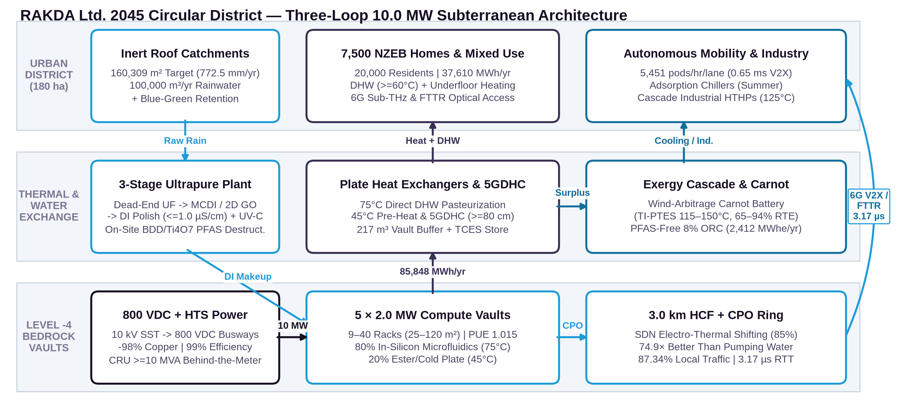

> **Figure 3.1 — Integrated Three-Loop $10.0\text{ MW}$ Subterranean Architecture**
> *System schematic illustrating the three closed loops across the $180\text{ ha}$ district: (1) Loop 1 Thermal Recovery routing $75^\circ\text{C}$ primary risers to building PHEs and stepped-down $45^\circ\text{C} \rightarrow 20\text{--}25^\circ\text{C}$ water through $30\text{ km}$ of 5GDHC piping backed by $8.0\text{ MW}_\text{th}$ HTHPs and a $2,500\text{ m}^3$ store; (2) Loop 2 Hydrological Cycle harvesting clean roof rainwater ($772.5\text{ mm/yr}$) through a $10,000\text{ m}^3$ cistern and $\le 1.0\text{ }\mu\text{S/cm}$ ultrapure train with BDD PFAS oxidation; and (3) Loop 3 Digital and Exergy Layer uniting five $2.0\text{ MW}$ Level $-4$ bedrock vaults via a $3.0\text{ km}$ NANF HCF ring ($3.17\text{ }\mu\text{s}$ RTT) and summer exergy cascades.*

---

### 3.2 2045 Compute Architecture, Power Delivery, and In-Silicon Cooling

#### 3.2.1 Rack Power Escalation ($11\text{ kW}$ to $1.2\text{ MW}$) and $800\text{ VDC}$ / HTS Power Delivery

Enterprise data-centre racks averaged $8.4\text{ kW}$ in 2020 and $\approx 11\text{ kW}$ in 2026, approaching the practical $10\text{--}20\text{ kW/rack}$ thermal limit of air cooling ($\approx 50\text{ W/cm}^2$ die flux). Generative AI workloads have driven rapid cabinet power escalation: NVIDIA Hopper HGX H100 reached $30\text{--}40\text{ kW/rack}$ ($70\text{--}100\text{ W/cm}^2$), Blackwell GB200 NVL72 reached $120\text{--}132\text{ kW/rack}$ ($150\text{--}200\text{ W/cm}^2$, mandating direct liquid cold plates), 2026 Vera Rubin VR200/CPX systems scale to $190\text{--}370\text{ kW/rack}$ ($250\text{--}400\text{ W/cm}^2$), and 2027–2028 Kyber Rubin Ultra vertical-blade cabinets target $600\text{ kW/rack}$ (RAKDA Ltd., 2026b). Extrapolating wafer-scale integration (Cerebras WSE-4 at $25\text{--}35\text{ kW/wafer}$ with $0.5\text{ mm}$ axial power delivery) and TSMC System-on-Wafer to 2045 yields standard urban AI cabinets of **$200\text{--}250\text{ kW/rack}$** and frontier 3D compute pods of **$600\text{--}1,200\text{ kW/rack}$** at die heat fluxes of $1,180\text{--}3,000+\text{ W/cm}^2$ ($9,000\text{--}15,000\text{ W/cm}^2$ in localised 3D hotspots).

At $600\text{--}1,200\text{ kW}$ per cabinet, conventional $415/480\text{ VAC}$ copper busbars incur excessive resistive ($I^2R$) losses and spatial bulk. Each subterranean vault therefore steps $10\text{ kV}$ utility feeds directly to **$800\text{ VDC}$** via Solid-State Transformers (SSTs)—delivering $>150\%$ more power per copper cross-section and eliminating $\approx 200\text{ kg}$ of copper busbar per rack—paired with **High-Temperature Superconducting (HTS) busways** ($30\text{--}77\text{ K}$; Tokamak Energy, 2026). HTS distribution reduces electrical conversion and conductor losses by $90\%$ (lifting delivery efficiency from $\approx 90\%$ to $99\%$) and displaces up to $98\%$ of facility copper.

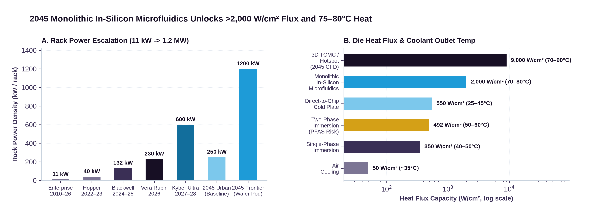

> **Figure 3.2 — Rack Power Escalation ($11\text{ kW}$ to $1.2\text{ MW}$) and Cooling Heat-Flux Regimes**
> *Comparative chart showing AI rack power progression from 2026 enterprise baselines through Hopper, Blackwell, Vera Rubin, Kyber Ultra, and 2045 frontier pods, paired with maximum removable die heat flux across air cooling ($\le 50\text{ W/cm}^2$), two-phase immersion ($\le 150\text{ W/cm}^2$, rejected due to PFAS), direct cold plates ($\le 400\text{ W/cm}^2$), and monolithic in-silicon microfluidics ($2,000\text{--}3,000\text{ W/cm}^2$).*

#### 3.2.2 Post-CMOS Efficiency and Thermodynamic Preference for Warm Silicon

Since 2010, compute energy-efficiency doubling has slowed from Koomey's Law ($1.57\text{ years}$) to $2.3\text{--}2.6\text{ years}$ ($\approx 16\times/\text{decade}$). Incremental CMOS scaling from a 2026 baseline of $25\text{ TOPS/W}$ reaches only $\approx 4,850\text{ TOPS/W}$ by 2045. Achieving the U.S. DOE EES2 roadmap target of **$25,000\text{ TOPS/W}$** ($1,000\times$ improvement) relies on six post-CMOS and non-von Neumann paradigms (U.S. DOE / NIST / SLAC, 2024–2026; RAKDA Ltd., 2026b): stacked CFET and 2D-TMD CMOS 2.0; monolithic 3D carbon-nanotube and RRAM stacks (avoiding the $52\text{ pJ/bit}$ off-chip DRAM energy wall); Co-Packaged Silicon Photonics ($3.2\text{--}200\text{ fJ/bit}$); spatial SRAM-only inference and neuromorphic processors; Analog In-Memory crossbars ($0.47\text{ fJ/op}$); and spintronic MESO logic ($10\text{ aJ/switch}$) alongside probabilistic p-bits.

Operating silicon warm ($75\text{--}85^\circ\text{C}$) to maximise district-heating utility imposes negligible fundamental compute penalty. Under Landauer's principle:

$$E_\text{Landauer} = k_B T \ln 2$$

elevating junction temperature from $300\text{ K}$ ($27^\circ\text{C}$) to $358.15\text{ K}$ ($85^\circ\text{C}$) increases the theoretical minimum bit-erasure energy by only **$19.4\%$**—from $2.871\text{ zJ}$ to $3.427\text{ zJ}$, five orders of magnitude below practical transistor switching energy. Conversely, cryogenic superconducting logic ($4.2\text{ K}$) demands kilowatts of room-temperature cryocooler input per milliwatt of logic and rejects low-grade ambient compressor heat. Warm-water post-CMOS hardware is therefore thermodynamically optimal for circular urban heat integration.

#### 3.2.3 Dual-Regime Cooling: Replacing Fluorocarbon Immersion with In-Silicon Microfluidics

Early design iterations evaluated two-phase fluorocarbon immersion tanks. Technical and regulatory auditing identified two disqualifying defects: fluorocarbons boil at $50\text{--}60^\circ\text{C}$ (below direct DHW pasteurisation requirements) and consist of persistent PFAS fluids subject to EU phase-out, while introducing subterranean asphyxiation hazards in the event of tank rupture.

The architecture therefore specifies **Dual-Regime Hybrid Cooling**:

* **Primary Loop ($80\%$ of IT heat — Monolithic In-Silicon Microfluidics):** Hierarchical manifold microchannels ($100\text{--}150\text{ }\mu\text{m}$ deep) are etched directly into the backside of the silicon die within $100\text{ }\mu\text{m}$ of active transistors, paired with cubic boron arsenide ($\text{c-BAs}$, $\approx 1,300\text{ W/m}\cdot\text{K}$) heat spreaders and electrocaloric spot coolers (Van Erp et al., 2020; RAKDA Ltd., 2026b). Eliminating thermal interface paste and copper cold plates reduces thermal resistance to $0.019\text{--}0.065\text{ K}\cdot\text{cm}^2/\text{W}$. Laboratory prototypes verified $>2,000\text{ W/cm}^2$ dissipation (up to $3,000\text{ W/cm}^2$ at $50\text{ kPa}$) at a $7.8\text{ kPa}$ pressure drop and cooling COP of $106,000$ (**projected $\text{PUE} \approx 1.015$**). Ultrapure rainwater enters at $50^\circ\text{C}$ and exits at **$75\text{--}80^\circ\text{C}$**, exceeding the $60^\circ\text{C}$ *Legionella* pasteurisation threshold directly. *(Audit caveat: sustaining $75\text{--}80^\circ\text{C}$ coolant output at $10.0\text{ MW}$ scale is a 2045 engineering projection not yet demonstrated commercially; Scenario B in §3.4 ensures full heating continuity if coolant temperatures are capped at $45^\circ\text{C}$.)*
* **Secondary Loop ($20\%$ of IT heat — Direct Cold Plates / Biodegradable Ester):** Captures thermal loads from HBM memory, optical transceivers, and voltage regulators at **$45^\circ\text{C}$** ($\Delta T = 15\text{ K}$) to preheat incoming cold municipal mains water before stepping down into the low-temperature 5GDHC network.

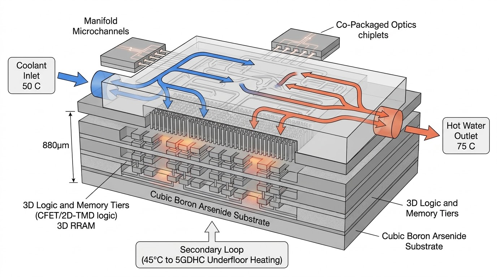

> **Figure 3.3 — 2045 Monolithic In-Silicon Microfluidic Die Stack Cutaway**
> *Technical cutaway of the 2045 logic package showing $50^\circ\text{C}$ ultrapure rainwater inlet through $100\text{--}150\text{ }\mu\text{m}$ backside-etched silicon microchannels exiting at $75\text{--}80^\circ\text{C}$, paired with a $\text{c-BAs}$ heat spreader, stacked logic/memory chiplets, Co-Packaged Optics (CPO), and the $45^\circ\text{C}$ secondary cold-plate loop.*

#### 3.2.4 District Compute Demand, City-Scale Replicability, and $10.0\text{ MW}$ Plant Sizing

Local compute demand across 20,000 residents is modelled at $750\text{ TFLOPS/resident}$ (**$15.0\text{ ExaFLOPS}$** sustained, $24.0\text{ ExaFLOPS}$ peak) across four civic pillars: personal AI and XR ($150\text{ TFLOPS/res}$), autonomous V2G transit and 6G sensing ($80\text{ TFLOPS/res}$), urban digital twin and material passports ($70\text{ TFLOPS/res}$), and municipal healthcare and enterprise cloud ($450\text{ TFLOPS/res}$). At $2,500\text{--}25,000\text{ TOPS/W}$, a **$10.0\text{ MW}$** facility delivers **$25\text{--}250\text{ ZettaOPS}$** (low-precision AI operations; INT4/FP8 equivalent)—satisfying $100\%$ of the $15.0\text{ ExaFLOPS}$ local FP16/FP32 civic demand while leasing **$>99.9\%$** of surplus AI capacity to commercial colocation tenants.

* **City-Scale Modularity:** Because each 20,000-resident district acts as a self-contained $10.0\text{ MW}$ thermal and digital cell, replicating this modular blueprint across a metropolitan area of 1,000,000 residents (50 integrated districts) yields **$500\text{ MW}$ of distributed urban compute ($1.25\text{--}12.5\text{ YottaOPS}$)** without constructing a single suburban gigawatt hyperscale campus—simultaneously decarbonising municipal heating across 375,000 homes and avoiding $7.9\text{--}8.8\text{ million m}^3/\text{yr}$ of evaporative cooling water.

Plant sizing is governed by **winter thermal reliability**. Table 3.2 compares $5.0\text{ MW}$, $6.0\text{ MW}$ (initial design iteration), and $10.0\text{ MW}$ configurations. Whereas a $6.0\text{ MW}$ plant covers annual average demand ($137.0\%$), it incurs a $3.64\text{ MW}_\text{th}$ cold-snap deficit and drops to $78.3\%$ annual coverage under conservative $70\%$ utilisation and $80\%$ capture. Selecting **$10.0\text{ MW}$ ($5 \times 2.0\text{ MW}$ modular vaults)** supplies $9.80\text{ MW}_\text{th}$ continuously—meeting the $9.52\text{ MW}_\text{th}$ winter peak independently—and retains $130.4\%$ annual coverage under conservative load. At $3.0\text{ m}^2$ gross IT floor per rack ($4.0\text{ m}$ ceiling height), the entire $10.0\text{ MW}$ IT hall requires only **$25\text{--}120\text{ m}^2$** (9–40 racks), or $\approx 250\text{--}400\text{ m}^2$ of total subterranean plant room across all five vaults.

**Table 3.2: Subterranean plant sizing comparison ($5.0\text{ MW}$, $6.0\text{ MW}$, and selected $10.0\text{ MW}$ baseline)**

| Sizing Metric | $5.0\text{ MW}$ IT Plant | $6.0\text{ MW}$ IT Plant (Initial Concept) | **$10.0\text{ MW}$ Plant (Selected: $5 \times 2.0\text{ MW}$)** |
| :--- | :--- | :--- | :--- |
| **Captured Heat ($98\%$ capture, full load)** | $42,924\text{ MWh}_\text{th}/\text{yr}$ ($4.90\text{ MW}_\text{th}$) | $51,509\text{ MWh}_\text{th}/\text{yr}$ ($5.88\text{ MW}_\text{th}$) | **$85,848\text{ MWh}_\text{th}/\text{yr}$ ($9.80\text{ MW}_\text{th}$)** |
| **Annual Coverage (7,500 / 8,000 homes)** | $114.1\%$ / $107.0\%$ | $137.0\%$ / $128.5\%$ | **$228.3\%$ / $214.1\%$** |
| **Conservative Coverage ($u=0.70, f_\text{cap}=0.80$)** | $65.2\%$ | $78.3\%$ | **$130.4\%$ ($49,056\text{ MWh}_\text{th}/\text{yr}$)** |
| **Winter Cold-Snap Margin (vs. $9.52\text{ MW}_\text{th}$)** | $-4.62\text{ MW}_\text{th}$ deficit | $-3.64\text{ MW}_\text{th}$ deficit | **$+0.28\text{ MW}_\text{th}$ surplus** |
| **Primary $75^\circ\text{C}$ Water Flow ($80\%$ gross, $\Delta T = 25\text{ K}$)** | $2,317.7\text{ L/min}$ ($38.63\text{ L/s}$) | $2,781.2\text{ L/min}$ ($46.35\text{ L/s}$) | **$4,635.3\text{ L/min}$ ($77.25\text{ L/s}$)** *(net $98\%$: $4,542.6\text{ L/min}$)* |
| **Secondary $45^\circ\text{C}$ Water Flow ($20\%$ gross, $\Delta T = 15\text{ K}$)** | $961.5\text{ L/min}$ ($16.03\text{ L/s}$) | $1,153.8\text{ L/min}$ ($19.23\text{ L/s}$) | **$1,923.1\text{ L/min}$ ($32.05\text{ L/s}$)** *(net $98\%$: $1,884.6\text{ L/min}$; ester opt.: $\approx 4,370\text{ L/min}$)* |
| **15-Min Vault Thermal Buffer ($\Delta T = 10\text{ K}$)** | $108.5\text{ m}^3$ | $130.2\text{ m}^3$ | **$217.0\text{ m}^3$ ($43.4\text{ m}^3$ per vault)** |
| **Racks & IT Floor ($250 / 600 / 1,200\text{ kW}$)** | 20 / 9 / 5 racks ($60\text{--}12.5\text{ m}^2$) | 24 / 10 / 5 racks ($72\text{--}15\text{ m}^2$) | **40 / 17 / 9 racks ($120\text{--}25\text{ m}^2$)** |
| **Compute Output ($2,500\text{--}25,000\text{ TOPS/W}$)** | $12.5\text{--}125\text{ ZettaOPS}$ | $15\text{--}150\text{ ZettaOPS}$ | **$25\text{--}250\text{ ZettaOPS}$ ($>99.9\%$ leasable)** |

---

### 3.3 Subterranean Isolation, Optical Latency Compression, and Electro-Thermal Routing

Once the primary thermal recovery case was established, RAKDA Ltd. investigated secondary urban advantages unlocked by embedding compute vaults directly beneath the district—specifically microsecond edge connectivity, locally managed autonomous mobility, and optical thermal load balancing.

#### 3.3.1 Physical Isolation and Resident Safety

Each $2.0\text{ MW}$ vault occupies Level $-4$ bedrock ($Z = -8.0\text{ m}$ to $-12.0\text{ m}$) exclusively beneath pedestrian plazas or commercial parking decks—never beneath residential structural cores—to sever vertical vibration and acoustic transmission paths (RAKDA Ltd., 2026d):

* **Vibration Attenuation:** Floating reinforced concrete floor slabs mounted on elastomeric base-isolation bearings, combined with $1.0\text{ m}$ foam-filled perimeter trenches, attenuate $85\%$ of low-frequency ($31.5\text{--}125\text{ Hz}$) pump and transformer vibration.
* **Acoustic-Safe Fire Suppression:** Conventional inert-gas discharges generate $130\text{--}145\text{ dB}$ acoustic shockwaves that damage legacy hard drives above $110\text{ dB}$ and create basement asphyxiation hazards. Specifying solid-state 3D RRAM storage paired with acoustically baffled low-pressure water-mist suppression constrains discharge noise to $<110\text{ dB}$ while protecting vault personnel.
* **Electromagnetic Shielding:** QXG-shielded switchgear enclosures around $800\text{ VDC}$ Solid-State Transformers contain electromagnetic interference within the bedrock shell.

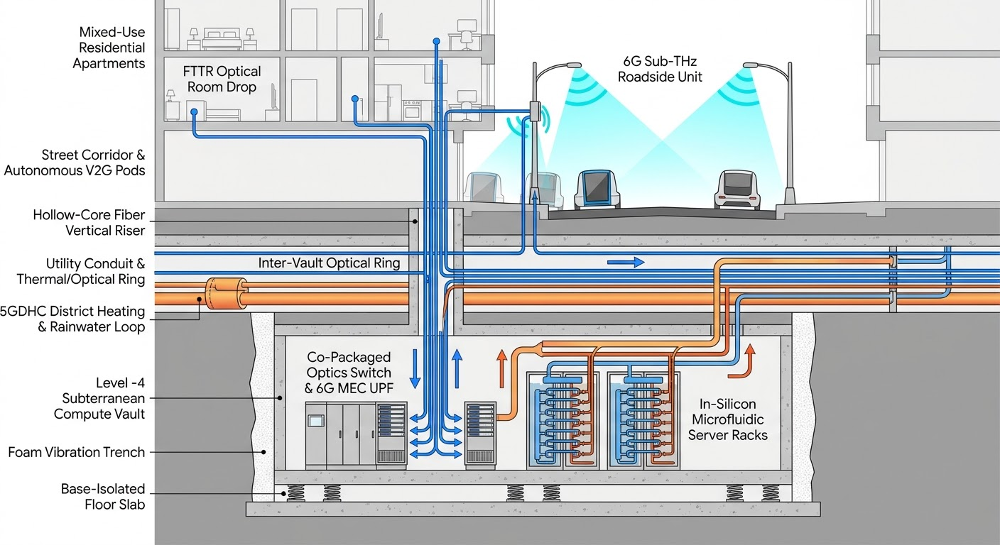

> **Figure 3.4 — Level $-4$ Bedrock Compute Vault Structural, Acoustic, and Safety Cross-Section**
> *Cross-section of one $2.0\text{ MW}$ subterranean vault sited exclusively beneath a pedestrian plaza ($Z = -8.0\text{ m}$ to $-12.0\text{ m}$), illustrating floating reinforced-concrete floor slabs on elastomeric base-isolation bearings ($-85\%$ vibration), $1.0\text{ m}$ foam-filled perimeter trenches, QXG-shielded $800\text{ VDC}$ switchgear, and $<110\text{ dB}$ low-pressure water-mist fire suppression.*

#### 3.3.2 Optical Latency Compression and $87.34\%$ Traffic Localisation

Distributing five vaults across $180\text{ ha}$ yields an average catchment zone of $36\text{ ha}$ (effective service radius $\approx 339\text{ m}$), interconnected by a **$3.0\text{ km}$ Nested Anti-Resonant Nodeless Hollow-Core Fiber (NANF HCF)** ring. Because light propagates through an air core ($n_g \approx 1.00$, $3.33\text{ }\mu\text{s/km}$) rather than solid silica ($n_g \approx 1.47$, $4.90\text{ }\mu\text{s/km}$) and terminates directly onto cut-through **Co-Packaged Optics (CPO)** switch fabrics (bypassing 5–6 metro router hops), modelled pure transport round-trip time (RTT) drops **$99.9\%$**—from $3,135\text{ }\mu\text{s}$ ($75\text{ km}$ regional cloud) to **$3.17\text{ }\mu\text{s}$** ($0.25\text{ km}$ average riser; Table 3.3).

Co-locating 6G Open-RAN Distributed Units (O-DUs), Multi-Access Edge Computing (MEC) User Plane Functions (UPFs), and 50G/100G-PON Fiber-to-the-Room (FTTR) optical line terminals inside the vaults consumes $<2\%$ of the $100\text{ }\mu\text{s}$ eCPRI fronthaul budget, delivering **$143.2\text{ }\mu\text{s}$** end-to-end wireless RTT and **$48.2\text{ }\mu\text{s}$** fixed FTTR RTT. Using Information-Centric Networking (ICN) and Segment Routing over IPv6 (SRv6), **$87.34\%$** of the district's $20.00\text{ Tbps}$ sustained data traffic ($17.47\text{ Tbps}$) remains local—consuming $0.87\text{ kW}$ ($7.7\text{ MWh}_\text{e}/\text{yr}$) internally and avoiding **$183.6\text{--}726.8\text{ MWh}_\text{e}/\text{yr}$** (midpoint $455\text{ MWh}_\text{e}/\text{yr}$) of external metro telecom power. Optical rings are protected by 100G Post-Quantum Cryptography (Falcon/Dilithium/Kyber IPsec) and Optical Frequency Domain Reflectometry (OFDR) millimetre-scale fault detection.

**Table 3.3: Modelled 2045 network latency comparison — regional cloud versus subterranean HCF + CPO vaults**

| Deployment Tier (Modelled 2045) | One-Way Route | Medium ($n_g$) | Pure Net RTT | 6G V2X / XR E2E RTT | Fixed FTTR E2E RTT | Tail Jitter |
| :--- | :--- | :--- | :--- | :--- | :--- | :--- |
| Regional Core Cloud (6 hops) | $75.0\text{ km}$ | G.652.D SMF ($1.47$) | $3,135.0\text{ }\mu\text{s}$ | $7.64\text{ ms}$ | $6.34\text{ ms}$ | $\pm 1,850\text{ }\mu\text{s}$ |
| Suburban Hyperscale (4 hops) | $25.0\text{ km}$ | G.652.D SMF ($1.47$) | $1,095.0\text{ }\mu\text{s}$ | $2.70\text{ ms}$ | $2.20\text{ ms}$ | $\pm 420\text{ }\mu\text{s}$ |
| Subterranean Vault (Avg Riser, SMF) | $0.25\text{ km}$ | G.657 SMF ($1.47$) | $6.95\text{ }\mu\text{s}$ | $167.0\text{ }\mu\text{s}$ | $72.0\text{ }\mu\text{s}$ | $\pm 8.0\text{ }\mu\text{s}$ |
| **Subterranean Vault (HCF + CPO)** | **$0.25\text{ km}$** | **NANF HCF ($\approx 1.00$)** | **$3.17\text{ }\mu\text{s}$** | **$143.2\text{ }\mu\text{s}$** | **$48.2\text{ }\mu\text{s}$** | **$\pm 2.5\text{ }\mu\text{s}$** |
| Inter-Vault Ring Hop (Vault A $\rightarrow$ B) | $1.00\text{ km}$ | NANF HCF ($\approx 1.00$) | $8.16\text{ }\mu\text{s}$ | — *(East–West sync)* | — | $\pm 1.2\text{ }\mu\text{s}$ |

#### 3.3.3 Autonomous Transit Pods and $74.9\times$ Electro-Thermal Workload Shifting

Vault proximity enables locally managed autonomous transit pods by offloading heavy perception and trajectory compute from individual vehicles directly into the subterranean edge nodes. Pairing $143.2\text{ }\mu\text{s}$ wireless RTT with $0.50\text{ ms}$ edge neural inference establishes a **$0.65\text{ ms}$** V2X control loop. At $50\text{ km/h}$ ($13.89\text{ m/s}$), a pod travels only **$9.0\text{ mm}$** blind during the $0.65\text{ ms}$ local control loop—compared with $106\text{ mm}$ during the $7.64\text{ ms}$ regional-cloud transport RTT alone (Table 3.3) and up to **$1.25\text{ m}$** across a full $\approx 90\text{ ms}$ multi-tenant cloud control loop including broker queuing and remote batch inference—permitting string-stable $0.25\text{ s}$ Cooperative Adaptive Cruise Control (CACC) headways ($4.97\text{ m}$ spacing), expanding single-lane throughput **$3.65\times$** (from 1,494 to $5,451\text{ pods/hr/lane}$), and reducing Slot-Based Intersection saturation delay by **$97.4\%$** ($99.76\text{ s}$ to $2.57\text{ s}$).

Equally significant for district energy efficiency is **electro-thermal workload shifting**. Of the $10.0\text{ MW}$ IT capacity, $15\%$ ($1.50\text{ MW}$) is location-pinned (6G baseband and traffic control), while **$85\%$ ($8.50\text{ MW}$)** comprises flexible cloud inference, digital-twin simulation, and batch training. Migrating $1.0\text{ MW}$ of flexible compute ($5.0\text{ Tbps}$) across $1.2\text{ km}$ of the HCF + CPO ring consumes **$250\text{ W}$**. Pumping $1.0\text{ MW}_\text{th}$ of $75^\circ\text{C}$ hot water over the same $1.2\text{ km}$ ($2,400\text{ m}$ round-trip) incurs $1,930\text{ W}$ of pump shaft power plus $16,800\text{ W}$ of pipe heat loss (**$18,730\text{ W}$** total)—making optical bit routing **$74.9\times$ more energy-efficient** than hydronic heat transport.

With three vaults positioned beneath residential clusters and two beneath the central commercial/educational hub (each rated to $2.40\text{ MW}$ burst), the SDN orchestrator matches diurnal heat demand via SRv6 live migration:

* **Morning & Evening Residential Peaks (06:00–09:00, 17:30–22:00):** Residential vaults ramp to $2.35\text{ MW}$ each ($7.05\text{ MW}$ IT / $6.91\text{ MW}_\text{th}$), while commercial vaults throttle to $1.475\text{ MW}$ each ($2.95\text{ MW}$ IT).
* **Midday Commercial & School Peak (09:00–16:30):** Commercial/school vaults ramp to $2.35\text{ MW}$ each ($4.70\text{ MW}$ IT / $4.61\text{ MW}_\text{th}$), while residential vaults settle to $1.77\text{ MW}$ each ($5.30\text{ MW}$ IT) to recharge thermal buffers.
* **Overnight Wind-Surplus Window (23:00–05:30):** Delay-tolerant batch training absorbs curtailed Irish wind generation, pre-charging the $217\text{ m}^3$ vault buffers and $2,500\text{ m}^3$ district thermal store.

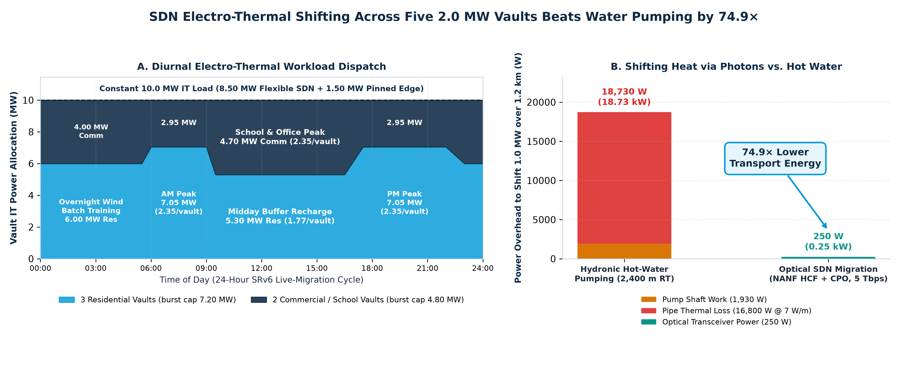

> **Figure 3.5 — Diurnal SDN Electro-Thermal Workload Shifting and $74.9\times$ Transport Efficiency Ratio**
> *Dual operational visual displaying: (A) 24-hour SRv6 live-migration dispatch of the $8.50\text{ MW}$ flexible compute pool across three residential vaults (burst cap $7.20\text{ MW}$) and two commercial/school vaults (burst cap $4.80\text{ MW}$); and (B) transport energy overhead to shift $1.0\text{ MW}$ over $1.2\text{ km}$, comparing hydronic hot-water pumping ($18,730\text{ W}$ combined shaft work and pipe heat loss) against NANF HCF + CPO optical workload migration ($250\text{ W}$, **$74.9\times$ lower**).*

---

### 3.4 Closed-Loop Thermal Energy Balance and Hybrid 5GDHC Network

Annual recoverable thermal energy is governed by:

$$Q_\text{rec} = P_\text{IT} \cdot u \cdot f_\text{cap} \cdot t$$

where $P_\text{IT} = 10.0\text{ MW}$, $u$ is average IT utilisation, $f_\text{cap}$ is thermal capture fraction, and $t = 8,760\text{ h/yr}$:

* **Base Case ($u = 1.00, f_\text{cap} = 0.98$):** $Q_\text{rec} = 85,848\text{ MWh}_\text{th}/\text{yr}$ ($9.80\text{ MW}_\text{th}$ continuous) — **$228.3\%$** of 7,500-home demand ($37,610\text{ MWh}_\text{th}/\text{yr}$) and **$214.1\%$** of 8,000-home demand ($40,100\text{ MWh}_\text{th}/\text{yr}$).
* **Realistic Cloud Utilisation ($u = 0.80, f_\text{cap} = 0.98$):** $Q_\text{rec} = 68,678\text{ MWh}_\text{th}/\text{yr}$ (**$182.6\%$** coverage; $7.84\text{ MW}_\text{th}$ continuous).
* **Conservative Stress Case ($u = 0.70, f_\text{cap} = 0.80$):** $Q_\text{rec} = 49,056\text{ MWh}_\text{th}/\text{yr}$ (**$130.4\%$** of 7,500-home demand; $122.3\%$ of 8,000-home demand).
* **Annual Break-Even Utilisation:** $u = 37,610 / 85,848 = \mathbf{43.8\%}$ at $98\%$ capture, or **$53.7\%$** at $80\%$ capture ($46.7\%$ and $57.2\%$ for 8,000 homes).

#### Hybrid 5GDHC and Local EN 253 Thermal Cascade

Earlier design reviews noted a thermal conflict between uninsulated near-ambient 5GDHC loops (where the $7.0\text{ W/m}$ loss benchmark applies; Buffa et al., 2019) and insulated high-temperature 4GDH networks (Lund et al., 2014). The final architecture resolves this via a **hybrid two-tier cascade**:

1. **Primary $75^\circ\text{C}$ Water Loop ($8.00\text{ MW}$ gross / $7.84\text{ MW}_\text{th}$ net at $98\%$ capture; $4,635.3\text{ L/min}$ gross design flow, $4,542.6\text{ L/min}$ net):** Routed strictly via short, **pre-insulated EN 253 risers** from each nearby vault to local building Plate Heat Exchangers (PHEs), pasteurising DHW to $\ge 60^\circ\text{C}$ (delivering $50^\circ\text{C}$ at outlets within one minute; HSE, 2024; HPSC, 2009) without continuous heat-pump lifting. At the $4,635.3\text{ L/min}$ ($77.25\text{ L/s}$) gross design flow, $\Delta p = 200\text{ kPa}$, and $\eta_p = 0.70$, primary-loop pumping requires **$22.1\text{ kW}_\text{e}$** ($\approx 194\text{ MWh}_\text{e}/\text{yr}$, or $0.22\%$ of IT power).
2. **Secondary $45^\circ\text{C}$ Water Loop ($2.00\text{ MW}$ gross / $1.96\text{ MW}_\text{th}$ net; $1,923.1\text{ L/min}$ gross water design flow, $1,884.6\text{ L/min}$ net at $\Delta T = 15\text{ K}$; $\approx 4,370\text{ L/min}$ if operated on biodegradable synthetic ester):** First preheats incoming $\approx 12^\circ\text{C}$ Dublin municipal mains water at the vault/substation heat exchangers, stepping coolant temperature down into the near-ambient 5GDHC operating band ($20\text{--}25^\circ\text{C}$) prior to entering $\approx 30\text{ km}$ of uninsulated twin-pipe HDPE distribution mains ($25\text{--}40\text{ mm}$ pipes spaced $\ge 80\text{ cm}$ apart to prevent $20\%$ ground thermal-plume interference). Maintaining near-ambient pipe temperatures preserves the $\approx 7.0\text{ W/m}$ linear loss rate, totalling **$1,840\text{ MWh}_\text{th}/\text{yr}$ ($4.9\%$ of annual demand)**. Any direct $45^\circ\text{C}$ sub-mains feeding underfloor heating without prior mains-preheating step-down must be pre-insulated.

#### Seasonal Balance, Cold-Snap Security, and Scenario B Fallback

Across 7,500 homes, DHW establishes a **$3.01\text{ MW}_\text{th}$** year-round baseload, rising to **$5.61\text{ MW}_\text{th}$** winter average (180-day heating season) and **$9.52\text{ MW}_\text{th}$** during winter cold-snap peaks ($5.99\text{ MW}_\text{th}$ average / $10.15\text{ MW}_\text{th}$ peak for 8,000 homes). At full load, the $9.80\text{ MW}_\text{th}$ output covers the $9.52\text{ MW}_\text{th}$ peak with a $+0.28\text{ MW}_\text{th}$ margin. To guarantee uninterrupted heating during a $60\text{--}80\%$ utilisation cold snap ($1.68\text{--}3.64\text{ MW}_\text{th}$ deficit), the utility deploys a **$2,500\text{--}2,700\text{ m}^3$ insulated hot-water thermal store** ($\Delta T = 30\text{ K}$, storing $\approx 87\text{--}94\text{ MWh}_\text{th}$ for a full peak day), $217.0\text{ m}^3$ of 15-minute vault ride-through buffers, and **$8.0\text{ MW}_\text{th}$ of backup natural-refrigerant High-Temperature Heat Pumps (HTHPs: R744, R718, R600)** (Arpagaus et al., 2018).

Under a conservative **Scenario B fallback** capping silicon coolant at $45^\circ\text{C}$ instead of $75^\circ\text{C}$, the HTHPs upgrade DHW from an evaporating temperature of $40^\circ\text{C}$ ($313.15\text{ K}$) to a condensing temperature of $70^\circ\text{C}$ ($343.15\text{ K}$) (Çengel, Boles and Kanoğlu, 2019):

$$\text{COP}_\text{Carnot} = \frac{T_H}{T_H - T_L} = \frac{343.15}{30} = 11.44$$

Applying a realistic practical efficiency band ($40\text{--}60\%$ of Carnot) yields **$\text{COP} = 4.6\text{--}6.9$**, requiring **$3,840\text{--}5,760\text{ MWh}_\text{e}/\text{yr}$** ($0.44\text{--}0.66\text{ MW}_\text{e}$ continuous, or $\approx 4.3\text{--}6.5\%$ of gross IT electricity) to upgrade all $26,362\text{ MWh}_\text{th}/\text{yr}$ of DHW. Conversely, the 185-day summer period yields **$30,148\text{ MWh}_\text{th}$** of surplus heat ($48,238\text{ MWh}_\text{th}/\text{yr}$ net annual surplus; $45,748\text{ MWh}_\text{th}/\text{yr}$ at 8,000 homes), dispatched through the Exergy-Priority Cascade (§3.6) and backed by independent N+1 dry coolers so server thermal safety never depends on residential heat draw.

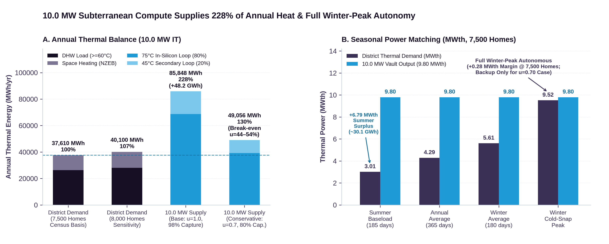

> **Figure 3.6 — Annual Thermal Energy Balance and Seasonal $\text{MW}_\text{th}$ Peak Demand Matching ($10.0\text{ MW}$ Baseline)**
> *Dual quantitative chart comparing: (A) annual recovered thermal supply ($85,848\text{ MWh}_\text{th}$ base / $49,056\text{ MWh}_\text{th}$ conservative) against the 7,500-home NZEB annual load ($37,610\text{ MWh}_\text{th}$, $228.3\%$ base / $130.4\%$ conservative coverage); and (B) seasonal thermal power demand across Summer DHW ($3.01\text{ MW}_\text{th}$), Annual Average ($4.29\text{ MW}_\text{th}$), Winter Average ($5.61\text{ MW}_\text{th}$), and Winter Cold Snap ($9.52\text{ MW}_\text{th}$) against $10.0\text{ MW}$ plant output ($9.80\text{ MW}_\text{th}$) and the $60\%$ stress-case threshold ($5.88\text{ MW}_\text{th}$).*

---

### 3.5 Hydrological Mass Balance, Rainwater Harvesting, and Ultrapure Filtration

Conventional evaporative cooling towers consume $1.8\text{--}2.0\text{ L/kWh}_\text{IT}$ (blended WUE to tower WUE). At $10.0\text{ MW}$ continuous IT load, closed-loop rainwater microfluidic cooling avoids **$157,680\text{--}175,200\text{ m}^3/\text{yr}$** of potable municipal water—saving **€261,749–€290,832/yr** (midpoint **€276.3k/yr**) at Uisce Éireann's 2026/27 Band 3 supply rate of €1.66/$\text{m}^3$, while eliminating €2.38/$\text{m}^3$ wastewater blowdown fees (Uisce Éireann / CRU, 2026).

#### Dublin Rainfall Audit and Catchment Segregation

Auditing an early $1,000\text{ mm/yr}$ assumption against Met Éireann's 1991–2020 Dublin Airport long-term average of **$772.5\text{ mm/yr}$** (Met Éireann, 2023) revises net harvestable yield on a $100,000\text{ m}^2$ roof catchment ($C_r = 0.80$, filter efficiency $\eta_f = 0.90$) to **$55,620\text{ m}^3/\text{yr}$** (up to **$62,379\text{ m}^3/\text{yr}$** on smooth metal/PV roofs at $0.85 \times 0.95$; RAKDA Ltd., 2026c). Delivering $100,000\text{ m}^3/\text{yr}$ requires expanding clean inert roof catchments to **$\approx 160,309\text{ m}^2$** ($8.9\%$ of the $180\text{ ha}$ district).

Because closed-loop cooling makeup consumes $<2\%$ of harvested volume, **water quality rather than gross quantity is the binding engineering constraint**. Catchment runoff is segregated into three discrete streams:

1. **Inert Elevated Roofs (Slate, Metal, PV):** Dedicated feedstock for the cooling-water treatment train owing to minimal microplastic and tyre-wear particulate loads.
2. **Multilayer Blue-Green Roofs ($54\text{ L/m}^2$ retention):** Attenuate Ireland's projected $+24\%$ winter storm-rainfall surge (Met Éireann, 2025), but discharge elevated Chemical Oxygen Demand (COD) prone to microchannel biofouling; routed strictly to landscape irrigation and toilet flushing.
3. **Roadways and Permeable Pavements:** Excluded from server cooling due to heavy metal, microplastic, and polycyclic aromatic hydrocarbon (PAH) loads; treated via engineered bioretention swales ($90\text{--}95\%$ PAH attenuation).

#### Ultrapure Treatment Train, PFAS Mineralisation, and Drought Storage

Subterranean reinforced-concrete cisterns sized at **$10,000\text{ m}^3$** (within the $8,220\text{--}12,330\text{ m}^3$ design band) isolate a cool cooling-water reserve sized for 45–66 day Dublin dry spells (thermally isolated from hot buffers to prevent *Legionella* proliferation), while supplying $\approx 50,000\text{ m}^3/\text{yr}$ of surplus treated rainwater for district non-potable uses (saving €83k/yr in municipal supply charges) behind **I.S. EN 16941 Type AA/AB physical air-gaps**.

Importantly, the preliminary $\le 100\text{ }\mu\text{S/cm}$ conductivity threshold (VDI 2035 building heating standard) is unsuitable for $50\text{--}100\text{ }\mu\text{m}$ etched silicon microchannels. Because rainwater now carries atmospheric PFAS (Cousins et al., 2022) and roof runoff introduces trace metals and microplastics (RAKDA Ltd., 2026c), a three-stage purification train polishes cooling makeup to semiconductor Grade C (**$\le 1.0\text{ }\mu\text{S/cm}$**, $1\text{--}18.2\text{ M}\Omega\cdot\text{cm}$, $\le 0.2\text{--}1.0\text{ }\mu\text{m}$ filtration, $\text{SiO}_2 \le 1.0\text{ ppm}$, metals $\le 0.10\text{ ppm}$):

1. **Ultrafiltration (UF):** Dead-end hollow-fibre membranes ($90\text{--}95\%$ recovery, $<0.1\text{ kWh/m}^3$) removing particulates, colloids, and microplastics.
2. **Membrane Capacitive Deionisation (MCDI):** Desalination and ion removal ($84\%$ recovery, $0.234\text{ kWh/m}^3$, $-85\%$ chemical regenerants) or 2045 2D graphene-oxide / MXene membranes.
3. **Polishing, Disinfection, and On-Site PFAS Destruction:** Mixed-bed deionisation polishing, mercury-free UV-C LED disinfection, continuous Total Organic Carbon (TOC) and flow-cytometry alarms, and **on-site Boron-Doped Diamond (BDD) / $\text{Ti}_4\text{O}_7$ electrochemical oxidation** to mineralise captured PFAS concentrates on site rather than transferring hazardous waste to landfill. Compact PNIPAM–MOF atmospheric water harvesters (regenerated at $\approx 40^\circ\text{C}$ using the $45^\circ\text{C}$ loop) provide auxiliary drought resilience.

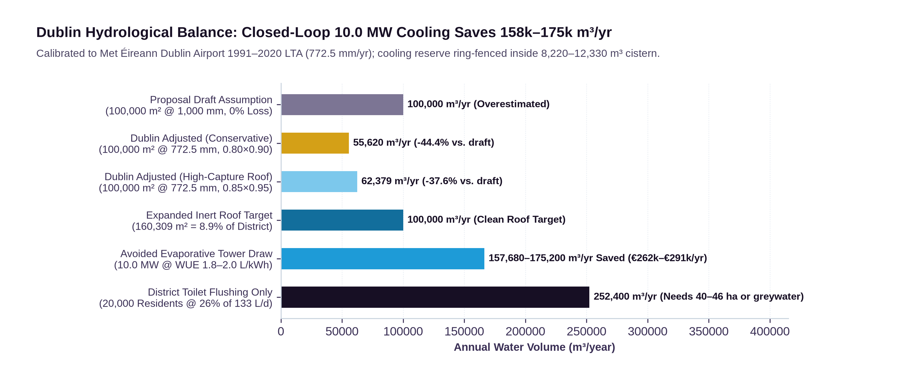

> **Figure 3.7 — Dublin Hydrological Mass Balance ($772.5\text{ mm/yr}$) and Evaporative Water Displacement**
> *Quantitative hydrological comparison illustrating audited Dublin Airport rainwater yields ($55,620\text{--}62,379\text{ m}^3/\text{yr}$ per $100,000\text{ m}^2$ clean inert roof; $100,000\text{ m}^3/\text{yr}$ at $160,309\text{ m}^2$), $10,000\text{ m}^3$ drought-buffer cistern sizing, and avoided municipal potable water ($157,680\text{--}175,200\text{ m}^3/\text{yr}$) achieved by replacing open evaporative towers with closed-loop ultrapure ($\le 1.0\text{ }\mu\text{S/cm}$) microfluidic cooling.*

---

### 3.6 Waste-Heat-to-Power (ORC/TEG) and the Exergy-Priority Cascade

Auditing preliminary $10\text{--}18\%$ ORC efficiency assumptions against the Second Law of Thermodynamics confirms tight theoretical bounds on direct electricity generation from $75^\circ\text{C}$ coolant. Against a $12.5^\circ\text{C}$ ($285.65\text{ K}$) Dublin rainwater cold sink, the Carnot ceiling at $75^\circ\text{C}$ ($348.15\text{ K}$) is:

$$\eta_\text{Carnot} = 1 - \frac{285.65}{348.15} = 17.95\%$$

Practical PFAS-free Organic Rankine Cycles operating with natural working fluids (cyclopentane or $\text{CO}_2$) achieve $42\text{--}48\%$ of Carnot—**$7.5\%$ to $8.6\%$ net electrical efficiency** ($\approx 8.0\%$ central). Across the $30,148\text{ MWh}_\text{th}$ 185-day summer surplus, an un-cascaded micro-ORC is capped at **$2,412\text{ MWh}_\text{e}/\text{yr}$** ($\approx 543\text{ kW}_\text{e}$ summer output, or $\approx 418\text{--}440\text{ kW}_\text{e}$ annualised). Similarly, skutterudite thermoelectric generators (TEGs) peak at $200\text{--}500^\circ\text{C}$; tellurium-free $\alpha\text{-MgAgSb} / \text{Mg}_3(\text{Bi,Sb})_2$ modules fit the $300\text{--}353\text{ K}$ window but remain constrained by contact losses to **$2.88\%\text{--}4.23\%$** ($868\text{--}1,275\text{ MWh}_\text{e}/\text{yr}$), confining silent ($0\text{ dBA}$) TEGs to self-powered vault instrumentation. Upgrading $75^\circ\text{C}$ water to $130^\circ\text{C}$ via a heat pump solely to drive an ORC represents a Second Law trap, consuming more compressor work than the turbine recovers ($-0.1987\text{ MW}_\text{e}/\text{MW}_\text{th}$ net loss).

Because direct low-grade thermal-to-electric conversion offers modest yields, RAKDA Ltd. pivoted toward higher-value thermal applications, dispatching surplus heat via a four-step **Exergy-Priority Cascade** (Figure 3.8):

1. **Electro-Thermal SDN Shifting:** Steer $85\%$ of compute ($8.50\text{ MW}$) optically to vaults serving active heating zones ($74.9\times$ more efficient than hydronic pumping).
2. **High-Yield Non-Electrical Thermal Cascades ($1.8\times\text{--}12.5\times$ ORC Grid Value):** Dispatch summer surplus to (a) MOF/silica adsorption chillers providing summer apartment cooling ($0.144\text{ MW}_\text{e}/\text{MW}_\text{th}$ displaced $= 1.80\times\text{ ORC}$); (b) ambient $\text{SrBr}_2/\text{K}_2\text{CO}_3$ salt thermochemical energy storage (TCES, $\approx 35\text{ MWh}_\text{th}$ seasonal buffer; $0.283\text{ MW}_\text{e}/\text{MW}_\text{th} = 3.54\times\text{ ORC}$); and (c) cascade industrial HTHPs lifting $75 \rightarrow 125^\circ\text{C}$ for district laundries, vertical farms, or biogas upgrading ($1.000\text{ MW}_\text{e}/\text{MW}_\text{th} = 12.50\times\text{ ORC}$).
3. **Wind-Arbitrage Carnot Battery (TI-PTES):** Charge a $2.0\text{ MW}_\text{e} / 16\text{ MWh}_\text{e}$ thermally integrated Pumped Thermal Energy Storage unit ($115\text{--}150^\circ\text{C}$) during curtailed Irish wind surpluses and discharge during evening SEM peaks (**$64.9\%\text{--}94.0\%$ round-trip efficiency**).
4. **Residual Micro-ORC:** Route remaining summer surplus through a sealed cyclopentane/$\text{CO}_2$ micro-ORC, conservatively dispatching **$\approx 2,000\text{ MWh}_\text{e}/\text{yr}$** (€0.250M/yr credit in §3.9).

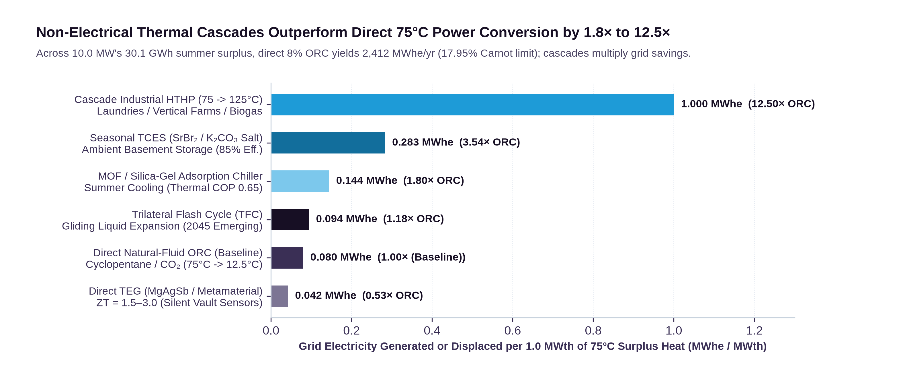

> **Figure 3.8 — Summer Exergy-Priority Cascade Multipliers vs. Direct $75^\circ\text{C}$ Micro-ORC Conversion**
> *Comparison of grid-electricity displacement multipliers per unit of $75^\circ\text{C}$ summer surplus heat across solid-state TEGs ($0.45\times$), direct micro-ORC ($1.00\times$ baseline, capped at $2,412\text{ MWh}_\text{e}/\text{yr}$), MOF adsorption chillers ($1.80\times$), $\text{SrBr}_2/\text{K}_2\text{CO}_3$ seasonal TCES ($3.54\times$), and cascade industrial HTHPs ($12.50\times$).*

---

### 3.7 Technical Feasibility Assessment and Evidence Audit

This section distinguishes **theoretical feasibility** (consistency with thermodynamic laws and verified benchmarks) from **demonstrated performance** (operating district-scale systems). Table 3.4 classifies the evidence hierarchy transparently, and Table 3.5 consolidates the $10.0\text{ MW}$ feasibility audit (worked derivations appear in Appendix B).

**Table 3.4: Classification of evidence underpinning the $10.0\text{ MW}$ feasibility assessment**

| Evidence Category | Examples in This Report | Primary Basis |
| :--- | :--- | :--- |
| **Established Fact / Statutory Standard** | IT electricity converts to heat; DHW stored at $\ge 60^\circ\text{C}$; Dublin Airport rainfall $772.5\text{ mm/yr}$; Tallaght AWS heat recovery; CRU $\ge 10\text{ MVA}$ dispatch rules | Thermodynamics; HSE (2024); HPSC (2009); Met Éireann (2023); Codema (2026); Arthur Cox (2026) |
| **Empirical Primary Survey Data** | Dublin resident acceptance of subterranean DCs ($3.19 / 5.00$, $n = 108$), recycled water ($3.86 / 5.00$, $n = 107$), heating priorities, and top physical safety concerns | RAKDA Ltd. (2026f) (`Liquid-cooled data centre survey.xlsx`, full $N = 109$ audited, §3.11) |
| **Research-Based Estimate** | District demand $37,610\text{ MWh}_\text{th}/\text{yr}$; near-ambient 5GDHC loss $\approx 7.0\text{ W/m}$; HTHP $40\text{--}60\%$ of Carnot; Band 3 water €1.66/$\text{m}^3$; Dublin DC build \$10.0–\$10.5M/MW | RAKDA Ltd. (2026a–e); Arpagaus et al. (2018); Uisce Éireann (2026); BuilderMuse (2026) |
| **Design Assumption** | $10.0\text{ MW}$ ($5 \times 2.0\text{ MW}$); utilisation ($60\text{--}100\%$); capture ($80\text{--}98\%$); $30\text{ km}$ network; thermal store $\Delta T = 30\text{ K}$; €95/$\text{MWh}_\text{th}$ tariff | Appendix A; §3.1–§3.9 |
| **Calculated Prediction** | Annual/seasonal heat balance, storage volume, HTHP COP, rainwater yield, Carnot/ORC output, $74.9\times$ SDN ratio, 30-year DCF/LCOH/TCO | Table 3.5; §3.9; Appendix B |
| **Emerging / Not Yet Demonstrated at Scale** | Monolithic in-silicon microfluidics at $75\text{--}80^\circ\text{C}$ and $10.0\text{ MW}$ district scale; $\text{PUE} \approx 1.015$; commercial 2045 pricing for HTS busways, NANF HCF, $\text{SrBr}_2$ TCES, and $75^\circ\text{C}$ micro-ORCs | Bounded by Scenario B fallback and $\pm 30\%$ CapEx sensitivity |

**Table 3.5: Consolidated $10.0\text{ MW}$ technical feasibility check (7,500-home primary basis)**

| Engineering Parameter | Base Case Result | Conservative / Stress Case | Feasibility Verdict |
| :--- | :--- | :--- | :--- |
| **Annual Recovered Heat** | $85,848\text{ MWh}_\text{th}/\text{yr}$ ($228.3\%$ of demand) | $49,056\text{ MWh}_\text{th}/\text{yr}$ ($130.4\%$ at $u=0.70, f_\text{cap}=0.80$) | **Pass** — Break-even $u = 43.8\%$ ($53.7\%$ at $80\%$ capture) |
| **Winter Cold-Snap Peak ($9.52\text{ MW}_\text{th}$)** | $9.80\text{ MW}_\text{th}$ output ($+0.28\text{ MW}_\text{th}$ margin) | $5.88\text{ MW}_\text{th}$ at $60\%$ load ($3.64\text{ MW}_\text{th}$ deficit) | **Pass with Guardrail** — $2,500\text{ m}^3$ store + $8.0\text{ MW}_\text{th}$ HTHPs |
| **DHW Pasteurisation ($\ge 60^\circ\text{C}$)** | Direct $75^\circ\text{C}$ PHEs (Scenario A) | $45^\circ\text{C} \rightarrow 70^\circ\text{C}$ HTHPs: $\text{COP } 4.6\text{--}6.9$ ($3.84\text{--}5.76\text{ GWh}_\text{e}/\text{yr}$) | **Pass with Guardrail** — Manageable electrical fallback |
| **Network Loss & Primary Pumping** | $1,840\text{ MWh}_\text{th}/\text{yr}$ ($4.9\%$ at $7\text{ W/m}$, $30\text{ km}$); $22.1\text{ kW}_\text{e}$ pump | Elevated losses if uninsulated pipes operate $>25^\circ\text{C}$ | **Pass with Guardrail** — Pre-insulate $75^\circ\text{C}$ risers & step down $45^\circ\text{C}$ loop |
| **Rainwater Yield vs. Tower Savings** | $55,620\text{--}62,379\text{ m}^3/\text{yr}$ per $100\text{k m}^2$; $158\text{--}175\text{k m}^3/\text{yr}$ saved | 45–66 day Dublin dry spell | **Pass** — $10,000\text{ m}^3$ cistern + $\le 1.0\text{ }\mu\text{S/cm}$ ultrapure train |
| **Summer Surplus & Exergy Cascade** | $30,148\text{ MWh}_\text{th}$ summer surplus; ORC $\le 2,412\text{ MWh}_\text{e}/\text{yr}$ | Heat-rejection failure threatens IT uptime | **Pass with Guardrail** — N+1 dry coolers + 4-step Exergy Cascade |
| **Facility Electricity & CRU Grid Rule** | $88,914\text{ MWh}_\text{e}/\text{yr}$ ($\text{PUE } 1.015$, saves $47.7\text{ GWh}_\text{e}$ vs. $1.56$) | $77,958\text{ MWh}_\text{e}/\text{yr}$ net grid import ($\approx 10.68\text{ MVA}$) | **Pass with Guardrail** — €15.30M BTM PV/BESS + $2\text{ MW}_\text{e}$ TI-PTES |

#### Feasibility Conclusion

The $10.0\text{ MW}$ architecture is **theoretically feasible and physically self-consistent**: recovered heat covers winter peaks independently and maintains $130.4\%$ annual coverage under conservative load; SDN optical routing shifts heat across vaults $74.9\times$ more efficiently than water pumping; and harvested Dublin rainwater comfortably supplies closed-loop makeup while displacing $158\text{--}175\text{k m}^3/\text{yr}$ of evaporative cooling water. Practical implementation enforces **four mandatory engineering guardrails**: (1) sizing $8.0\text{ MW}_\text{th}$ backup HTHPs and $2,500\text{--}2,700\text{ m}^3$ thermal storage for Scenario B ($45^\circ\text{C}$ coolant / $60\text{--}70\%$ load); (2) installing full N+1 independent dry coolers; (3) funding behind-the-meter PV, BESS, and TI-PTES for CRU $\ge 10\text{ MVA}$ grid compliance; and (4) executing 8,760-hour coupled transient simulations prior to detailed engineering.

---

### 3.8 30-Year Life-Cycle Assessment (2045–2075)

#### 3.8.1 Assessment Horizon and Component Service Lives

The lifecycle evaluation spans **30 years (2045–2075)**. Individual subsystems follow distinct renewal intervals: IT chiplets refresh every 3–5 years (6–10 tenant-funded cycles), while EN 1990 reinforced concrete vaults exceed the 30-year horizon and remain reusable post-2075. Where verified manufacturer lifespans are unavailable, Table 3.6 flags the requirement transparently.

**Table 3.6: Indicative component service lives over the 2045–2075 evaluation period**

| Component | Indicative Service Life | Source / Verification Status | Replacements in 30 Years |
| :--- | :--- | :--- | :--- |
| **IT hardware (servers, AI chiplets)** | $\approx 3\text{--}5\text{ years}$ (refresh cycle) | RAKDA Ltd. (2026b); Bashroush (2018) | 6–10 refresh cycles *(tenant-funded)* |
| **LFP Battery Energy Storage (BESS)** | $\approx 12\text{ years}$ | Parametric industry benchmark (§3.9.2) | 2 replacements (Years 12 & 24) |
| **Building-level heat pumps** | $15\text{ years}$ (ground-source: $20\text{ years}$) | SEAI (2022) planning assumptions | 1–2 replacements |
| **Central natural-refrigerant HTHPs** | $\approx 15\text{--}20\text{ years}$ | Parametric engineering estimate *(OEM spec in detailed design)* | At least 1 major overhaul (Year 15 budgeted) |
| **Pre-insulated district heating pipes** | $\ge 30\text{ years}$ at $120^\circ\text{C}$ (EN 253); longer at $20\text{--}75^\circ\text{C}$ | Jakubowicz et al. (2022) | None expected within 30-year horizon |
| **Plate heat exchangers, pumps, CDUs** | $\approx 15\text{--}25\text{ years}$ *(seals/gaskets 7–10 yr)* | Parametric engineering estimate *(OEM spec in detailed design)* | Periodic refurbishment (Year 15 budgeted) |
| **Water-treatment membranes, UV-C LEDs, BDD** | Periodic replacement ($5\text{--}10\text{ years}$ media/electrodes) | RAKDA Ltd. (2026c) | Scheduled media swaps (Years 10, 15, 20) |
| **ORC / TEG / TI-PTES / TCES units** | $\approx 15\text{--}20\text{ years}$ | Parametric engineering estimate *(OEM spec in detailed design)* | Year 15 overhaul budgeted in §3.9.2 |
| **Vault structure (reinforced concrete)** | $50\text{ years}$ design working life | CEN (2002) EN 1990 | None; structurally reusable post-2075 |

#### 3.8.2 Construction Embodied Carbon and Materials Transport

Compressing $10.0\text{ MW}$ of IT capacity into $25\text{--}120\text{ m}^2$ of IT floor ($\approx 350\text{ m}^2$ total plant room across five bedrock vaults) eliminates extensive surface superstructures, steel chiller yards, and evaporative cooling towers. Because reinforced concrete carries $0.162\text{--}0.243\text{ kgCO}_2\text{e/kg}$, vault specifications mandate Ireland's $\ge 30\%$ GGBS low-carbon cement blend alongside prefabricated modular cassettes to curtail heavy goods vehicle (HGV) transport haulage. Inside the vaults, $800\text{ VDC}$ Solid-State Transformers and HTS busways displace $\approx 98\%$ of copper busbars ($\approx 200\text{ kg/rack}$).

#### 3.8.3 Routine and Preventive Maintenance

* **Cooling Loops and Vaults:** Continuous telemetry of coolant conductivity ($\le 1.0\text{ }\mu\text{S/cm}$), temperature, and flow; micro-filter changes; leak detection; inspection of $<110\text{ dB}$ water-mist suppression and elastomeric base-isolation bearings.
* **Water Treatment:** Scheduled replacements of UF/MCDI membranes, UV-C LED arrays, and BDD/$\text{Ti}_4\text{O}_7$ oxidation electrodes; first-flush and cistern cleaning; verified on-site PFAS mineralisation (RAKDA Ltd., 2026c).
* **Heat Pumps:** Periodic servicing and certified leak inspections under the F-gas Regulation (Regulation (EU) 2024/573); Year 15 compressor overhauls.
* **Heat Network and Substations:** Water-chemistry control against corrosion and scaling, valve and heat-meter calibration, and statutory *Legionella* verification across DHW loops (HPSC, 2009).
* **Power Recovery and Electrical Plant:** Scheduled maintenance of cyclopentane/$\text{CO}_2$ micro-ORC loops, TI-PTES stores, BESS racks, and $800\text{ VDC}$ switchgear.

#### 3.8.4 Reliability and Downtime Management

Two operational imperatives govern reliability: residents must never lose heating during IT faults or refreshes, and servers must never throttle when residential heat draw declines. Partitioning the $10.0\text{ MW}$ plant across **five $2.0\text{ MW}$ vaults** enables staggered hardware refreshes in which one vault goes offline while **$80\%$ of compute and thermal output ($7.84\text{ MW}_\text{th}$)** remains active. Redundant N+1 dry coolers, N+1 pumps, $217\text{ m}^3$ vault buffers, and the $2,500\text{ m}^3$ thermal store fully decouple residential heating continuity from server uptime.

#### 3.8.5 Environmental Implications of Maintenance and Replacement

The largest recurring material stream arises from IT hardware: 6–10 refresh cycles over 30 years generate substantial embodied impacts and electronic waste, requiring refresh schedules that balance energy-efficiency gains against manufacturing carbon (Bashroush, 2018). Specifying natural refrigerants (R744, R718, R600) eliminates high-GWP refrigerant leakage, while water-based cooling and on-site BDD/$\text{Ti}_4\text{O}_7$ oxidation prevent PFAS-contaminated waste streams from reaching landfills.

#### 3.8.6 Decommissioning and End of Life (2075)

* **IT Hardware:** Managed under the WEEE Directive (Directive 2012/19/EU), prioritising cascade refurbishment and reuse in lower-tier edge nodes followed by hydrometallurgical recovery of silicon, $\text{c-BAs}$, and precious metals.
* **Heat Pumps, BESS, and ORC Units:** Certified recovery of refrigerants, working fluids, and lithium-iron-phosphate cells prior to dismantling and recycling of copper, steel, and aluminium.
* **District Heating Pipes:** Retained in ground to serve successor heat sources (geothermal, river-source, or next-generation heat pumps), or recovered for steel/HDPE recycling.
* **Subterranean Vaults:** Structurally reusable beyond 2075 (50-year EN 1990 life) for successor compute, grid-scale storage, or thermal reservoirs without demolition.
* **Water Treatment:** Ceramic membranes and regenerable adsorbers prioritised over disposable cartridges; captured PFAS mineralised on site.

---

### 3.9 Financial Feasibility, CapEx Allocation, and 30-Year Lifecycle Economics

Operating at the **$10.0\text{ MW}$ IT baseline**, the subterranean circular district covers the 7,500-home annual heat demand ($37,610\text{ MWh}_\text{th}/\text{yr}$; $228.3\%$ coverage) and $9.52\text{--}10.15\text{ MW}_\text{th}$ winter cold-snap peak independently, while proving financially bankable as a ring-fenced co-investment between a regulated district utility and a commercial colocation developer. Under 2045 central estimates, whole-system CapEx totals **€137.08M** (€13,708/$\text{kW}_\text{IT}$, down from €175.25M in 2026 anchor terms), split between **€57.73M** (€5,773/$\text{kW}_\text{IT}$) in Public/Utility District Infrastructure (Case 1) and **€79.35M** (€7,935/$\text{kW}_\text{IT}$) in Commercial Data-Centre Operator assets—incorporating €15.30M for behind-the-meter solar PV and battery storage toward CRU compliance, while treating 3–5 year server refreshes as $100\%$ tenant-funded.

Over 30 years (2045–2075), the combined project (Case 2) generates **€22.201M/yr EBITDA**, delivering an unsubsidised **$15.7\%$ IRR**, a **6.2-year simple payback**, and an **NPV of €232.98M at a $4\%$ public discount rate** (€105.07M at an $8\%$ private hurdle rate). Conversely, an unsubsidised standalone District Energy Utility (Case 1) operating on a Tallaght-style zero-cost heat swap achieves only a **$3.7\%$ IRR** (NPV $-€1.84\text{M}$ at $4\%$; 18.7-year payback) and a 30-year Net Levelised Cost of Heat (LCOH) of **€97.8/$\text{MWh}_\text{th}$** at $4\%$ (€144.5/$\text{MWh}_\text{th}$ at $8\%$) against a regulated €95.0/$\text{MWh}_\text{th}$ tariff. Closing this standalone utility gap requires either a **$30\%$ public capital grant** (SEAI District Heating Support Scheme, Climate Action Fund, or EU Innovation Fund—reducing Case 1 Net LCOH to **€71.2/$\text{MWh}_\text{th}$** and payback to 11.7 years) or a **€1.000M/yr (€100/$\text{kW}_\text{IT}/\text{yr}$) cooling-service transfer fee** paid by the data-centre operator (Case 1b—raising utility IRR to **$6.1\%$** and $4\%$ NPV to **+€15.45M**).

Three modelling caveats govern these results: (1) heat-network civil works, water tariffs, retail fuel rates, and Dublin hyperscale shell-and-core builds are anchored in verified 2022–2026 datasets (Codema, SEAI, Uisce Éireann, CCAC, CRU, Turner & Townsend, JLL, CBRE), whereas commercial 2045 quotes for wafer-scale microfluidics, HTS busways, HCF rings, $\text{SrBr}_2$ TCES, and $75^\circ\text{C}$ micro-ORCs are parametric projections bounded across $\pm 30\%$ CapEx sensitivity; (2) because Heat Works does not publish residential Tallaght €/$\text{MWh}_\text{th}$ tariffs, €95.0/$\text{MWh}_\text{th}$ is calibrated against SEAI residential bills; and (3) continuous Scenario B HTHP fallback ($45^\circ\text{C}$ coolant) adds €0.354M–€0.593M/yr net OpEx, increasing Case 1 Net LCOH by €9.4–€15.8/$\text{MWh}_\text{th}$.

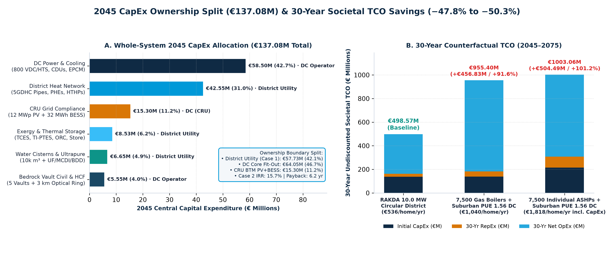

> **Figure 3.9 — 2045 CapEx Ownership Architecture (€137.08M) and 30-Year Counterfactual TCO Savings**
> *Dual financial visual displaying: (A) 2045 CapEx allocation across District Utility (€57.73M, $42.1\%$), DC Core Fit-Out (€64.05M, $46.7\%$), and CRU BTM PV+BESS (€15.30M, $11.2\%$) with subsystem breakdowns; and (B) 30-year undiscounted societal TCO comparing RAKDA $10.0\text{ MW}$ (€498.57M; €536/home/yr) against 7,500 Gas Boilers + $\text{PUE } 1.56$ DC (€955.40M; $+€456.83\text{M}$) and 7,500 ASHPs + $\text{PUE } 1.56$ DC (€1,003.06M; $+€504.49\text{M}$).*

#### 3.9.1 Ownership Boundary and Bottom-Up CapEx Architecture

Separating public district infrastructure from commercial compute assets insulates residents from cloud-tenant turnover and preserves open access for successor heat sources after 2075:

* **District Utility CapEx (Case 1 — €72.66M in 2026 / €57.73M in 2045):** Pipework and substations are anchored on Climate Change Advisory Council (CCAC) Working Paper No. 29 (Swedish civil works €390–€500/m; UK DECC £1,000/m average; Glen Cork €4,500/connection; €4,625 European substation baseline; CCAC, 2024) and Codema's Dublin Heating and Cooling Plan (€852/m blended; Codema, 2022). Installing twin HDPE 5GDHC mains alongside greenfield roads prices $30\text{ km}$ at €750/m (€22.50M in 2026), falling to €600/m (€18.00M) by 2045. Blending substations across 3,000 houses and 95 apartment blocks totals €23.68M (€3,157/home) in 2026 and €19.75M (€2,633/home) in 2045.
* **Commercial DC Operator CapEx (€102.59M in 2026 / €79.35M in 2045):** Turner & Townsend's 2025–2026 *Data Centre Construction Cost Index* benchmarks Dublin air-cooled hyperscale shell-and-core builds at US\$10.0M/MW, while JLL's *2026 Global Data Center Outlook* reports a Dublin midpoint of US\$10.5M/MW excluding land, grid works, and tenant IT (BuilderMuse, 2026; Archdesk, 2026). Liquid-cooled AI builds carry a $7\text{--}10\%$ premium ($48\%$ electrical, $33\%$ mechanical, $9\%$ core/shell, $10\%$ general conditions). Compressing $10.0\text{ MW}$ into 9–40 racks eliminates surface superstructures, chillers, and cooling towers while HTS busways cut copper by $98\%$, placing core subterranean fit-out (Items 1a–1b, 4a–4d) at €81.35M (€8.14M/MW) in 2026 and **€64.05M (€6.41M/MW)** in 2045. Including Item 4e (**€15.30M** in 2045 for $12\text{ MW}_p$ BTM PV + $8\text{ MW}/32\text{ MWh}$ LFP BESS toward CRU/2025/236 compliance) brings total DC Operator CapEx to **€79.35M**.

**Table 3.7: $10.0\text{ MW}$ subsystem CapEx and ownership boundary split (2026 anchor vs. 2045 central estimate)**

| Subsystem & Line Item | Ownership Boundary | Evidence Tier & Cost Basis | 2026 Anchor (€M) | 2045 Central (€M) | 2045 Unit Cost (€/$\text{kW}_\text{IT}$) |
| :--- | :--- | :--- | :---: | :---: | :---: |
| **1. Civil & Subterranean Vaults** | | | **9.48** | **8.23** | **823** |
| 1a. Level $-4$ bedrock excavation & RC vaults ($5 \times 2.0\text{ MW}$, $\approx 350\text{ m}^2$, $\ge 30\%$ GGBS) | DC Operator | Parametric civil estimate / 2045 LC | 3.00 | 2.60 | 260 |
| 1b. Floating acoustic slabs, $1.0\text{ m}$ vibration trenches & water-mist fire ($<110\text{ dB}$) | DC Operator | Parametric civil estimate / 2045 LC | 0.85 | 0.75 | 75 |
| 1c. Vault 15-min thermal buffer tanks ($217.0\text{ m}^3$ stainless insulated) | District Utility | Parametric mechanical estimate | 0.43 | 0.38 | 38 |
| 1d. Subterranean rainwater cisterns ($10,000\text{ m}^3$ RC; $8,220\text{--}12,330\text{ m}^3$ band) | District Utility | Parametric civil estimate | 5.20 | 4.50 | 450 |
| **2. District Thermal Network & Upgrading** | | | **64.43** | **50.70** | **5,070** |
| 2a. Hybrid 5GDHC twin-pipe network ($\approx 30\text{ km}$ HDPE, $\ge 80\text{ cm}$ gap + EN 253 risers) | District Utility | Empirical anchor (Codema/CCAC) + greenfield | 22.50 | 18.00 | 1,800 |
| 2b. Building PHE substations & HIUs (3,095 bldgs / 7,500 homes + civic) | District Utility | Empirical anchor (CCAC/Glen Cork) + block blend | 23.68 | 19.75 | 1,975 |
| 2c. Backup natural-refrigerant HTHPs ($8.0\text{ MW}_\text{th}$ R744/R718/R600, Scenario B) | District Utility | Parametric estimate (DEA/SEAI framework) | 6.00 | 4.80 | 480 |
| 2d. Diurnal/cold-snap thermal store ($2,500\text{--}2,700\text{ m}^3$ insulated tank) | District Utility | Parametric estimate (DEA framework) | 1.25 | 1.10 | 110 |
| 2e. $\text{SrBr}_2/\text{K}_2\text{CO}_3$ thermochemical storage (TCES) modules ($\approx 35\text{ MWh}_\text{th}$) | District Utility | 2045 learning-curve projection | 4.80 | 2.80 | 280 |
| 2f. TI-PTES Carnot battery ($2\text{ MW}_\text{e}/16\text{ MWh}_\text{e}$) + $\approx 418\text{--}440\text{ kW}_\text{e}$ micro-ORC + MOF chillers | District Utility | 2045 learning-curve projection | 6.20 | 4.25 | 425 |
| **3. Water Harvesting & Ultrapure Treatment Train** | | | **2.60** | **2.15** | **215** |
| 3a. Inert roof catchment segregation & first-flush civil works ($100\text{--}160\text{k m}^2$) | District Utility | Parametric civil estimate | 0.80 | 0.70 | 70 |
| 3b. Ultrapure train (UF + MCDI/2D + DI $\le 1\text{ }\mu\text{S/cm}$ + UV-C LED + BDD PFAS + SAWH) | District Utility | Parametric / 2045 learning-curve projection | 1.80 | 1.45 | 145 |
| **4. Data Centre Electrical, Cooling, Optical & CRU Fit-Out** *(IT tenant-funded)* | | | **98.74** | **76.00** | **7,600** |
| 4a. $10.0\text{ MW}$ power delivery ($800\text{ VDC}$ SSTs + HTS busways, $-98\%$ Cu, switchgear) | DC Operator | Empirical anchor (T&T MEP) / 2045 HTS LC | 48.00 | 38.00 | 3,800 |
| 4b. Liquid-cooling interface (microfluidic CDUs, PHEs, pumps, N+1 dry coolers) | DC Operator | Empirical anchor (T&T liquid) / 2045 LC | 18.50 | 14.50 | 1,450 |
| 4c. $3.0\text{ km}$ Hollow-Core Fiber (NANF HCF) ring + CPO switches + PQC security | DC Operator | 2045 learning-curve projection | 3.50 | 2.20 | 220 |
| 4d. MEP commissioning, telemetry & EPCM fees ($\approx 10\%$ facility fit-out) | DC Operator | Empirical anchor (T&T $10\%$ GC/fees) | 7.50 | 6.00 | 600 |
| 4e. CRU/EirGrid LEU compliance assets ($12\text{ MW}_p$ solar PV + $8\text{ MW}/32\text{ MWh}$ BESS) | DC Operator | CRU mandate; parametric PV/BESS / 2045 LC | 21.24 | 15.30 | 1,530 |
| **Summary: Case 1 (Public/Utility District Infrastructure: 1c–d, 2a–f, 3a–b)** | **District Utility** | **€51.08M thermal + €6.65M water (2045)** | **72.66** | **57.73** | **5,773** |
| **Summary: DC Core Facility Fit-Out (1a–b, 4a–d; excl. CRU PV/BESS & IT)** | **DC Operator** | **Benchmarked vs. T&T \$10.0M / JLL \$10.5M/MW** | **81.35** | **64.05** | **6,405** |
| **Summary: DC Operator Total (incl. 4e CRU PV+BESS)** | **DC Operator** | **Subterranean MEP + CRU compliance** | **102.59** | **79.35** | **7,935** |
| **Summary: Case 2 (Whole-System Combined Project)** | **Combined** | **All Integrated Physical Assets** | **175.25** | **137.08** | **13,708** |

#### 3.9.2 Annualised OpEx, Mid-Life Replacements (RepEx), and Multi-Stream Revenue

At $100\%$ IT load and $\text{PUE} = 1.015$, the facility consumes **$88,914\text{ MWh}_\text{e}/\text{yr}$**—saving **$47,742\text{ MWh}_\text{e}/\text{yr}$** relative to the $136,656\text{ MWh}_\text{e}/\text{yr}$ drawn at the Uptime Institute's $1.56$ global average PUE (Uptime Institute, 2024). Behind-the-meter $12\text{ MW}_p$ PV supplies $\approx 10,956\text{ MWh}_\text{e}/\text{yr}$ directly, leaving **$77,958\text{ MWh}_\text{e}/\text{yr}$** of net grid import. Applying an all-in green Corporate PPA (CPPA) rate of **€125.0/$\text{MWh}_\text{e}$** (€80/MWh renewable wholesale + €45/MWh network charges and levies; SEAI S1 2026 commercial Band IF retail is €196.10/$\text{MWh}_\text{e}$; SEAI, 2026) gives €9.745M/yr in net grid OpEx ($100\%$ passed through to colocation tenants). Routine O&M is modelled at $\approx 1.1\%$ of Utility CapEx (€0.635M/yr) and $\approx 1.8\%$ of DC CapEx (€1.428M/yr). Discrete 30-year replacement events (RepEx) total **€8.20M** for the Utility and **€17.50M** for the DC Operator (**€25.70M** combined).

Revenue is anchored by leasing $10.0\text{ MW}$ of ultra-low-latency ($3.17\text{ }\mu\text{s}$), liquid-cooled AI capacity at **€165/kW/month Triple-Net (NNN)** (**€19.800M/yr**, benchmarked against FLAP-D €145/kW/mo, CBRE \$194.95/kW/mo, and JLL \$222/kW/mo regional NNN rates; Advanced Analytics US, 2026) plus power pass-through (€9.745M/yr). District heat sales of $37,610\text{ MWh}_\text{th}/\text{yr}$ at **€95.0/$\text{MWh}_\text{th}$** generate **€3.573M/yr** (€3.810M/yr at 8,000 homes). Adding TI-PTES arbitrage (€0.420M/yr), summer micro-ORC power ($\approx 2,000\text{ MWh}_\text{e}/\text{yr} = \text{€}0.250\text{M/yr}$), avoided municipal water (€0.359M/yr), and displaced WAN telecom power (€0.057M/yr) yields **€34.204M/yr** total revenue and **€22.201M/yr EBITDA** (Table 3.8). Non-cash carbon displacement ($\approx 8,020\text{ tCO}_2/\text{yr}$ gas heating + $\approx 15,822\text{ tCO}_2/\text{yr}$ PUE savings at Codema's $331.4\text{ gCO}_2/\text{kWh}$ 2024 Dublin factor; see §3.10.7 for full ethical net-carbon bounds) equates to €2.384M/yr at Ireland's €100/$\text{tCO}_2$ 2030 Carbon Tax or €7.677M/yr at the €322/$\text{tCO}_2$ Infrastructure Guidelines shadow cost (TU Dublin, 2024).

**Table 3.8: Annualised steady-state cash flow, replacement reserves, and revenue breakdown (2045 Real, $100\%$ IT Load)**

| Cash Flow Line Item (€M/yr, 2045 Real) | Case 1: Utility-Only | Case 1b: Utility + Cooling Fee | DC Operator (excl. / incl. Fee) | Case 2: Whole-System Combined | Basis & Verification Anchor |
| :--- | :---: | :---: | :---: | :---: | :--- |
| **Annual Operating Expenditure (OpEx)** | | | | | |
| Net DC grid PPA electricity ($77,958\text{ MWh}_\text{e}$ @ €125/MWh) | 0.000 | 0.000 | $-9.745$ | $-9.745$ | $88,914\text{ MWh}_\text{e}$ less $10,956\text{ MWh}_\text{e}$ BTM PV |
| 5GDHC pumping & HTHP trim ($\approx 1,200\text{ MWh}_\text{e}$ @ €125/MWh) | $-0.150$ | $-0.150$ | 0.000 | $-0.150$ | $22.1\text{ kW}$ pump + trim *(Scen. B net: +€0.354–0.593M)* |
| Water treatment consumables & BDD/$\text{Ti}_4\text{O}_7$ electrodes | $-0.045$ | $-0.045$ | 0.000 | $-0.045$ | UF/MCDI/DI/BDD replacement media |
| Routine O&M ($\approx 1.1\%$ Utility CapEx; $\approx 1.8\%$ DC CapEx) | $-0.635$ | $-0.635$ | $-1.428$ | $-2.063$ | Preventive mechanical, electrical & pipe upkeep |
| **Total Cash OpEx** | **$-0.830$** | **$-0.830$** | **$-11.173$** | **$-12.003$** | **Steady-state annual O&M + energy** |
| **Annual Revenue & Direct Utility Savings** | | | | | |
| District heat sales ($37,610\text{ MWh}_\text{th}$ @ €95.0/$\text{MWh}_\text{th}$) | $+3.573$ | $+3.573$ | 0.000 | $+3.573$ | 7,500 homes *(8,000-home sens.: +€3.810M)* |
| Colocation NNN base rent ($10,000\text{ kW}$ @ €165/kW/mo) | 0.000 | 0.000 | $+19.800$ | $+19.800$ | Anchored on FLAP-D / CBRE / JLL NNN rates |
| Tenant grid power pass-through reimbursement | 0.000 | 0.000 | $+9.745$ | $+9.745$ | $100\%$ pass-through of net grid PPA draw |
| DC cooling-service transfer fee (€100/$\text{kW}_\text{IT}/\text{yr}$) | 0.000 | $+1.000$ | $0.000 / -1.000$ | 0.000 | Internal transfer (nets to €0 in Case 2) |
| TI-PTES Carnot battery wind/peak arbitrage ($2\text{ MW}_\text{e}$) | $+0.420$ | $+0.420$ | 0.000 | $+0.420$ | Curtailed wind charging + SEM evening discharge |
| Summer residual micro-ORC ($\approx 2,000\text{ MWh}_\text{e}$ @ €125/MWh) | $+0.250$ | $+0.250$ | 0.000 | $+0.250$ | Cascaded residual below $2,412\text{ MWh}_\text{e}$ ceiling |
| Avoided Uisce Éireann water (DC towers + district) | $+0.083$ | $+0.083$ | $+0.276$ | $+0.359$ | Band 3 €1.66/$\text{m}^3$ supply (excl. €2.38/$\text{m}^3$ sewer) |
| Displaced WAN telecom power ($\approx 455\text{ MWh}_\text{e}$ @ €125/MWh) | 0.000 | 0.000 | $+0.057$ | $+0.057$ | $87.34\%$ local HCF/CPO traffic breakout |
| **Total Cash Revenue & Direct Savings** | **$+4.326$** | **$+5.326$** | **$+29.878 / +28.878$** | **$+34.204$** | **30-year steady-state revenue** |
| **Net Operating Cash Flow (EBITDA)** | **$+3.496$** | **$+4.496$** | **$+18.705 / +17.705$** | **$+22.201$** | **Before mid-life RepEx & financing** |
| **Memo: Mid-Life RepEx (2045–2075)** | | | | | |
| Discrete RepEx events (Yrs 10, 12, 15, 20, 24 total) | $-8.20$ | $-8.20$ | $-17.50$ | $-25.70$ | Utility: Yr 10/20 €0.45M, Yr 15 €7.30M; DC: Yr 12/24 €4.5M, Yr 15 €8.5M |
| Annualised undiscounted sinking-fund equivalent | $-0.273$ | $-0.273$ | $-0.583$ | $-0.857$ | *3–5 yr IT refreshes $100\%$ tenant-funded* |
| **Memo: Non-Cash Avoided Carbon Value** | | | | | |
| Displaced heating ($\approx 8,020\text{ tCO}_2/\text{yr}$ @ €100 / €322/t) | $+0.802 / +2.582$ | $+0.802 / +2.582$ | 0.000 | $+0.802 / +2.582$ | 2030 Carbon Tax / Govt. Shadow Cost *(see §3.10.7)* |
| Avoided PUE grid power ($\approx 15,822\text{ tCO}_2/\text{yr}$ @ €100 / €322/t) | 0.000 | 0.000 | $+1.582 / +5.095$ | $+1.582 / +5.095$ | $47,742\text{ MWh}_\text{e}/\text{yr}$ @ Codema $331.4\text{ gCO}_2/\text{kWh}$ static benchmark *(dynamic $163\text{--}308\text{ g/kWh}$ range in Table 3.12)* |

#### 3.9.3 Discounted Cash-Flow Metrics and 30-Year Counterfactual TCO

DCF evaluation over 25- and 30-year horizons applies a **$4\%$ public utility discount rate** and an **$8\%$ private hurdle rate**. Levelised Cost of Heat ($\text{LCOH}$) discounts initial CapEx ($C_0$), annual cash OpEx ($O_t$), discrete replacement events ($R_t$), and non-heat operational credits ($S_t$, zero for Gross LCOH) over discounted delivered heat ($H_t = 37,610\text{ MWh}_\text{th}/\text{yr}$):

$$\text{LCOH} = \frac{C_0 + \sum_{t=1}^{N} \frac{O_t + R_t - S_t}{(1 + r)^t}}{\sum_{t=1}^{N} \frac{H_t}{(1 + r)^t}}$$

Unsubsidised Case 1 produces a 30-year Gross LCOH of €117.9/$\text{MWh}_\text{th}$ at $4\%$ (€164.6 at $8\%$), dropping to **€97.8/$\text{MWh}_\text{th}$** Net LCOH after €0.753M/yr (€20.0/$\text{MWh}_\text{th}$) in non-heat credits ($3.7\%$ IRR, $-€1.84\text{M}$ NPV). This mirrors Irish precedent: Codema's Maynooth study required €10.6M CapEx over a 25-year public payback, whereas Tallaght reached $<2$-year payback only through €4.5M–€4.9M in Climate Action Fund grants, €670k in EU Interreg support, and €770k in local authority seed funding (Codema, 2026). Introducing a €1.000M/yr DC cooling-service fee (Case 1b) shortens utility payback to 12.9 years ($+€15.45\text{M}$ NPV at $4\%$, $6.1\%$ IRR), while combined Case 2 achieves $+€232.98\text{M}$ NPV at $4\%$ ($+€105.07\text{M}$ at $8\%$), $15.7\%$ IRR, and a 7.2-year discounted payback at $4\%$ (8.9 years at $8\%$).

Against conventional Dublin counterfactuals delivering the identical service bundle ($37,610\text{ MWh}_\text{th}/\text{yr}$ residential heating plus $10.0\text{ MW}$ continuous IT load), whole-system savings are decisive (Table 3.9):

* **Counterfactual A (7,500 Individual ASHPs + Suburban $\text{PUE } 1.56$ DC):** Prices ASHPs at €12,500/home bulk new-build + €1,539/home ESB LV/MV upgrades + €9,500/home Year 15 replacement, alongside a suburban air-cooled DC (€95.00M shell/core + €15.30M CRU PV/BESS). Undiscounted 30-year TCO totals **€1,003.06M** (€667.11M PV at $4\%$)—**€504.49M ($+101\%$) costlier** than the circular district (€498.57M undiscounted / €344.48M PV at $4\%$).
* **Counterfactual B (7,500 Individual Gas Boilers + Suburban $\text{PUE } 1.56$ DC):** Lower initial CapEx (€138.80M) is overwhelmed by €25.770M/yr OpEx (SEAI S1 2026 Band D1 residential gas at €139.90/MWh + servicing + $\text{PUE } 1.56$ power), reaching **€955.40M** (€608.14M PV at $4\%$) before post-2030 carbon escalation—**€456.83M costlier** than our system.
* **Household Bill Impact:** The regulated €95.0/$\text{MWh}_\text{th}$ tariff plus €60/yr standing charge yields a **€536/home/yr** heating bill—directly meeting the #1 resident survey priority (§3.11)—compared with €693/home/yr ASHP OpEx (€1,818/home/yr with amortised CapEx) and €1,040/home/yr Band D1 gas OpEx (€1,261–€1,382/home/yr with boiler CapEx).

**Table 3.9: 25-year and 30-year DCF investment metrics and 30-year counterfactual TCO comparison**

| Metric / Financial Basis | Case 1: Utility-Only ($0\%$ Grant) | Case 1b: Utility + Cooling Fee | Case 2: Whole-System Circular District | Counterfactual A: 7,500 ASHPs + $\text{PUE } 1.56$ DC | Counterfactual B: 7,500 Gas Boilers + $\text{PUE } 1.56$ DC |
| :--- | :---: | :---: | :---: | :---: | :---: |
| **DCF Returns & LCOH (25-Yr / 30-Yr)** | | | | *(Cost-only TCO)* | *(Cost-only TCO)* |
| Initial CapEx (€M) | 57.73 | 57.73 | 137.08 | 215.59 | 138.80 |
| Simple Payback (years, incl. RepEx) | 18.7 | 12.9 | **6.2** | — | — |
| Internal Rate of Return (25 yr / 30 yr) | $2.7\%$ / $3.7\%$ | $5.3\%$ / $6.1\%$ | **$15.4\%$ / $15.7\%$** | — | — |
| NPV @ $4\%$ Public Rate (25 yr / 30 yr, €M) | $-7.68$ / $-1.84$ | $+7.94$ / $+15.45$ | **$+195.90$ / $+232.98$** | — | — |
| Discounted Payback @ $4\%$ (years) | $>30.0$ | 20.6 | **7.2** | — | — |
| NPV @ $8\%$ Private Rate (25 yr / 30 yr, €M) | $-23.02$ / $-20.98$ | $-12.34$ / $-9.72$ | **$+92.13$ / $+105.07$** | — | — |
| Discounted Payback @ $8\%$ (years) | $>30.0$ | $>30.0$ | **8.9** | — | — |
| Gross LCOH @ $4\%$ / $8\%$ (25 yr, €/$\text{MWh}_\text{th}$) | 128.1 / 172.4 | *(Same asset cost)* | — | — | — |
| Gross LCOH @ $4\%$ / $8\%$ (30 yr, €/$\text{MWh}_\text{th}$) | 117.9 / 164.6 | *(Same asset cost)* | — | — | — |
| Net LCOH @ $4\%$ / $8\%$ (25 yr, €/$\text{MWh}_\text{th}$) | 108.1 / 152.3 | — | — | — | — |
| Net LCOH @ $4\%$ / $8\%$ (30 yr, €/$\text{MWh}_\text{th}$) | 97.8 / 144.5 | — | — | — | — |
| $30\%$-Grant Net LCOH @ $4\%$ / $8\%$ (25 yr) | 78.6 / 109.2 | — | — | — | — |
| $30\%$-Grant Net LCOH @ $4\%$ / $8\%$ (30 yr) | **71.2 / 103.6** | — | — | — | — |
| **30-Year TCO Comparison (2045–2075)** | | | | | |
| 30-Year Mid-Life RepEx (€M, undiscounted) | 8.20 | 8.20 | 25.70 | 92.25 | 43.50 |
| 30-Year Net Operating Cost (€M, undiscounted) | — | — | 335.79 | 695.22 | 773.10 |
| **30-Year Undiscounted TCO (€M)** | — | — | **498.57** | **1,003.06 (+€504.49M)** | **955.40 (+€456.83M)** |
| **30-Year Present Value TCO @ $4\%$ (€M)** | — | — | **344.48** | **667.11 (+€322.63M)** | **608.14 (+€263.66M)** |
| **30-Year Present Value TCO @ $8\%$ (€M)** | — | — | **270.87** | **505.22 (+€234.35M)** | **442.29 (+€171.42M)** |
| **Annual Household Heating Bill (€/home/yr)** | **€536** | **€536** | **€536** | €693 OpEx (€1,818 incl. CapEx) | €1,040 (D1 OpEx, ex-CapEx) |

#### 3.9.4 Parametric Sensitivity Matrix Across CapEx, Utilisation, and Grants

Table 3.10 evaluates 18 scenarios spanning $\pm 30\%$ CapEx uncertainty, average IT utilisation ($60\%$, $80\%$, $100\%$), and public capital grants ($0\%$ vs. $30\%$ on Utility CapEx). At $60\%$ utilisation, annual recovered heat ($51,509\text{ MWh}_\text{th}/\text{yr}$ at $98\%$ capture) still satisfies annual demand, while lower winter output ($5.88\text{ MW}_\text{th}$) increases HTHP trim electricity from €0.150M/yr to €0.400M/yr and reduces residual summer micro-ORC revenue from €0.250M/yr to €0.100M/yr, with colocation NNN rent scaling proportionally (€11.880M/yr at $60\%$; €15.840M/yr at $80\%$). Even under the severest stress test ($+30\%$ CapEx, $60\%$ utilisation, $0\%$ grant), combined Case 2 retains a positive **$5.9\%$ IRR** and **13.4-year simple payback**, demonstrating that commercial AI colocation provides substantial resilience against capital escalation.

**Table 3.10: 30-year sensitivity matrix for district utility LCOH and whole-system payback**

| CapEx Scenario | Avg IT Utilisation | Public Grant (on Utility) | Utility / Combined Net CapEx (€M) | Case 1 Net LCOH @ $4\%$ (€/$\text{MWh}_\text{th}$) | Case 1 Net LCOH @ $8\%$ (€/$\text{MWh}_\text{th}$) | Case 1 Simple Payback (yr) | Case 2 Simple Payback (yr) | Case 2 30-Yr IRR ($\%$) |
| :--- | :---: | :---: | :---: | :---: | :---: | :---: | :---: | :---: |
| **$-30\%$ Optimistic** | $60\%$ | $0\%$ | 40.41 / 95.96 | 79.7 | 112.4 | 13.2 | 7.0 | $13.7\%$ |
| **$-30\%$ Optimistic** | $60\%$ | $30\%$ | 28.29 / 83.83 | 61.1 | 83.8 | 9.2 | 6.1 | $15.9\%$ |
| **$-30\%$ Optimistic** | $80\%$ | $0\%$ | 40.41 / 95.96 | 71.8 | 104.5 | 12.0 | 5.3 | $18.5\%$ |
| **$-30\%$ Optimistic** | $80\%$ | $30\%$ | 28.29 / 83.83 | 53.1 | 75.8 | 8.3 | 4.6 | $21.3\%$ |
| **$-30\%$ Optimistic** | $100\%$ | $0\%$ | 40.41 / 95.96 | 69.1 | 101.8 | 11.6 | 4.3 | $22.9\%$ |
| **$-30\%$ Optimistic** | $100\%$ | $30\%$ | 28.29 / 83.83 | 50.5 | 73.2 | 8.1 | 3.8 | $26.3\%$ |
| **Base (2045)** | $60\%$ | $0\%$ | 57.73 / 137.08 | 108.5 | 155.2 | 21.3 | 10.0 | $8.8\%$ |
| **Base (2045)** | $60\%$ | $30\%$ | 40.41 / 119.76 | 81.8 | 114.3 | 13.2 | 8.7 | $10.4\%$ |
| **Base (2045)** | $80\%$ | $0\%$ | 57.73 / 137.08 | 100.5 | 147.2 | 19.3 | 7.6 | $12.4\%$ |
| **Base (2045)** | $80\%$ | $30\%$ | 40.41 / 119.76 | 73.9 | 106.3 | 12.0 | 6.6 | $14.4\%$ |
| **Base (2045)** | $100\%$ | $0\%$ | 57.73 / 137.08 | 97.8 | 144.5 | 18.7 | **6.2** | **$15.7\%$** |
| **Base (2045)** | $100\%$ | $30\%$ | 40.41 / 119.76 | 71.2 | 103.6 | 11.7 | 5.4 | $18.1\%$ |
| **$+30\%$ Conservative** | $60\%$ | $0\%$ | 75.05 / 178.20 | 137.2 | 197.9 | 27.7 | 13.4 | $5.9\%$ |
| **$+30\%$ Conservative** | $60\%$ | $30\%$ | 52.53 / 155.69 | 102.6 | 144.8 | 20.4 | 11.6 | $7.2\%$ |
| **$+30\%$ Conservative** | $80\%$ | $0\%$ | 75.05 / 178.20 | 129.2 | 190.0 | 25.2 | 9.9 | $8.9\%$ |
| **$+30\%$ Conservative** | $80\%$ | $30\%$ | 52.53 / 155.69 | 94.6 | 136.8 | 18.4 | 8.6 | $10.6\%$ |
| **$+30\%$ Conservative** | $100\%$ | $0\%$ | 75.05 / 178.20 | 126.6 | 187.3 | 24.5 | 8.0 | $11.6\%$ |
| **$+30\%$ Conservative** | $100\%$ | $30\%$ | 52.53 / 155.69 | 91.9 | 134.1 | 17.9 | 7.0 | $13.5\%$ |

#### 3.9.5 Empirical Financial Evidence Audit

Verified 2022–2026 empirical benchmarks remain clearly delineated from 2045 engineering cost projections: verified figures include Uisce Éireann Band 3 tariffs (€1.66/$\text{m}^3$ supply, €2.38/$\text{m}^3$ wastewater), SEAI S1 2026 domestic gas (€139.90/MWh Band D1) and commercial Band IF electricity (€196.10/MWh), Ireland's €100/$\text{tCO}_2$ 2030 Carbon Tax and €322/$\text{tCO}_2$ shadow carbon cost, Codema's $331.4\text{ gCO}_2/\text{kWh}$ Dublin grid intensity and €852/m blended pipework benchmark, CCAC/Glen Cork substation costs, Maynooth's €10.6M CapEx, Tallaght's grant stack, CRU/2025/236 rules, Turner & Townsend's \$10.0M/MW and JLL's \$10.5M/MW Dublin build indices, and FLAP-D/CBRE/JLL colocation rates. Emerging 2045 hardware costs remain bounded within Table 3.10's $\pm 30\%$ sensitivity envelope.

---

### 3.10 Ethical Assessment

This assessment evaluates the system against the six ethical domains mandated in 1E17—public health and safety, environmental quality, social equity, affordability, accessibility, and future generations (Trinity College Dublin, 2026b)—grounded in the Engineers Ireland Code of Ethics, under which commercial obligations to a client can never override responsibility to human welfare and the environment (Engineers Ireland, 2023). Four 1E17 lecture frameworks further inform Sections 3.10.6 to 3.10.10:

1. **Nexus and Paradigm Shift:** Framing resource constraints within the food–water–energy–climate nexus linked to UN SDGs 6, 7, and 13, reframing waste streams as feedstocks (Ali, 2026a).
2. **Quantitative Carbon Accounting:** Substantiating sustainability claims through consistent unit conversions and empirical fuel and grid emission factors (Ali, 2026b).
3. **Built-Environment Circularity and Climate Resilience:** Embedding waste elimination, high-value material circulation across building layers, ecological regeneration, and climate-resilient design (Byrne, 2026).
4. **AI Ethics and Epistemic Integrity:** Addressing generative AI's energy/water footprint, hallucination risks, and societal impacts on labour and public trust (Ahmad, 2026; O'Dwyer, 2026).

**Table 3.11: Ethical assessment across the six 1E17 domains ($10.0\text{ MW}$ baseline)**

| Ethical Domain | Key Ethical Risks Identified | Engineered & Governance Safeguard |
| :--- | :--- | :--- |
| **1. Public Health & Safety** | *Legionella* in DHW and cisterns; scalding; vault fire, $130\text{--}145\text{ dB}$ inert-gas shock, $31.5\text{--}125\text{ Hz}$ vibration, EMI | DHW stored at $\ge 60^\circ\text{C}$; cool ring-fenced cistern + I.S. EN 16941 air-gaps; Level $-4$ plaza siting; $<110\text{ dB}$ water mist; elastomeric base isolation + $1.0\text{ m}$ trenches + QXG EMI shielding |
| **2. Environmental Quality** | PFAS coolants and rainwater residues; refrigerant leakage; soil thermal plumes; $22\%$ Irish DC grid share | Zero fluorocarbon immersion (ultrapure water); on-site BDD/$\text{Ti}_4\text{O}_7$ PFAS destruction; natural refrigerants (R744/R718/R600); N+1 dry coolers + $\ge 80\text{ cm}$ pipe spacing; $12\text{ MW}_p$ PV + $\ge 80\%$ Irish CPPAs |
| **3. Social Equity** | Residents living near vaults experiencing localised nuisance while benefits accrue district-wide | Siting exclusively beneath plazas/parking decks; uniform thermal and water service across all 7,500 homes; empirical public consultation executed ($N = 109$, §3.11) |
| **4. Affordability** | Cloud-tenant volatility or capital overruns inflating residential heating bills | Regulated non-profit utility ring-fence; €95.0/$\text{MWh}_\text{th}$ tariff (€536/home/yr vs. €1,040 gas); commercial colocation co-investment, €1.0M/yr cooling fee, or $30\%$ grant |
| **5. Accessibility & Inclusion** | Vulnerable households losing heat during IT outages or facing upfront equipment barriers | $217\text{ m}^3$ buffers + $2,500\text{ m}^3$ store + $8.0\text{ MW}_\text{th}$ backup HTHPs; universal FTTR building risers; zero upfront household heat-pump cost; plain-language resident guidance |
| **6. Future Generations** | 30-year lock-in to a commercial operator; 6–10 server e-waste cycles; structural embodied carbon | Open 5GDHC accepts post-2075 heat sources; 50-year reusable EN 1990 vaults ($\ge 30\%$ GGBS); WEEE chiplet/$\text{c-BAs}$ recovery |

#### 3.10.1 Reliability of Essential Civic Infrastructure

Domestic heating and hot water are essential public services; coupling them to a commercial computing facility creates an ethical obligation to guarantee uninterrupted supply. Five staggered vaults ($80\%$ live during refresh), $2,500\text{ m}^3$ of thermal storage, $8.0\text{ MW}_\text{th}$ of backup HTHPs, and binding heat-continuity service-level agreements are therefore incorporated as mandatory safeguards rather than discretionary options.

#### 3.10.2 Sustainable Use of Energy and Resources

Thermal recovery converts unavoidable IT electricity into civic value, while closed-loop water cooling avoids $157,680\text{--}175,200\text{ m}^3/\text{yr}$ of potable water loss. Crucially, district heating must not legitimise unrestrained electricity growth in a grid where data centres already draw $22\%$ of metered power (CSO, 2025). The facility is sized specifically to the district's winter thermal envelope ($10.0\text{ MW}$ IT $\rightarrow 9.80\text{ MW}_\text{th}$ vs. $9.52\text{ MW}_\text{th}$ peak) and pairs behind-the-meter solar/BESS with CRU's $\ge 80\%$ new indigenous renewable requirement.

#### 3.10.3 Transparency in Assumptions and Engineering Calculations

Professional integrity requires reporting uncertainty candidly. This report classifies its evidence hierarchy (Table 3.4), distinguishes 2045 projections from operational benchmarks, tests conservative utilisation ($60\text{--}70\%$) and $\pm 30\%$ CapEx ranges, transparently flags humorous or incomplete survey entries (§3.11), and documents four substantive technical corrections made during internal auditing (rainfall, ORC efficiency, coolant conductivity, and PFAS elimination).

#### 3.10.4 Professional Accountability

Every work package is owned by a named executive (Table 1.1), and all quantitative derivations are traceable to cited sources (Appendix B). Prior to physical construction, the concept would require chartered-engineer verification, statutory compliance across *Legionella*, fire, electrical, F-gas, and CRU frameworks, and independent validation of 2045 hardware performance.

#### 3.10.5 Resolving Conflicts Between Economic, Environmental, and Social Objectives

Two structural ethical tensions govern the design: commercial colocation tenants may prioritise high utilisation, rapid refresh turnover, or relocation at odds with residents' need for stable, affordable heat; and low-cost uninsulated low-temperature networks conflict with $\ge 60^\circ\text{C}$ *Legionella*-safe DHW standards. The design resolves both by legally ring-fencing the public district utility from commercial DC assets (§3.9.1) and accepting added capital expenditure for pre-insulated $75^\circ\text{C}$ risers, backup HTHPs, thermal storage, and on-site PFAS mineralisation—upholding the primacy of public welfare over commercial profit (Engineers Ireland, 2023).

#### 3.10.6 Waste Heat as a Resource: Built-Environment Circularity

The architecture operationalises the linear-to-circular shift described by Ali (2026a) alongside Byrne's (2026) three circularity principles for the built environment:

* **Eliminate Waste and Pollution:** Heat is dispatched in strict exergy order (cascading principle; Byrne, 2026): $75^\circ\text{C}$ coolant pasteurises DHW first, $45^\circ\text{C}$ heat preheats mains water and feeds near-ambient space heating, and summer surplus serves non-electrical cascades ($1.8\times\text{--}12.5\times$ ORC value) prior to residual micro-ORC conversion. Closed-loop cooling eliminates evaporative loss, and excluding fluorocarbons removes persistent PFAS coolants.
* **Circulate Products and Materials at Highest Value:** Reflecting Byrne's (2026) building-layer model, vaults are designed for disassembly (DfD) because concrete structures last $50+$ years and mechanical plant $15\text{--}30$ years, whereas IT chiplets refresh every 3–5 years. Racks, manifolds, and PHEs utilise dry, bolted interfaces paired with digital material passports. Retired hardware follows the 10R hierarchy—cascading first to reuse/refurbishment and then to WEEE material recovery—while bedrock vaults remain reusable post-2075.
* **Regenerate Nature:** Above-grade blue-green roofs and bioretention swales attenuate storm runoff and enrich urban biodiversity, while $\ge 80\text{ cm}$ pipe spacing and N+1 dry coolers safeguard soil and groundwater ecosystems against thermal plumes.

#### 3.10.7 Energy and Carbon Accounting ($10.0\text{ MW}$ Honesty Check)

Ali (2026b) underscores that sustainability claims must be backed by consistent unit accounting using empirical emission factors. In Ireland, natural gas and oil drive $39\%$ and $36\%$ of heat emissions (National Heat Study, 2022, cited in Byrne, 2026). Table 3.12 compares the district's $37,610\text{ MWh}_\text{th}/\text{yr}$ heat supply against gas boilers using 1E17 lecture emission factors (Ali, 2026b): natural gas at $5.3\text{ kg CO}_2$ per $30.3\text{ kWh}$ ($0.175\text{ t CO}_2/\text{MWh}$; note that §3.9.2's $\approx 8,020\text{ tCO}_2/\text{yr}$ memo reflects SEAI's upstream gas benchmark), Ireland's all-island electricity average ($163\text{ g CO}_2/\text{kWh}$), and a gas-intensive supplier mix ($308\text{ g CO}_2/\text{kWh}$).

**Table 3.12: Carbon accounting comparison with gas-boiler heating ($10.0\text{ MW}$ baseline, 7,500 homes, Ali 2026b factors)**

| Quantity | Calculation Basis | Result |
| :--- | :--- | :--- |
| **Gas-boiler counterfactual** | $37,610\text{ MWh}_\text{th} \div 0.90\text{ eff.} \times 0.175\text{ t/MWh}$ | $\approx 7,310\text{ t CO}_2/\text{yr}$ |
| **Scenario A utility electricity (pumping + trim)** | $1,200\text{ MWh}_\text{e} \times 0.163\text{ t/MWh}$ ($\times 0.308\text{ t/MWh}$) | $\approx 200\text{ t}$ ($370\text{ t}$) $\text{CO}_2/\text{yr}$ |
| **Net heating emissions avoided (Scenario A)** | $7,313 - (196\text{ to }370)$ | $\approx 6,940\text{--}7,120\text{ t CO}_2/\text{yr}$ |
| **Scenario B HTHP electricity ($45^\circ\text{C}$ fallback)** | $3,840\text{--}5,760\text{ MWh}_\text{e} \times 0.163$ ($\times 0.308$) | $\approx 630\text{--}940\text{ t}$ ($1,180\text{--}1,770\text{ t}$) $\text{CO}_2/\text{yr}$ |
| **Net heating emissions avoided (Scenario B)** | $7,313 - (626\text{ to }1,774)$ | $\approx 5,540\text{--}6,690\text{ t CO}_2/\text{yr}$ |
| **Avoided heating emissions per resident** | $(5,540\text{ to }7,120\text{ t}) \div 20,000\text{ res.} \div 365\text{ d}$ | $\approx 0.76\text{--}0.98\text{ kg CO}_2/\text{person/day}$ |
| **Heat demand per resident** | $37,610\text{ MWh}_\text{th} \div 20,000 \div 365\text{ d}$ | $\approx 5.15\text{ kWh/person/day}$ |
| **Avoided PUE grid penalty ($\text{PUE } 1.015\text{ vs. }1.56$)** | $47,742\text{ MWh}_\text{e} \times 0.163$ ($\times 0.308$) | $\approx 7,780\text{ t}$ ($14,700\text{ t}$) $\text{CO}_2/\text{yr}$ |
| **Data-centre net grid electricity emissions** | $77,958\text{ MWh}_\text{e}$ (after $10.96\text{ GWh}$ PV) $\times 0.163$ ($\times 0.308$) | $\approx 12,710\text{ t}$ ($24,010\text{ t}$) $\text{CO}_2/\text{yr}$ |

Three ethical conclusions emerge directly from Table 3.12:

1. **Meaningful yet Bounded Per-Capita Saving:** Recovered heat avoids $\approx 5,540\text{--}7,120\text{ t CO}_2/\text{yr}$, or $0.76\text{--}0.98\text{ kg CO}_2/\text{person/day}$—meaningful against Ali's (2026b) $14.9\text{ kg CO}_2/\text{day}$ personal benchmark, yet complementary to broader transport, building, and power-grid decarbonisation.
2. **Primary Energy Efficiency:** At Ireland's primary-to-delivered electricity factor of $1.66$ (Ali, 2026b), even Scenario B's upper-bound $5,760\text{ MWh}_\text{e}$ HTHP demand uses $\approx 9,560\text{ MWh}$ of primary energy—under one quarter of the $\approx 41,790\text{ MWh}$ of gas burned by residential boilers.
3. **Rejection of "Carbon-Negative" Claims:** Under current grid intensities, the $10.0\text{ MW}$ plant's net grid emissions ($12,710\text{--}24,010\text{ t CO}_2/\text{yr}$) remain higher than the residential heating emissions avoided ($5,540\text{--}7,120\text{ t CO}_2/\text{yr}$). Heat recovery and $\text{PUE } 1.015$ cooling substantially mitigate the climate footprint of computing, **but do not render computing carbon-neutral or carbon-negative**. A genuine net climate gain occurs only when the plant displaces less efficient suburban compute and operates on additional indigenous renewables under CRU/2025/236 and Ireland's Climate Action Plan 2025 ($80\%$ renewable electricity by 2030; net zero by 2050; Ali, 2026b).

#### 3.10.8 Water, the Energy–Water Nexus, and Avoiding Burden-Shifting

Ahmad (2026) highlights the material energy and water footprint of generative AI ($\approx 0.34\text{ Wh}$ per query), amplified by conventional evaporative cooling towers. Closing the cooling loop eliminates $157,680\text{--}175,200\text{ m}^3/\text{yr}$ of potable municipal draw in support of UN SDG 6 (Ali, 2026a). Echoing the lesson of Bazalgette's 19th-century London sewers—which solved cholera in neighbourhoods by offloading sewage into the Thames until the Tideway interceptor was built over a century later (Ali, 2026a)—our architecture prevents burden-shifting to groundwater or landfills through independent heat rejection, soil-temperature monitoring, and on-site BDD/$\text{Ti}_4\text{O}_7$ PFAS mineralisation.

#### 3.10.9 Responsible Artificial Intelligence and Epistemic Integrity

Hosting commercial AI capacity beneath a residential district carries heightened governance duties. O'Dwyer (2026) contrasts beneficial AI applications against harms including disinformation deepfakes, non-consensual voice cloning, and creative-worker displacement. Colocation leases must therefore enforce an acceptable-use policy prohibiting unlawful workloads, mandate compliance with the EU Artificial Intelligence Act (Regulation (EU) 2024/1689), prioritise civic applications (healthcare, education, autonomous transit), and publish transparent EU EED energy and water disclosures (Directive (EU) 2023/1791).

Ahmad (2026) further cautions against generative AI hallucinations—fluent outputs containing fabricated citations or numerical errors. Where generative AI assisted research organisation and drafting for this report, every quantitative parameter was audited against primary sources; this process identified and corrected early discrepancies in Dublin rainfall, Carnot-exceeding ORC efficiencies, and coolant conductivity limits. Full professional responsibility rests exclusively with the named student engineers.

#### 3.10.10 Resilience to a Changing Climate

Byrne (2026) stresses designing urban systems for climate extremes: extreme heat caused $86\text{--}91\%$ of weather- and climate-related European fatalities between 1980 and 2020, while floods impacted 5.5 million Europeans over three decades. For Ireland, Ali (2026b) and Met Éireann's TRANSLATE projections (2025) indicate drier springs and summers alongside heavier autumn and winter rainfall ($+24\%$ winter storm surge). The architecture responds across grey, green, and soft measures:

* **Flood Protection (Grey):** Raised flood-resistant vault entrances, watertight service penetrations, backup-powered sump pumps, and climate-adjusted flood freeboards.
* **Stormwater Attenuation and Drought Reserve (Green):** Blue-green roofs ($54\text{ L/m}^2$ retention), bioretention swales, and the $10,000\text{ m}^3$ cistern buffer winter cloudbursts while securing a 45–66 day dry-spell reserve.
* **Heatwave Rejection (Grey + Green + Soft):** Independent N+1 dry coolers sited away from dwellings and plazas, sized for 2045 summer heatwaves and complemented by urban canopy trees and joint utility–resident emergency operating plans (Byrne, 2026).

---

### 3.11 Stakeholder Engagement Findings (Dublin Resident Acceptance Survey)

To anchor design priorities in empirical public sentiment, RAKDA Ltd. launched an anonymous online Microsoft Forms survey (*"Liquid-cooled data centre survey"*, `Liquid-cooled data centre survey.xlsx`; RAKDA Ltd., 2026f) on **18 November 2026**, logging **$N = 109$ responses** (`Sheet1!A2:K110`) across 18–20 November 2026—more than double our 30–50 response target.

> **Full Data-Cleaning Audit ($N = 109$ vs. Cleaned $N = 105$):** In accordance with Section 3.10.3, every row of the complete $N = 109$ export was audited programmatically. Item-level non-response produced $n = 108$ valid responses for Q3, $n = 107$ for Q5, and $n = 98$ valid rankings each for Q4 and Q6. Four entries ($3.7\%$) contained humorous free-text demographic labels (`Id 5`, `Id 49`, `Id 87`, and `Id 89`; detailed in Appendix C). Table 3.13 reports both the **full audited dataset ($N = 109$)** and a **cleaned sensitivity cohort ($N = 105$)** excluding those four rows; all headline rankings, means, and engineering conclusions remain invariant across both cohorts.

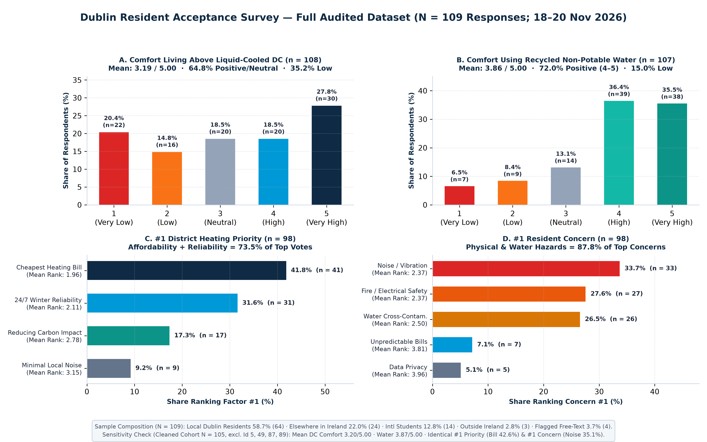

> **Figure 3.10 — Dublin Resident Acceptance Survey Dashboard (Full Audited Dataset $N = 109$)**
> *Four-panel empirical summary displaying: (A) Q3 comfort living above a liquid-cooled data centre ($n = 108$, mean $3.19/5.00$, $64.8\%$ positive or neutral); (B) Q5 comfort using recycled non-potable water ($n = 107$, mean $3.86/5.00$, $72.0\%$ positive); (C) Q4 #1 district heating priorities ($n = 98$: cheapest bill $41.8\%$, 24/7 winter reliability $31.6\%$, carbon reduction $17.3\%$, minimal noise $9.2\%$); and (D) Q6 #1 resident concerns ($n = 98$: noise/vibration $33.7\%$, fire/electrical safety $27.6\%$, water cross-contamination $26.5\%$, unpredictable bills $7.1\%$, data privacy $5.1\%$). Cleaned $N = 105$ sensitivity confirms identical rankings.*

**Table 3.13: Full empirical findings from RAKDA Ltd.'s Dublin resident acceptance survey (`Liquid-cooled data centre survey.xlsx`, RAKDA Ltd., 2026f)**

| Survey Dimension | Full Audited Dataset ($N = 109$) | Cleaned Sensitivity ($N = 105$, excl. 4 flagged) | Direct Design & Governance Implication |
| :--- | :--- | :--- | :--- |
| **Connection to Dublin** | Local Dublin: **$58.7\%$** ($64$); Elsewhere in Ireland: **$22.0\%$** ($24$); Intl Student: $12.8\%$ ($14$); Outside Ireland: $2.8\%$ ($3$); Flagged free-text: $3.7\%$ ($4$) | Local Dublin: **$61.0\%$** ($64$); Elsewhere in Ireland: $22.9\%$ ($24$); Intl Student: $13.3\%$ ($14$); Outside Ireland: $2.9\%$ ($3$) | **$80.7\%$ Irish-resident sample** ($83.8\%$ cleaned), providing credible local grounding across Dublin and wider Irish housing contexts |
| **Accommodation Type** | House: **$64.2\%$** ($70$; $65.1\%$ incl. *"A house"*); Student Accomm.: **$20.2\%$** ($22$); Apartment: **$11.9\%$** ($13$); Flagged/Other: $3.7\%$ ($4$) | House: **$66.7\%$** ($70$); Student Accomm.: $21.0\%$ ($22$); Apartment: $12.4\%$ ($13$) | Reflects Dublin's house-dominated existing stock ($21.2\%$ apartments) and underscores the value of clear compact-district communication |
| **Comfort Above Liquid-Cooled DC** *(1–5 scale, cheaper bills; $n = 108$)* | Mean: **$3.19 / 5.00$** · Positive (4–5): **$46.3\%$** ($50$) · Neutral (3): **$18.5\%$** ($20$) · Low (1–2): **$35.2\%$** ($38$) | Mean: **$3.20 / 5.00$** · Positive: $46.2\%$ ($48/104$) · Neutral: $18.3\%$ ($19$) · Low: $35.6\%$ ($37$) | **$64.8\%$ positive or neutral**, yet a **$35.2\%$ hesitant minority** proves social licence cannot be assumed—mandating plaza-only Level $-4$ siting and verified safety transparency |
| **#1 Ranked District Heating Priority** *($n = 98$ valid)* | **1st: Cheapest bill — $41.8\%$ ($41$, mean rank $1.96$)** · **2nd: 24/7 reliability — $31.6\%$ ($31$, $2.11$)** · 3rd: Carbon — $17.3\%$ ($17$, $2.78$) · 4th: Noise — $9.2\%$ ($9$, $3.15$) | **1st: Cheapest bill — $42.6\%$ ($40/94$)** · **2nd: 24/7 reliability — $30.9\%$ ($29$)** · 3rd: Carbon — $17.0\%$ ($16$) · 4th: Noise — $9.6\%$ ($9$) | **Affordability + Reliability $= 73.5\%$** — directly validates scaling to $10.0\text{ MW}$ for winter security and capping household bills at €536/yr (€95/$\text{MWh}_\text{th}$) |
| **Comfort Using Recycled Water** *(non-potable; 1–5 scale; $n = 107$)* | Mean: **$3.86 / 5.00$** · Positive (4–5): **$72.0\%$** ($77$) · Neutral (3): **$13.1\%$** ($14$) · Low (1–2): **$15.0\%$** ($16$) | Mean: **$3.87 / 5.00$** · Positive: $72.8\%$ ($75/103$) · Neutral: $11.7\%$ ($12$) · Low: $15.5\%$ ($16$) | Strong public trust (**$72.0\%$ positive**, $85.0\%$ positive/neutral) in non-potable circular water reuse; strict potable segregation preserves this confidence |
| **#1 Ranked Resident Concern** *($n = 98$ valid)* | **1st: Noise/vibration — $33.7\%$ ($33$, mean rank $2.37$)** · **2nd: Fire/electrical — $27.6\%$ ($27$, $2.37$)** · **3rd: Water — $26.5\%$ ($26$, $2.50$)** · 4th: Bills — $7.1\%$ ($7$, $3.81$) · 5th: Privacy — $5.1\%$ ($5$, $3.96$) | **1st: Noise/vibration — $35.1\%$ ($33/94$)** · **2nd: Fire/electrical — $26.6\%$ ($25$)** · **3rd: Water — $26.6\%$ ($25$)** · 4th: Bills — $6.4\%$ ($6$) · 5th: Privacy — $5.3\%$ ($5$) | **Physical & Water Hazards $= 87.8\%$** (Noise + Fire/Electrical $= 61.2\%$; Water $= 26.5\%$) — directly validates elastomeric base isolation, $1.0\text{ m}$ trenches, $<110\text{ dB}$ water mist, QXG shielding, and I.S. EN 16941 air-gaps |

#### Key Engineering Takeaways from Public Consultation

1. **Affordability and Reliability Outweigh Carbon Altruism:** Nearly three-quarters of respondents (**$73.5\%$**) ranked lowest heating bill ($41.8\%$) or 24/7 winter reliability ($31.6\%$) ahead of carbon reduction ($17.3\%$). Circular infrastructure must therefore succeed on household economics (€536/yr vs. €1,040 gas) and winter cold-snap security ($10.0\text{ MW}$ supply plus $8.0\text{ MW}_\text{th}$ backup HTHPs).
2. **Noise/Vibration and Fire/Electrical Safety Lead Resident Risk Perception:** Across the full $N = 109$ sample ($n = 98$ valid rankings), **noise/vibration ($33.7\%$)** emerged as the #1 concern (tied in mean rank at $2.37$ with **fire/electrical safety at $27.6\%$**), while data privacy ranked last ($5.1\%$). Because $35.2\%$ of respondents also reported low initial comfort (1–2/5) living above a data centre, plaza-only Level $-4$ bedrock siting, elastomeric base-isolation bearings ($-85\%$ vibration), $1.0\text{ m}$ perimeter trenches, $<110\text{ dB}$ water-mist suppression, and live public acoustic monitoring are mandatory social-licence requirements rather than optional refinements.
3. **Water Acceptance Hinges on Cross-Contamination Prevention:** While $72.0\%$ support recycled non-potable water (mean $3.86 / 5.00$), **$26.5\%$** identified drinking-water cross-contamination as their foremost concern (mean rank $2.50$). Enforcing I.S. EN 16941 Type AA/AB physical air-gaps, UV-C LED disinfection, and continuous TOC/flow-cytometry monitoring converts that concern into a verifiable engineering barrier.
4. **Industry Outreach Protocols:** Structured interview protocols for a practising data-centre MEP engineer and an Irish district heating operator (Codema / Heat Works) remain prepared in Appendix C for optional supplementary validation.

---

### 3.12 Principal Engineering Risks, Mitigations, and Limitations

**Table 3.14: Principal engineering risk register ($10.0\text{ MW}$ baseline)**

| Risk | Potential Consequence | Engineering Mitigation | Residual Risk |
| :--- | :--- | :--- | :--- |
| **$75^\circ\text{C}$ microfluidics underperforms** | Coolant capped at $45^\circ\text{C}$ (Scenario B); $+3.84\text{--}5.76\text{ GWh}_\text{e}/\text{yr}$ HTHP load (+€9.4–€15.8/$\text{MWh}_\text{th}$ LCOH) | Size $8.0\text{ MW}_\text{th}$ backup natural-refrigerant HTHPs from inception; treat direct $75^\circ\text{C}$ DHW as base upside | Medium |
| **Low IT utilisation ($<60\%$) or tenant exit** | Winter cold-snap heat shortfall; reduced colocation revenue | $2,500\text{ m}^3$ thermal store + backup HTHPs; ring-fenced utility ownership; long-term heat offtake SLA | Medium |
| **Network temperature / insulation mismatch** | Distribution losses exceed $7.0\text{ W/m}$ ($4.9\%$) benchmark | Pre-insulate all $75^\circ\text{C}$ EN 253 risers; step $45^\circ\text{C}$ loop to $20\text{--}25^\circ\text{C}$ via mains preheating before uninsulated 5GDHC ring | Low–Medium |
| **Summer surplus ($30.1\text{ GWh}_\text{th}$) rejection failure** | Server thermal throttling or groundwater thermal plumes | Independent N+1 dry coolers + 4-step Exergy-Priority Cascade + $\ge 80\text{ cm}$ pipe spacing | Low |
| **Grid connection refusal or blackout ($\ge 10\text{ MVA}$)** | Simultaneous disruption of compute and district heating | $12\text{ MW}_p$ PV + $8\text{ MW}/32\text{ MWh}$ LFP BESS + $2\text{ MW}_\text{e}$ TI-PTES + backup HTHPs | Medium |
| **Microchannel fouling or PFAS accumulation** | Silicon overheating; hazardous landfill residue | Inert roof segregation; UF + MCDI + $\le 1.0\text{ }\mu\text{S/cm}$ DI + continuous TOC/flow cytometry + on-site BDD oxidation | Medium |
| ***Legionella* or potable cross-contamination** | Public health hazard ($26.5\%$ #1 survey concern, $N = 109$) | DHW stored at $\ge 60^\circ\text{C}$; cool ring-fenced rainwater cistern; I.S. EN 16941 air-gaps; routine monitoring | Low (if controlled) |
| **Acoustic, vibration, flood, or fire event** | Resident nuisance; asset damage ($61.2\%$ combined #1 survey concerns: $33.7\%$ noise + $27.6\%$ fire/electrical) | Level $-4$ bedrock plaza siting; elastomeric bearings + $1.0\text{ m}$ trenches; flood-sealed entries; $<110\text{ dB}$ water mist | Low–Medium |
| **2045 CapEx escalation ($+30\%$)** | Higher unsubsidised utility LCOH (€126.6–€137.2/$\text{MWh}_\text{th}$) | Commercial colocation co-investment (retains $5.9\%\text{--}11.6\%$ Case 2 IRR at $+30\%$ CapEx) + $30\%$ SEAI/EU grant | Medium |

**Key Study Limitations:** (1) Energy and hydrological balances rely on annual and seasonal steady-state averages rather than 8,760-hour coupled transient simulations; (2) 2045 emerging-hardware costs (microfluidics, HTS, HCF, TCES, micro-ORC) represent parametric learning-curve estimates rather than commercial vendor quotations; (3) no specific Dublin site parcel has been mapped, deferring exact pipe runs, dwelling-specific floor areas, and the $15.54\text{ ha}$ school-land resolution to detailed masterplanning; and (4) while the full $N = 109$ resident survey (RAKDA Ltd., 2026f) has been audited and verified against a cleaned $N = 105$ sensitivity cohort, optional supplementary MEP and district-heating operator interviews (Appendix C.2) remain outside the current desk-study scope.

---

## 4. Conclusions and References

### 4.1 Conclusions and Objective Scorecard (O1–O12)

Integrating a **$10.0\text{ MW}$ ($5 \times 2.0\text{ MW}$) subterranean liquid-cooled data centre** into a 20,000-resident, $180\text{ ha}$ 2045 circular Irish urban district is thermodynamically, hydrologically, digitally, socially, ethically, and financially coherent—provided five governing engineering rules are enforced:

1. **Zero-PFAS High-Grade Cooling with Thermal Fallback:** Replacing fluorocarbon immersion with Dual-Regime In-Silicon Microfluidics ($75^\circ\text{C} / 45^\circ\text{C}$) while retaining full $8.0\text{ MW}_\text{th}$ Scenario B HTHP backup.
2. **Quality-First Hydrological Closure:** Segregating clean inert roof rainwater, polishing cooling makeup to $\le 1.0\text{ }\mu\text{S/cm}$, mineralising captured PFAS on site via BDD oxidation, and isolating non-potable loops behind I.S. EN 16941 air-gaps.
3. **Exergy-Prioritised Heat Dispatch:** Prioritising SDN electro-thermal shifting ($74.9\times$ more efficient than hydronic pumping) and non-electrical thermal cascades ($1.8\times\text{--}12.5\times$ grid value over $\approx 8\%$ micro-ORC conversion) for summer surpluses.
4. **Ring-Fenced Co-Investment Governance:** Structuring ownership across a regulated public utility and a commercial colocation developer so residential bills satisfy citizens' #1 affordability priority (€536/home/yr) while whole-system returns remain bankable ($15.7\%$ IRR, 6.2-year simple payback, and $-50.3\%$ societal 30-year TCO savings versus individual heat pumps).
5. **Carbon Accounting Rigour:** Acknowledging transparently that heat recovery and $\text{PUE } 1.015$ efficiency substantially reduce the environmental burden of computing without rendering it carbon-neutral unless powered by additional indigenous renewables.

**Table 4.1: Measurable project objectives scorecard (O1–O12)**

| ID | Objective Summary | Key $10.0\text{ MW}$ Outcome | Status |
| :--- | :--- | :--- | :--- |
| **O1** | Size IT capacity, power, racks & vault area | $10.0\text{ MW}$ ($5 \times 2.0\text{ MW}$); $800\text{ VDC}$/HTS; 9–40 racks ($25\text{--}120\text{ m}^2$ IT; $\approx 350\text{ m}^2$ plant room) | **Achieved** |
| **O2** | Annual recovered heat vs. demand | $85,848\text{ MWh}_\text{th}/\text{yr}$ ($228.3\%$ of 7,500-home demand; $130.4\%$ conservative; $43.8\%$ break-even $u$) | **Achieved** |
| **O3** | Seasonal/winter peak & thermal storage | $9.80\text{ MW}_\text{th}$ covers $9.52\text{ MW}_\text{th}$ winter peak; $217\text{ m}^3$ buffers + $2,500\text{ m}^3$ store for $60\text{--}80\%$ load | **Achieved** |
| **O4** | DHW *Legionella* & HTHP fallback | Direct $75^\circ\text{C}$ PHE pasteurisation ($\ge 60^\circ\text{C}$); Scenario B HTHPs $\text{COP } 4.6\text{--}6.9$ ($3.84\text{--}5.76\text{ GWh}_\text{e}/\text{yr}$) | **Achieved** |
| **O5** | Network heat loss & pumping power | Hybrid EN 253 / near-ambient 5GDHC ($7.0\text{ W/m}$, $1,840\text{ MWh}_\text{th}/\text{yr} = 4.9\%$); primary pump $= 22.1\text{ kW}_\text{e}$ | **Achieved** |
| **O6** | Dublin rainwater yield & purity | $772.5\text{ mm/yr} \rightarrow 55.6\text{--}62.4\text{k m}^3/\text{yr}$ per $100\text{k m}^2$; $158\text{--}175\text{k m}^3/\text{yr}$ saved; $\le 1.0\text{ }\mu\text{S/cm}$ + BDD PFAS | **Achieved** |
| **O7** | ORC/TEG vs. exergy cascades | $17.95\%$ Carnot $\rightarrow \approx 8\%$ ORC ($2.0\text{--}2.4\text{ GWh}_\text{e}/\text{yr}$); non-electrical cascades yield $1.8\times\text{--}12.5\times$ grid value | **Achieved** |
| **O8** | Feasibility, latency, SDN & risks | $3.17\text{ }\mu\text{s}$ RTT ($-99.9\%$); $87.34\%$ local; $74.9\times$ SDN shifting; Level $-4$ isolation & full risk register | **Achieved** |
| **O9** | 30-year LCA (2045–2075) | $\ge 30\%$ GGBS concrete, $-98\%$ copper, 5-vault staggered refreshes, service-life register, WEEE & 50-yr vault reuse | **Achieved** |
| **O10** | 30-year financials & counterfactual TCO | €137.08M CapEx; Case 2: $15.7\%$ IRR, 6.2-yr payback, $-50.3\%$ TCO vs. ASHPs; 18-case sensitivity matrix | **Achieved** *(Parametric 2045 bounds)* |
| **O11** | 6 ethical domains & lecture frameworks | Public welfare override across 6 domains, Ali/Byrne/Ahmad/O'Dwyer lectures, EU AI Act & honest carbon audit | **Achieved** |
| **O12** | Stakeholder register & empirical survey | 9 stakeholder groups traced; **full $N = 109$ resident survey audited** (plus cleaned $N = 105$ sensitivity check; Figure 3.10) | **Achieved** |

*Final Binding Checklist (Human / Team Sign-Off Items):* (1) Attach the signed weekly attendance record and meeting minutes (Weeks 6–12) in Appendix D (COO — Ava O'Dwyer); (2) record the supervisor's proposal approval date in Table 1.2; (3) confirm exact lecture titles and lecturer initials for Byrne (2026) and O'Dwyer (2026) in §4.2 and final CSO table citation for the 2025 urban apartment completion share ($69.4\%$) in §3.1; and (4) ensure the Week 12 oral presentation deck mirrors this $10.0\text{ MW}$ Draft 3.2 baseline.

*Finis coronat opus.*

---

### 4.2 References

* Advanced Analytics US (2026) *Field Guide: Data Center Electrical Equipment Preview* (citing CBRE colocation pricing and JLL 2026 equipment lead times).
* Ahmad, K. (2026) *1E17 Engineering Practice 2 Lecture on Artificial Intelligence, Energy/Water Footprints and Hallucinations*. Unpublished lecture slides, Trinity College Dublin.
* AKCP (2026) *Ireland Data Center Regulations*. 28 July 2026. Available at: https://www.akcp.com/2026/07/28/ireland-data-center-regulations/ (Accessed: November 2026).
* Ali, M. (2026a) *1E17 Engineering Practice 2 Lecture on Sustainability, the Food–Water–Energy–Climate Nexus and Urban Water Engineering*. Unpublished lecture slides, Trinity College Dublin.
* Ali, M. (2026b) *1E17 Engineering Practice 2 Lecture on Energy and Carbon Accounting, Grid Emission Factors and Irish Climate Targets*. Unpublished lecture slides, Trinity College Dublin.
* Archdesk (2026) *Global AI Data Center Construction 2026* (citing JLL *2026 Global Data Center Outlook* and Turner & Townsend *Data Centre Construction Cost Index 2025*).
* Arpagaus, C., Bless, F., Uhlmann, M., Schiffmann, J. and Bertsch, S.S. (2018) 'High temperature heat pumps: market overview, state of the art, research status, refrigerants, and application potentials', *Energy*, 152, pp. 985–1010. doi:10.1016/j.energy.2018.03.166.
* Arthur Cox (2026) *New Connection Policy for Data Centres in Ireland* (CRU Decision CRU/2025/236 & EirGrid DCCOPP V3). Dublin: Arthur Cox LLP.
* Bashroush, R. (2018) 'A comprehensive reasoning framework for hardware refresh in data centers', *IEEE Transactions on Sustainable Computing*, 3(4), pp. 209–220. doi:10.1109/TSUSC.2018.2795465.
* Buffa, S., Cozzini, M., D'Antoni, M., Baratieri, M. and Fedrizzi, R. (2019) '5th generation district heating and cooling systems: a review of existing cases in Europe', *Renewable and Sustainable Energy Reviews*, 104, pp. 504–522. doi:10.1016/j.rser.2018.12.059.
* BuilderMuse (2026) *US vs. Europe Data Center Construction Costs* (citing Turner & Townsend *Data Centre Construction Cost Index 2025–2026* and JLL). 10 April 2026.
* Byrne (2026) *1E17 Engineering Practice 2 Lecture on Circularity in the Built Environment, Building Layers and Climate Resilience*. Unpublished lecture slides, Trinity College Dublin *(lecturer initial to be confirmed)*.
* CEN (2002) *EN 1990:2002 Eurocode – Basis of structural design*. Brussels: European Committee for Standardization.
* Çengel, Y.A., Boles, M.A. and Kanoğlu, M. (2019) *Thermodynamics: an engineering approach*. 9th edn. New York: McGraw-Hill Education.
* Central Statistics Office (CSO) (2023) *Census of Population 2022 – summary results: household size and marital status*. Cork: CSO. Available at: https://www.cso.ie/en/releasesandpublications/ep/p-cpsr/censusofpopulation2022-summaryresults/householdsizeandmaritalstatus/ (Accessed: 16 November 2026).
* Central Statistics Office (CSO) (2025) *Data Centres Metered Electricity Consumption 2024*. Statistical release, 10 June. Cork: CSO. Available at: https://www.cso.ie/en/releasesandpublications/ep/p-dcmec/datacentresmeteredelectricityconsumption2024/keyfindings/ (Accessed: 14 November 2026).
* Central Statistics Office (CSO) (2026) *Urban and rural life in Ireland 2025: housing*. Cork: CSO. Available at: https://www.cso.ie/en/releasesandpublications/ep/p-urli/urbanandrurallifeinireland2025/housing/ (Accessed: 16 November 2026).
* Climate Change Advisory Council (CCAC) (2024) *Working Paper No. 29: District Heating Infrastructure Costs and Policy Options in Ireland*. Dublin: CCAC.
* Codema (2022) *Heating and Cooling Plan for Dublin (Decarb City Pipes 2050, Deliverable D3.3)*. Dublin: Codema – Dublin's Energy Agency.
* Codema (2026) *Tallaght District Heating Scheme*. Available at: https://www.codema.ie/our-work/tallaght-district-heating-scheme/ (Accessed: 14 November 2026).
* Cousins, I.T., Johansson, J.H., Salter, M.E., Sha, B. and Scheringer, M. (2022) 'Outside the safe operating space of a new planetary boundary for per- and polyfluoroalkyl substances (PFAS)', *Environmental Science & Technology*, 56(16), pp. 11172–11179.
* Covington & Burling LLP (2025) *The EU's Energy Efficiency Directive and its impact on datacenters*. Available at: https://www.cov.com/-/media/files/corporate/publications/2025/04/the-eus-energy-efficiency-directive-and-its-impact-on-datacenters.pdf (Accessed: 14 November 2026).
* Department of Education and Skills (2017) *Barnhill Local Area Plan Submission – School Demand and Site Area Methodology* (cited in RAKDA Ltd., 2026e).
* Department of Housing, Local Government and Heritage (2024) *Sustainable residential development and compact settlements: guidelines for planning authorities*. Dublin: Government of Ireland. Available at: https://www.opr.ie/wp-content/uploads/2024/01/Sustainable-Residential-Development-and-Compact-Settlements-Guidelines-for-Planning-Authorities.pdf (Accessed: 16 November 2026).
* Directive 2012/19/EU of the European Parliament and of the Council of 4 July 2012 on waste electrical and electronic equipment (WEEE) (recast). *Official Journal of the European Union*, L 197, 24 July 2012. Available at: https://eur-lex.europa.eu/eli/dir/2012/19/oj/eng (Accessed: 14 November 2026).
* Directive (EU) 2023/1791 of the European Parliament and of the Council of 13 September 2023 on energy efficiency and amending Regulation (EU) 2023/955 (recast). *Official Journal of the European Union*, L 231, 20 September 2023, p. 1. Available at: https://eur-lex.europa.eu/eli/dir/2023/1791/oj/eng (Accessed: 14 November 2026).
* DLA Piper (2026) *New Irish Large Energy Users connection policy*. 7 January. Available at: https://www.dlapiper.com/en/insights/publications/2026/01/new-irish-large-energy-users-connection-policy (Accessed: 14 November 2026).
* Ebrahimi, K., Jones, G.F. and Fleischer, A.S. (2014) 'A review of data center cooling technology, operating conditions and the corresponding low-grade waste heat recovery opportunities', *Renewable and Sustainable Energy Reviews*, 31, pp. 622–638. doi:10.1016/j.rser.2013.12.007.
* Engineers Ireland (2023) *Code of Ethics*. Dublin: Engineers Ireland. Available at: https://www.engineersireland.ie/Professionals/News-Insights/Resource-centre/Member-resources/Code-of-ethics (Accessed: 14 November 2026).
* Health and Safety Executive (HSE) (2024) *Legionnaires' disease: hot and cold water systems*. Available at: https://www.hse.gov.uk/legionnaires/hot-and-cold.htm (Accessed: 14 November 2026).
* Health Protection Surveillance Centre (HPSC) (2009) *National guidelines for the control of legionellosis in Ireland, 2009*. Dublin: HPSC. Available at: https://www.hpsc.ie/a-z/microbiologyantimicrobialresistance/infectioncontrolandhai/guidelines/National%20Guidelines%20for%20the%20control%20of%20legionellosis%20in%20Ireland%202009.pdf (Accessed: 14 November 2026).
* Huang, P., Copertaro, B., Zhang, X., Shen, J., Löfgren, I., Rönnelid, M., Fahlen, J., Andersson, D. and Svanfeldt, M. (2020) 'A review of data centers as prosumers in district energy systems: renewable energy integration and waste heat reuse for district heating', *Applied Energy*, 258, 114109. doi:10.1016/j.apenergy.2019.114109.
* International Energy Agency (IEA) (2025) *Energy and AI*. Paris: IEA. Available at: https://www.iea.org/reports/energy-and-ai (Accessed: 14 November 2026).
* Interreg Europe (2026) *Waste heat recovery from data centre for district heating supply: Tallaght District Heating Scheme*. Available at: https://www.interregeurope.eu/good-practices/waste-heat-recovery-from-data-centre-for-district-heating-supply-tallaght-district-heating-scheme (Accessed: 14 November 2026).
* Jakubowicz, I., Sällström, J.H., Vega, A. and Yarahmadi, N. (2022) *Lifetime predictions and status assessments of district heating pipelines*. Report 2022:872. Stockholm: Energiforsk. Available at: https://energiforsk.se/media/31455/liftetime-predictions-and-status-assessments-energiforskrapport-2022-872.pdf (Accessed: 14 November 2026).
* Lund, H., Werner, S., Wiltshire, R., Svendsen, S., Thorsen, J.E., Hvelplund, F. and Mathiesen, B.V. (2014) '4th Generation District Heating (4GDH): integrating smart thermal grids into future sustainable energy systems', *Energy*, 68, pp. 1–11. doi:10.1016/j.energy.2014.02.089.
* Met Éireann (2023) *Dublin Airport 1991–2020 averages*. Available at: https://www.met.ie/cms/assets/uploads/2023/09/www_met_ie_dublin_9120.htm (Accessed: 14 November 2026).
* Met Éireann (2025) *TRANSLATE: Standardised Future Climate Projections for Ireland*. Dublin: Met Éireann.
* O'Dwyer (2026) *1E17 Engineering Practice 2 Lecture on Responsible Artificial Intelligence, Creative Labour and Societal Impacts*. Unpublished lecture slides, Trinity College Dublin *(lecturer initial to be confirmed)*.
* RAKDA Ltd. (2026a) *Closed-loop datacentre heat recovery system: proposal draft, team profiles and working notes*. Unpublished group documents, Trinity College Dublin, 28 October – 21 November 2026.
* RAKDA Ltd. (2026b) *2045 data centre compute density, efficiency trajectories, and experimental hardware paradigms*. Unpublished research note, Trinity College Dublin.
* RAKDA Ltd. (2026c) *Rainwater collection and filtration: research for the rain loop of the 2045 circular district*. Unpublished research note, Trinity College Dublin, 13 November 2026.
* RAKDA Ltd. (2026d) *Subterranean urban data centres: network latency compression, autonomous traffic routing, and electro-thermal workload orchestration*. Unpublished research note, Trinity College Dublin.
* RAKDA Ltd. (2026e) *A modern urban district for 20,000 residents: Irish survey evidence, design assumptions, housing programme and indicative land allocation*. Unpublished district study, Trinity College Dublin.
* RAKDA Ltd. (2026f) *Liquid-cooled data centre survey (`Liquid-cooled data centre survey.xlsx`, $N = 109$ anonymous responses)*. Primary stakeholder survey dataset, Trinity College Dublin, launched 18 November 2026.
* Regulation (EU) 2024/573 of the European Parliament and of the Council of 7 February 2024 on fluorinated greenhouse gases, amending Directive (EU) 2019/1937 and repealing Regulation (EU) No 517/2014. *Official Journal of the European Union*. Available at: https://eur-lex.europa.eu/eli/reg/2024/573/oj/eng (Accessed: 14 November 2026).
* Regulation (EU) 2024/1689 of the European Parliament and of the Council of 13 June 2024 laying down harmonised rules on artificial intelligence (Artificial Intelligence Act). *Official Journal of the European Union*. Available at: https://eur-lex.europa.eu/eli/reg/2024/1689/oj/eng (Accessed: November 2026).
* SEAI (2022) *Low carbon heating and cooling technologies: options, costs, performance and suitability*. National Heat Study, Report 4. Dublin: Sustainable Energy Authority of Ireland. Available at: https://www.seai.ie/publications/Low-Carbon-Heating-and-Cooling-Technologies.pdf (Accessed: 14 November 2026).
* SEAI (2025) *Comprehensive Assessment of the Potential for Efficient Heating and Cooling – Technical Annex*. Dublin: Sustainable Energy Authority of Ireland.
* SEAI (2026) *Commercial and Domestic Fuel Cost Comparison (S1 2026)* (Band IF €196.10/MWh electricity; Band D1 €139.90/MWh gas). Dublin: Sustainable Energy Authority of Ireland.
* Tokamak Energy (2026) *High-Temperature Superconducting Data Centre Busway Feasibility Study* ($99\%$ efficiency, $-98\%$ copper). Oxford: Tokamak Energy.
* Trinity College Dublin (2026a) *1E17 Project 2026: the Circular City – project description 2026–27*. Unpublished course document.
* Trinity College Dublin (2026b) *1E17 Engineering Practice 2: project setup slides*. Unpublished lecture slides.
* TU Dublin (2024) *Climate Action Opportunity Evaluation Report* (citing Irish Infrastructure Guidelines €322/$\text{tCO}_2$ Shadow Cost of Carbon). Dublin: Technological University Dublin.
* Uisce Éireann / CRU (2026) *Non-Domestic Water and Wastewater Tariff Framework 2026/27* (Band 3: €1.66/$\text{m}^3$ supply, €2.38/$\text{m}^3$ wastewater). Dublin: Commission for Regulation of Utilities.
* Uptime Institute (2024) *Uptime Institute global data center survey 2024*. Keynote Report 146M. Available at: https://datacenter.uptimeinstitute.com/rs/711-RIA-145/images/2024.GlobalDataCenterSurvey.Report.pdf (Accessed: 14 November 2026).
* U.S. DOE / NIST / SLAC (2024–2026) *Energy Efficiency Scaling for Two Decades (EES2) Roadmap*. Washington, DC: U.S. Department of Energy.
* Van Erp, R., Soleimanzadeh, R., Nela, L., Kampitsis, G. and Matioli, E. (2020) 'Co-designing electronics with microfluidics for more sustainable cooling', *Nature*, 585, pp. 211–216. doi:10.1038/s41586-020-2666-1.
* Wahlroos, M., Pärssinen, M., Rinne, S., Syri, S. and Manner, J. (2018) 'Future views on waste heat utilization – case of data centers in Northern Europe', *Renewable and Sustainable Energy Reviews*, 82, pp. 1749–1764. doi:10.1016/j.rser.2017.10.058.
* Yuan, X., Liang, Y., Hu, X., Xu, Y., Chen, Y. and Kosonen, R. (2023) 'Waste heat recoveries in data centers: a review', *Renewable and Sustainable Energy Reviews*, 188, 113777. doi:10.1016/j.rser.2023.113777.

---

## Appendices

### Appendix A: Master Assumptions Register ($10.0\text{ MW}$ Baseline)

**Table A.1: Consolidated district, technical, and financial assumptions register**

| Parameter | Adopted Value | Classification | Evidence Basis / Caveat |
| :--- | :--- | :--- | :--- |
| **District population & area** | 20,000 residents; $180\text{ ha}$ ($1.80\text{ km}^2$) | Brief requirement / design choice | TCD 1E17 brief; RAKDA Ltd. (2026e) |
| **Housing stock & typology** | 7,500 homes (3,095 bldgs; $60\%$ apartments; 2–7 floors) | Census-audited design choice | CSO Census 2022 ($2.74/\text{hh} \rightarrow 7,299$ + margin); above $21.2\%$ existing stock |
| **Residential land & parks** | $90\text{ ha}$ residential ($83.3\text{ dph}$); $25\text{ ha}$ parks ($13.9\%$ gross) | Design choice | Net site boundaries unmapped; $10\text{--}15\%$ open-space rule applies to net area |
| **Schools & community land** | $15.0\text{ ha}$ allocated | Potentially inadequate | Screening requires $\approx 15.54\text{ ha}$ for schools alone (Appendix E) |
| **Unit floor area & heat demand** | $100\text{ m}^2/\text{home}$; $15\text{ kWh/m}^2\cdot\text{yr}$ space; $9.63\text{ kWh/d}$ DHW $\rightarrow 37,610\text{ MWh}_\text{th}/\text{yr}$ *(exact $37,612$)* | Team estimate / calculated | Uniform $100\text{ m}^2$ simplifies smaller apartments; $8,000$-home check $= 40,100\text{ MWh}_\text{th}/\text{yr}$ *(exact $40,120$)* |
| **Winter cold-snap peak** | $9.52\text{ MW}_\text{th}$ ($10.15\text{ MW}_\text{th}$ at 8,000 homes) | Scaled engineering estimate | 180-day heating season; hourly transient profile pending |
| **IT capacity & vault split** | $10.0\text{ MW}$ ($5 \times 2.0\text{ MW}$ vaults; $2.40\text{ MW}$ burst) | Design choice | Scaled from initial $6.0\text{ MW}$ concept to meet peak winter load |
| **Cooling & PUE** | $80\%$ @ $75^\circ\text{C}$, $20\%$ @ $45^\circ\text{C}$; $\text{PUE} = 1.015$ | 2045 engineering projection | Lab microfluidic $\text{COP} = 106,000$; not yet demonstrated at $10\text{ MW}$ scale |
| **Dublin rainfall & yield** | $772.5\text{ mm/yr}$; $C_r = 0.80$; $\eta_f = 0.90$ | Verified climate data / estimate | Met Éireann (2023); $55.6\text{--}62.4\text{k m}^3/\text{yr}$ per $100\text{k m}^2$ clean roof |
| **Hybrid 5GDHC network** | $\approx 30\text{ km}$ near-ambient HDPE ($\ge 80\text{ cm}$ gap, $7.0\text{ W/m}$) + EN 253 risers | Research estimate / layout assumption | RAKDA Ltd. (2026a); exact pipe length pending mapped site layout |
| **Financial discount rates** | $4\%$ public utility; $8\%$ private hurdle | Standard Irish DCF | Infrastructure Guidelines; tested across 18 scenarios in Table 3.10 |
| **Green CPPA & heat tariff** | €125/$\text{MWh}_\text{e}$ CPPA; €95.0/$\text{MWh}_\text{th}$ heat tariff | Calibrated 2026 Irish benchmarks | SEAI (2026); CRU/2025/236; Heat Works residential tariff unpublished |

---

### Appendix B: Key Engineering Calculations ($10.0\text{ MW}$ Baseline)

1. **Annual Thermal Recovery ($Q_\text{rec}$):**
   * Base ($u=1.00, f_\text{cap}=0.98$): $Q_\text{rec} = 10.0 \times 1.00 \times 0.98 \times 8,760 = 85,848\text{ MWh}_\text{th}/\text{yr}$ ($9.80\text{ MW}_\text{th}$). Coverage $= 85,848 / 37,610 = \mathbf{228.3\%}$.
   * Conservative ($u=0.70, f_\text{cap}=0.80$): $Q_\text{rec} = 10.0 \times 0.70 \times 0.80 \times 8,760 = 49,056\text{ MWh}_\text{th}/\text{yr}$ ($\mathbf{130.4\%}$).
   * Break-even utilisation: $u = 37,610 / 85,848 = \mathbf{43.8\%}$ (at $98\%$ capture) or $\mathbf{53.7\%}$ (at $80\%$ capture).
2. **Primary & Secondary Loop Flows and Primary Pumping Power ($\Delta p = 200\text{ kPa}$, $\eta_p = 0.70$):**
   * Primary $75^\circ\text{C}$ water loop ($8.00\text{ MW}$ gross design basis, $\Delta T = 25\text{ K}$, $\rho c_p \approx 4.142\text{ MJ/m}^3\cdot\text{K}$): $\dot{V}_1 = 8,000 / (4.142 \times 25) = 0.07725\text{ m}^3/\text{s} = \mathbf{4,635.3\text{ L/min}}$ (at $98\%$ net capture $= 7.84\text{ MW}_\text{th}$: $4,542.6\text{ L/min}$).
   * Secondary $45^\circ\text{C}$ water loop ($2.00\text{ MW}$ gross design basis, $\Delta T = 15\text{ K}$, $\rho c_p \approx 4.160\text{ MJ/m}^3\cdot\text{K}$): $\dot{V}_2 = 2,000 / (4.160 \times 15) = 0.03205\text{ m}^3/\text{s} = \mathbf{1,923.1\text{ L/min}}$ (at $98\%$ net capture $= 1.96\text{ MW}_\text{th}$: $1,884.6\text{ L/min}$; synthetic ester option $\rho c_p \approx 1.83\text{ MJ/m}^3\cdot\text{K}$ requires $\approx 4,370\text{ L/min}$).
   * Primary shaft power (gross design basis): $P_\text{pump} = (0.07725 \times 200,000) / 0.70 = 22,071\text{ W} \approx \mathbf{22.1\text{ kW}_\text{e}}$ ($\approx 194\text{ MWh}_\text{e}/\text{yr}$).
3. **Cold-Snap Storage Volume ($60\%$ Utilisation Stress Case: $3.64\text{ MW}_\text{th}$ Deficit for $24\text{ h}$):**
   * Energy deficit: $E = 3.64\text{ MW} \times 24\text{ h} = 87.36\text{ MWh}_\text{th} = 3.145 \times 10^8\text{ kJ}$.
   * Storage volume ($\Delta T = 30\text{ K}$, $\rho = 1,000\text{ kg/m}^3$, $c_p = 4.18\text{ kJ/kg}\cdot\text{K}$): $V = (3.145 \times 10^8) / (1,000 \times 4.18 \times 30) \approx \mathbf{2,508\text{ m}^3}$.
4. **Scenario B HTHP Electricity ($40^\circ\text{C} \rightarrow 70^\circ\text{C}$):**
   * $\text{COP}_\text{Carnot} = 343.15 / (343.15 - 313.15) = 11.44$. At $40\%\text{--}60\%$ of Carnot $\rightarrow \text{COP} = 4.58\text{--}6.86$.
   * Annual DHW upgrading electricity $= 26,362 / (6.86\text{ to }4.58) = \mathbf{3,843\text{--}5,756\text{ MWh}_\text{e}/\text{yr}}$.
5. **PUE Electricity and Evaporative Water Savings:**
   * Electricity saved vs. $\text{PUE } 1.56$: $10.0 \times (1.56 - 1.015) \times 8,760 = \mathbf{47,742\text{ MWh}_\text{e}/\text{yr}}$.
   * Evaporative water avoided ($\text{WUE } 1.8\text{--}2.0\text{ L/kWh}$): $10,000 \times 8,760 \times (1.8\text{--}2.0) / 1,000 = \mathbf{157,680\text{--}175,200\text{ m}^3/\text{yr}}$ (€261,749–€290,832/yr at €1.66/$\text{m}^3$).
6. **Second Law ORC Bound and Summer Ceiling ($75^\circ\text{C}$ Source, $12.5^\circ\text{C}$ Sink):**
   * $\eta_\text{Carnot} = 1 - 285.65 / 348.15 = 17.95\%$; practical $\eta_\text{ORC} \approx 8.0\%$.
   * 185-day summer surplus: $(9.80 - 3.01)\text{ MW}_\text{th} \times 4,440\text{ h} = 30,148\text{ MWh}_\text{th}$. Un-cascaded ORC ceiling $= 30,148 \times 0.08 = \mathbf{2,412\text{ MWh}_\text{e}/\text{yr}}$ ($\approx 543\text{ kW}_\text{e}$ summer; $\approx 2,000\text{ MWh}_\text{e}/\text{yr}$ dispatched after exergy cascade).
7. **SDN Bit Routing vs. Hydronic Pumping ($1.0\text{ MW}$ over $1.2\text{ km}$):**
   * Hydronic ($2,400\text{ m}$ round-trip): $1,930\text{ W}$ pump + ($7.0\text{ W/m} \times 2,400\text{ m} = 16,800\text{ W}$ loss) $= 18,730\text{ W}$.
   * Optical ($5.0\text{ Tbps}$ @ $0.05\text{ W/Gbps}$) $= 250\text{ W}$. Efficiency ratio $= 18,730 / 250 = \mathbf{74.92\times}$.
8. **Carbon Accounting Check (Ali 2026b Emission Factors):**
   * Gas-boiler baseline: $(37,610 / 0.90) \times 0.175 = \mathbf{7,313\text{ t CO}_2/\text{yr}}$.
   * Data-centre net grid emissions ($88,914 - 10,956 = 77,958\text{ MWh}_\text{e}/\text{yr}$): $\times 0.163 = \mathbf{12,707\text{ t CO}_2/\text{yr}}$; $\times 0.308 = \mathbf{24,011\text{ t CO}_2/\text{yr}}$.

---

### Appendix C: Stakeholder Engagement Evidence and Interview Protocol

#### C.1 Executed Dublin Resident Acceptance Survey (`Liquid-cooled data centre survey.xlsx`)

* **Instrument:** Anonymous 6-question Microsoft Form deployed online on 18 November 2026 (no personal names or emails collected; voluntary informed participation).
* **Sample Logged:** **$N = 109$ responses** (`Sheet1!A2:K110`).
* **Survey Questions:**
  1. *Which best describes your current connection to Dublin?* (Local Resident / International College Student / Resident elsewhere in Ireland / Other)
  2. *What type of accommodation do you currently live in?* (House / Apartment / Student Accommodation / Other)
  3. *How comfortable would you feel living above a liquid-cooled data centre (given electricity prices would be cheaper)?* (1–5 rating)
  4. *Which factors mean the most to you regarding district heating (rank most to least important)?* (Cheapest heating bill; 24/7 winter reliability and heating supply; Reducing carbon emissions and environmental impact; Minimal local construction and operation noise)
  5. *How comfortable would you feel using recycled water for dishwashers, laundry, garden irrigation, etc.?* (1–5 rating)
  6. *What are your main concerns about living in a district powered by an underground data centre (rank highest concern to lowest)?* (Fire or electrical safety risk; Noise / frequency vibration from data centre; Water quality or cross-contamination between rainwater and drinking water; Risk of unpredictable utility bills; Data privacy)
* **Full Data-Cleaning Audit ($N = 109$, RAKDA Ltd., 2026f):** All 109 logged responses (`Sheet1!A2:K110`, IDs 1–110 excluding absent `Id 4`) were audited programmatically. Valid item counts: Q1/Q2 ($N = 109$), Q3 ($n = 108$, 1 blank), Q4 ($n = 98$, 11 blanks), Q5 ($n = 107$, 2 blanks), and Q6 ($n = 98$, 11 blanks). Four entries ($3.7\%$) were flagged for humorous/non-standard free-text demographics: `Id 5` (*"Non chalant D4 stud"* / *"Daddy's mansion"*), `Id 49` (*"Spiritually"* / *"A house"*), `Id 87` (*"Hypergamous"* / *"Cave"*), and `Id 89` (*"Polyamorous"* / *"Tardis"*). Removing all four rows ($N = 105$ cleaned cohort) shifts mean Q3 comfort by only $+0.01$ ($3.19 \rightarrow 3.20$), mean Q5 comfort by $+0.01$ ($3.86 \rightarrow 3.87$), and preserves identical #1 rankings for Q4 (cheapest bill: $41.8\% \rightarrow 42.6\%$) and Q6 (noise/vibration: $33.7\% \rightarrow 35.1\%$).
* **Full Distribution Summary ($N = 109$ audited dataset):**
  * **Q3 Comfort Above Liquid-Cooled DC ($n = 108$):** 5: 30 ($27.8\%$); 4: 20 ($18.5\%$); 3: 20 ($18.5\%$); 2: 16 ($14.8\%$); 1: 22 ($20.4\%$) $\rightarrow$ Mean $= \mathbf{3.19 / 5.00}$ ($64.8\%$ positive or neutral; $35.2\%$ low).
  * **Q5 Recycled Non-Potable Water Comfort ($n = 107$):** 5: 38 ($35.5\%$); 4: 39 ($36.4\%$); 3: 14 ($13.1\%$); 2: 9 ($8.4\%$); 1: 7 ($6.5\%$) $\rightarrow$ Mean $= \mathbf{3.86 / 5.00}$ ($72.0\%$ positive; $85.0\%$ positive or neutral).
  * **Q4 #1 District Heating Priority ($n = 98$):** Cheapest bill $41.8\%$ ($41$, mean rank $1.96$); 24/7 reliability $31.6\%$ ($31$, $2.11$); Carbon reduction $17.3\%$ ($17$, $2.78$); Minimal noise $9.2\%$ ($9$, $3.15$).
  * **Q6 #1 Resident Concern ($n = 98$):** Noise/vibration $33.7\%$ ($33$, mean rank $2.37$); Fire/electrical safety $27.6\%$ ($27$, $2.37$); Water cross-contamination $26.5\%$ ($26$, $2.50$); Unpredictable bills $7.1\%$ ($7$, $3.81$); Data privacy $5.1\%$ ($5$, $3.96$).

#### C.2 Optional Expert Interview Protocol (Prepared)

* **Target Contacts:** (1) Practising data-centre MEP engineer (validating operational IT utilisation bands, liquid-cooling $\Delta T$ stability, and staggered 5-vault refresh downtime); (2) Irish district heating operator such as Codema or Heat Works (validating backup HTHP sizing, network $\Delta T$, and regulated residential heat tariffs).

---

### Appendix D: Project Log and Attendance

*Administrative Action (COO & Project Secretary — Ava O'Dwyer): Attach the signed weekly 1E17 attendance record and meeting minutes covering Weeks 6–12 prior to final hard-copy and Blackboard submission.*

---

### Appendix E: District Design Evidence and School-Land Screening

This appendix summarises concept-stage spatial screening from the team's district study (RAKDA Ltd., 2026e):

* **School Demand and Land Screening:** Applying Department of Education and Skills (2017) ratios ($12\%$ primary-school age $= 2,400$ pupils; $8.5\%$ post-primary $= 1,700$ pupils across 20,000 residents), provision requires four 600-place primary schools ($4 \times 1.60\text{ ha} = 6.40\text{ ha}$) and two 850-place post-primary schools ($2 \times 4.57\text{ ha} = 9.14\text{ ha}$), totalling **$15.54\text{ ha}$** before childcare or community hubs. Because Table 3.1 allocates $15.0\text{ ha}$ to schools and community facilities combined, this shortfall is flagged for resolution via shared multi-storey urban school campuses or partial reallocation from the $36.0\text{ ha}$ road budget (enabled by $3.65\times$ autonomous lane capacity) during detailed masterplanning.
* **Open Space and Density:** The $25.0\text{ ha}$ park allocation equals $13.9\%$ of gross area ($12.5\text{ m}^2/\text{resident}$); because Irish guidelines ($10\text{--}15\%$) apply to net residential site area (Department of Housing, Local Government and Heritage, 2024), mapped net boundaries are required in detailed design. Urban density guidance of $50\text{--}250\text{ dph}$ implies $75\text{--}94\text{ ha}$ of net residential land at $80\text{--}100\text{ dph}$ for 7,500 dwellings, consistent with the $90.0\text{ ha}$ allocation.

**Table E.1: Proposed district civic and commercial facilities (design proposition)**

| Facility | Initial Proposition | Validation Required in Detailed Design |
| :--- | :--- | :--- |
| **Primary schools** | 4 schools ($\approx 600$ places each) | Local demographic age forecast and adjacent spare capacity |
| **Post-primary schools** | 2 schools ($\approx 850$ places each) | Catchment analysis and multi-storey urban campus design |
| **Childcare** | 4–6 centres | Age-profile assessment and statutory childcare ratios |
| **Health centre** | 1 primary-care centre | HSE local service-demand assessment |
| **Sports & community hub** | 1 integrated district hub | Facility specification and shared-campus integration |
| **Retail clusters** | 3–4 local clusters + central street | Retail impact and commercial viability assessment |
| **Autonomous transit stops** | Distributed across $36\text{ ha}$ corridors | V2G pod routing and accessibility modelling |

---

### Appendix F: Glossary of Key Technical Terms

| Term / Acronym | Concise Technical Definition |
| :--- | :--- |
| **5GDHC** | Fifth-Generation District Heating and Cooling: near-ambient ($15\text{--}25^\circ\text{C}$) bidirectional thermal pipe network minimising ground heat loss. |
| **BDD / $\text{Ti}_4\text{O}_7$ Oxidation** | Boron-Doped Diamond / Magnéli-phase titanium oxide electrochemical oxidation: advanced anodic process that mineralises persistent PFAS molecules on site. |
| **$\text{c-BAs}$** | Cubic Boron Arsenide: ultra-high thermal conductivity semiconductor heat spreader ($\approx 1,300\text{ W/m}\cdot\text{K}$). |
| **CPO / NANF HCF** | Co-Packaged Optics and Nested Anti-Resonant Nodeless Hollow-Core Fiber: ultra-low-latency optical switching and air-core fibre transmitting light near vacuum speed ($n_g \approx 1.00$). |
| **HTHP** | High-Temperature Heat Pump: industrial heat pump capable of delivering $\ge 70\text{--}125^\circ\text{C}$ heat using natural refrigerants (R744, R718, R600). |
| **HTS Busway** | High-Temperature Superconducting busway ($30\text{--}77\text{ K}$): near-zero-resistance electrical distribution cutting facility copper mass by $\approx 98\%$. |
| **LCOH** | Levelised Cost of Heat (€/$\text{MWh}_\text{th}$): discounted lifecycle cost per unit of delivered thermal energy across the project horizon. |
| **MCDI** | Membrane Capacitive Deionisation: low-energy electrosorption desalination achieving high water recovery with sharply reduced chemical regenerants. |
| **ORC / TEG** | Organic Rankine Cycle (low-boiling working-fluid turbine) and Thermoelectric Generator (solid-state Seebeck heat-to-electricity converter). |
| **PUE / WUE** | Power Usage Effectiveness (total facility power $\div$ IT power) and Water Usage Effectiveness ($\text{L/kWh}_\text{IT}$). |
| **SDN / SRv6** | Software-Defined Networking and Segment Routing over IPv6: programmable optical network orchestration shifting flexible compute workloads across vaults in real time. |
| **TCES / TI-PTES** | Thermochemical Energy Storage ($\text{SrBr}_2/\text{K}_2\text{CO}_3$ salt hydration) and Thermally Integrated Pumped Thermal Energy Storage (Carnot battery for wind arbitrage). |